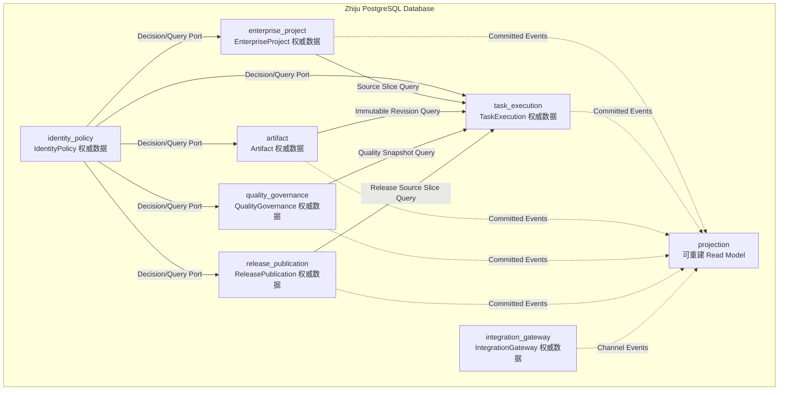
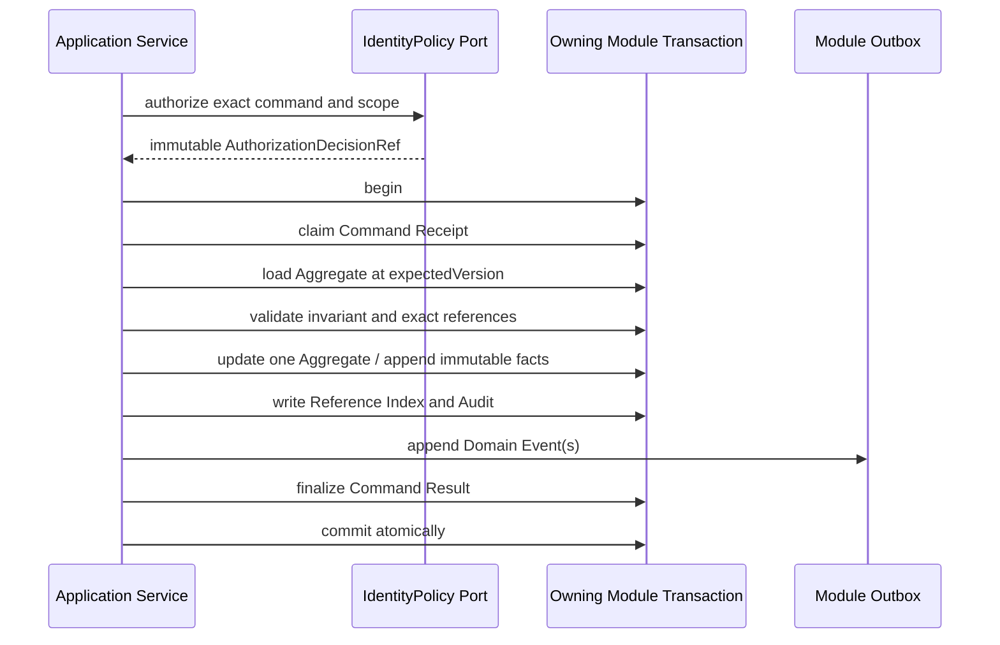

# Zhiju Core PostgreSQL Logical Model v0.1

版本：v0.1
日期：2026-08-12
状态：`CURRENT DATA MODEL BASELINE / IMPLEMENTATION NOT STARTED`

文档角色：PostgreSQL Schema 所有权、逻辑表、关系/JSONB/对象存储、事务技术表、RLS、并发约束和 Projection 的唯一权威。本文不重新定义 Domain 或 Contract 语义。

本文把已冻结的 Domain Model、Typed Reference、Core Contract 和模块边界映射为 PostgreSQL 逻辑数据模型。当前不包含可执行 DDL、Migration、ORM Model、Repository 或性能结论。

权威输入：

- [`02-zhiju-core-architecture.md`](./02-zhiju-core-architecture.md)；
- [`03-core-contracts.md`](./03-core-contracts.md)；
- [`04-domain-model-v0.1.md`](./04-domain-model-v0.1.md)；
- [`05-cross-aggregate-consistency-module-boundary-v0.1.md`](./05-cross-aggregate-consistency-module-boundary-v0.1.md)；
- [`06-typed-references-contract-catalog-v0.1.md`](./06-typed-references-contract-catalog-v0.1.md)。

---

## 1. 文档目标

本文回答：

1. 哪些业务事实进入 PostgreSQL，哪些进入对象存储；
2. 七个模块如何拥有独立 Schema、表和 Repository；
3. Aggregate、Entity、不可变 Version、Snapshot 与 Contract 如何落表；
4. Typed Reference 如何保存和验证，又不形成跨模块数据库耦合；
5. 单 Aggregate 事务、Outbox/Inbox、Process Manager 和幂等如何持久化；
6. optimistic concurrency、Lease、Branch、Approval 和 Release 竞态由什么约束承载；
7. Enterprise/Project 隔离、RLS、模块数据库角色和敏感数据边界如何实现；
8. 哪些 Query 读取权威表，哪些读取可重建 Projection；
9. 采购控制程序 Reference Project 如何形成完整可追溯数据链。

### 1.1 非目标

本文不决定：

- 可执行 SQL DDL、Migration 顺序或 ORM 注解；
- PostgreSQL 精确大版本、托管厂商或高可用部署；
- HTTP、MCP、飞书事件或 Runtime Adapter Payload；
- 索引类型、分区阈值、连接池大小或查询性能结论；
- 具体对象存储厂商；
- 审计保留年限、Lease 秒数、重试次数等可配置 Policy 值；
- 通用 Event Sourcing、通用 Workflow Engine 或跨数据库事务。

---

## 2. v0.1 持久化决策

| ID | 决策 |
|---|---|
| PG-001 | v0.1 使用一个 PostgreSQL Database 承载模块化单体。逻辑模块不拆独立数据库。 |
| PG-002 | 七个业务模块各有独立权威 Schema；另设只保存可重建视图的 `projection` Schema。 |
| PG-003 | Core 使用状态模型加不可变版本、业务事实和审计记录，不采用 Event Sourcing 作为完整重建源。 |
| PG-004 | Core ObjectId、VersionId、RevisionId、SnapshotId、CommandId 和 EventId 使用应用生成的 UUIDv7，数据库类型为 `uuid`；文档中的 `PRJ-...`、`REV-...` 是展示别名。 |
| PG-005 | `aggregate_version` 是从 1 递增的并发令牌；业务历史版本使用独立 UUID 和同 Root 内 `version_no`，二者不能互换。 |
| PG-006 | v0.1 不引入 CustomerAccount/Tenant 业务 Aggregate；Enterprise 是企业数据隔离边界，Project 是其下级 Scope。 |
| PG-007 | 所有 Enterprise-owned Row 保存 `enterprise_id`；Project-owned Row 同时保存 `enterprise_id + project_id`，不得只通过 Join 推断 Scope。 |
| PG-008 | Platform Reference 与 Enterprise Data 分表，不用 nullable `enterprise_id` 把全局与客户数据混在同一表。 |
| PG-009 | 模块内强关系使用外键/唯一/检查约束；跨模块关系只保存 Typed Reference，不建立跨 Schema 外键。 |
| PG-010 | 模块不得通过跨 Schema Join 或共享 Repository 完成业务判断；同步业务读取必须经过 owning module Query/Decision Port。 |
| PG-011 | 高频过滤、排序、唯一性、Scope、状态和完整性字段关系化；不可变 Contract Body 使用 Canonical JSONB；大内容和二进制进入对象存储。 |
| PG-012 | 每个 Contract 只有一个 Canonical Payload Source；被提升为列的路由字段是受校验镜像，不成为第二套可编辑内容。 |
| PG-013 | v0.1 Canonical Hash 使用 SHA-256，数据库保存算法、Canonicalization Version 和 32-byte Hash；API 展示使用小写十六进制。 |
| PG-014 | 时间点使用 UTC `timestamptz`；仅真正的业务日历日期使用 `date`；外部 occurredAt 与 Core recordedAt 分开保存。 |
| PG-015 | 业务状态使用 text + closed CHECK/静态注册表，不使用 PostgreSQL native enum，以免 Contract Minor/Major 升级被数据库类型部署绑死。 |
| PG-016 | 不对受控业务记录使用级联删除；撤销、失效、替换、召回和归档均保存为状态或追加事实。 |
| PG-017 | 每个模块拥有自己的 Command Receipt、Outbox、Inbox、Process Manager、Audit 和 Reference Index 技术表。 |
| PG-018 | Domain Event 是至少一次投递；数据库不宣称 exactly-once。Inbox、Command Idempotency 和外部稳定幂等键共同保证业务效果不重复。 |
| PG-019 | Enterprise-owned 表强制 RLS；RLS 是应用授权之外的纵深防御，不替代 IdentityPolicy Decision。 |
| PG-020 | 每个模块使用独立 Migration Owner 与 Runtime Role；Runtime Role 不是表 Owner、无 `BYPASSRLS`，默认无其他业务 Schema 表权限。 |
| PG-021 | Projection 只消费已提交事件，可丢弃重建；Projection 延迟或失败不能作为 Command 成功判据。 |
| PG-022 | Object Type Registry、Contract Schema Registry 和 Human-only Capability Registry v0.1 由构建期静态声明发布；数据库记录所用版本，不提供在线动态改语义功能。 |
| PG-023 | v0.1 强制 Hash 和不可变 Authorization/Actor Snapshot，不强制服务端数字签名；签名能力以后以独立扩展记录增加，不改变既有 Payload。 |
| PG-024 | 数据库不保存长期 Provider Token、共享 Human Credential、模型密钥或 Chain of Thought。 |
| PG-025 | 对象存储与 PostgreSQL 不组成分布式事务；使用 Staging、完整性验证、数据库 Link Commit 和可审计 Orphan Cleanup。 |
| PG-026 | Product 在 v0.1 作为 EnterpriseProject 拥有的独立版本化 Aggregate；Enterprise 只保存关系/投影，不在 Enterprise 事务内整体更新 Product。 |

---

## 3. 数据库拓扑与 Schema 所有权



箭头表示应用 Port 或已提交 Event，不表示跨 Schema 外键或直接表 Join。

### 3.1 Schema 清单

| Schema | 权威内容 | 禁止内容 |
|---|---|---|
| `identity_policy` | Principal、External Identity Link、Role/Capability、Actor/Policy/Authorization Snapshot | Project、Approval、外部 Credential |
| `enterprise_project` | Enterprise、Project、Material、Baseline、Reference Snapshot、Gap、DeliveryPlan | Run、Revision、Gate、Release |
| `task_execution` | Task、ContextSnapshot、WorkOrder、Run、AgentResult、InformationRequest、Usage | Project Fact、Revision Content、Approval |
| `artifact` | Artifact、Revision、Lineage、Representation、EffectiveBinding | Evidence、Gate、Release Attempt |
| `quality_governance` | Evidence、QualityProfile、GateResult、ReviewIssue、Approval、Quality Snapshot | Revision Content、外部发布 |
| `release_publication` | Release、Frozen Package、Destination、Attempt、Formal Receipt、Recall | Renderer/Feishu SDK、EffectiveBinding |
| `integration_gateway` | Inbound Envelope、Channel Binding、Adapter Attempt、Raw Receipt、Quarantine、Health | 任何业务完成、Approval、正式 Release Receipt |
| `projection` | Project Board、Artifact Trace、Feishu Conversation、搜索/运营 Read Model | 权威业务状态、Command Result |

### 3.2 数据库角色

每个权威 Schema 至少定义：

```text
<module>_owner
    NOLOGIN；拥有 Schema/Table；仅 Migration Pipeline 临时 SET ROLE

<module>_app
    LOGIN；只拥有本 Schema 必要 SELECT/INSERT/UPDATE；无 DROP/ALTER/DELETE 默认权限

<module>_dispatcher
    只 Claim/发布本模块 Outbox 并更新投递元数据；不得改业务表绕过 Application Service
```

另外定义：

```text
projection_app
    只写 projection，读取事件投递接口，不直读权威表构造业务结论

audit_reader
    只读经脱敏的审计 View；默认不能读取 Canonical Payload/敏感 ExternalId

migration_runner
    LOGIN；只能在受控部署期间切换到特定 <module>_owner
```

同一个模块化单体进程可以维护多个模块数据源/连接池；这不等于微服务。模块 Repository 必须使用自己的 Role，数据库层也能拒绝意外跨模块写入。

### 3.3 Schema 迁移所有权

- 每个 Migration 文件只改变一个业务 Schema；
- 跨 Schema 发布按 Expand → Producer → Consumer → Contract → Contract Cleanup 顺序执行；
- 不允许一个 Migration 同时重写多个模块业务数据来模拟跨模块事务；
- Projection Migration 可以单独丢弃重建，但不得反向修改权威表；
- Contract Major 并行期间，数据库保存独立 `contract_type + contract_version`，不覆盖旧 Payload。

---

## 4. 通用逻辑列约定

### 4.1 Aggregate Root

所有可变 Aggregate Root 采用下列逻辑列组：

```text
id                         uuid PK
enterprise_id?             uuid Scope
project_id?                uuid Scope
aggregate_version          bigint >= 1
status                     text closed value
created_at                 timestamptz
created_by_principal_id    uuid
created_by_actor_snapshot_id uuid
updated_at                 timestamptz
last_command_id            uuid
retention_class            text
```

规则：

1. `aggregate_version` 每个成功 Command 恰好增加一次；
2. 更新使用 `id + expected aggregate_version` Compare-And-Set；
3. `last_command_id` 用于诊断，不替代 Command Receipt；
4. `created_by_principal_id` 是 PrincipalRef 的 ID 镜像，不建立 IdentityPolicy 外键；
5. Enterprise/Project Scope 创建后不可改变；需要转移时创建新业务对象和显式迁移事实；
6. 不增加通用 `deleted_at` 来掩盖不同业务删除语义。

### 4.2 不可变 Version / Snapshot / Fact

```text
id                         uuid PK
root_id?                   uuid FK within owning schema
version_no?                integer > 0
enterprise_id?             uuid
project_id?                uuid
contract_type?             text
contract_version?          text
canonicalization_version?  text
payload_hash_algorithm     text
payload_hash               bytea
canonical_payload?         jsonb
created_at                 timestamptz
created_by_principal_id    uuid
created_by_actor_snapshot_id uuid
source_command_id          uuid
retention_class            text
```

规则：

- `root_id + version_no` 唯一；
- ID 与 Hash 创建后不可改变；
- 已激活/封存版本不更新 Payload；
- Root 可以保存 `current_version_id` 供 AUTHORITATIVE UI 使用，但可重放 Contract 仍必须保存精确 VersionRef；
- `current_version_id` 不是 `latest` Contract，不能在历史 Payload 中延迟解析；
- 不可变表默认禁止 UPDATE/DELETE；需要撤销时创建 Revocation/Invalidation Fact。

### 4.3 Scope 列

| Scope | 必填列 | 规则 |
|---|---|---|
| PLATFORM | 独立 Platform Reference Table，无 `enterprise_id` | 只由受控平台角色写 |
| ENTERPRISE | `enterprise_id` | RLS 强制匹配当前授权 Enterprise |
| PROJECT | `enterprise_id + project_id` | 模块内组合关系证明 Project 属于 Enterprise |
| OBJECT | 在 Enterprise/Project 基础上增加 owner object ID | 不从目标对象反向推断 Scope |

Project-owned 表需要在同一模块内使用复合唯一键/外键确保：

```text
(enterprise_id, project_id)
    references enterprise_project.project_scope_claim
```

其他模块不能外键到 `enterprise_project.project`，因此各模块通过已验证 Scope Claim 和事件复制最小 Scope Key；该复制是安全路由元数据，不是 Project 业务副本。

### 4.4 时间

```text
occurred_at
    外部或业务事件声称发生的时间；可能不可信

recorded_at / created_at
    Core 数据库接受事实的时间；由受信数据库/应用时钟生成

valid_from / valid_to
    业务有效期；只用于确有有效期语义的 Fact/Binding

expires_at
    Decision、Lease、Request 等到期时间；到期不删除历史
```

不保存无时区 timestamp。外部时区作为来源元数据保存，不能改变 UTC 事实排序。

### 4.5 Hash 与 Canonicalization

逻辑列组：

```text
hash_algorithm             text = SHA-256
hash_bytes                 bytea length = 32
canonicalization_version   text
payload_size_bytes         bigint
```

规则：

- Hash 比较使用原始 bytes，不比较大小写不同的字符串；
- Payload Hash 不包含顶层自身 `payload_hash`；
- 对象存储内容 Hash 与 Contract Payload Hash 分开命名；
- Representation `checksum`、Revision `content_hash`、Package `package_hash` 不得互相替代；
- Hash 不等于授权、签名或加密；读取仍受 RLS/Policy 控制；
- 跨语言 Hash Fixture 在实现阶段成为发布 Gate。

### 4.6 Presence 与不确定性

`ValuePresence` 使用显式列组：

```text
presence_code     KNOWN | UNKNOWN | NOT_APPLICABLE | REDACTED
value_json        jsonb nullable
reason_code       text nullable
evidence_ref_json jsonb nullable
```

检查语义：

- `KNOWN` 必须有 `value_json`；
- `UNKNOWN/NOT_APPLICABLE/REDACTED` 不得在 `value_json` 偷放值；
- `REDACTED` 的 reason 不得包含被隐藏内容；
- `NULL` 只表示数据库层未提供 optional field，不表达业务 Unknown。

### 4.7 Closed State 与扩展字段

- 生命周期状态、Outcome、PrincipalKind、Gate Stage 等使用 closed text constraint；
- Extension 使用有命名空间的 JSONB，只允许 Contract Registry 已知 Key；
- 未知 Required Extension 拒绝写入；
- JSONB 不允许成为绕过 closed state 或权限字段的“备用字段袋”。

---

## 5. 关系数据、Canonical JSONB 与对象存储边界

### 5.1 关系列必须承载

- 主键、Scope、Root/Version 关系；
- Aggregate Version、状态、时间与有效期；
- 唯一性、并发 Claim 和幂等键；
- Contract Type/Version、Hash 和 Payload Size；
- 高频授权、过滤、排序、Join-within-module 字段；
- 对象存储 Locator/Hash/Size/MediaType；
- Outbox/Inbox/Attempt/Receipt 调度字段。

### 5.2 Canonical JSONB 承载

- Project Context Contract Body；
- READY WorkOrder Specification；
- AgentResult Body；
- RevisionAcceptance、ApprovalBundle、ReleaseReadiness Snapshot Body；
- AuthorizationDecision、ActorSnapshot、PolicySnapshot Body；
- Command/Event Payload 和稳定 Result Payload；
- 结构会按 Contract Minor 增加 Optional 字段、但整体必须一起 Hash 的不可变 Value Object。

Canonical JSONB 是原始 Contract 的唯一 Payload Source。若 `enterprise_id`、`project_id`、`run_id`、`outcome` 等字段被提升为列，则 Writer 必须在同一事务校验列值与 Payload 相等；后续 DDL 优先使用 generated/extracted column 或不可绕过的写入函数减少漂移。

### 5.3 对象存储承载

- 客户上传的原始二进制；
- Canonical Document/Workbook 等较大结构化内容；
- DOCX、PDF、XLSX 和预览图等 Representation；
- 超过数据库 Payload Policy 的原始 Adapter Payload；
- 大型验证附件或 Renderer 诊断包。

数据库保存：

```text
storage_provider
storage_bucket
storage_key
object_version_id?
content_hash_algorithm
content_hash
byte_size
media_type
encryption_key_ref?
verified_at
retention_class
storage_state
```

`storage_key` 是内部不透明 Locator，不是公开 URL。下载链接必须临时签发并重新授权。

### 5.4 对象写入协议

```text
upload to staging key
    ↓
virus/type/size/hash validation
    ↓
create immutable object manifest in owning Aggregate transaction
    ↓
mark object LINKED/FROZEN
    ↓
later orphan collector considers only unlinked staging objects past grace period
```

数据库事务失败后对象可能成为 Orphan；对象写失败时不得提交业务 Link。Cleanup 只能删除：

1. 明确处于 staging；
2. 超过安全宽限期；
3. 数据库反向引用检查为零；
4. 不属于 Legal Hold/Quarantine；
5. 删除行为本身写审计结果。

### 5.5 默认 Payload Guard

实现阶段的默认安全 Guard：

- Command/Event Canonical Payload：建议不超过 256 KiB；
- Contract Snapshot Canonical Payload：建议不超过 4 MiB；
- 超限内容必须对象化并在 Payload 中保存 ContentAddressedRef；
- 不允许把附件 Base64、完整 DOCX/PDF 或 Chain of Thought 放入 JSONB。

这些数值是可配置 Guard，不是业务语义，也不影响表结构。

---

## 6. Typed Reference 持久化

### 6.1 逻辑列组

跨模块强引用按用途保存以下列组：

```text
target_module
target_object_type
target_object_id
target_version_id?
target_payload_hash_algorithm?
target_payload_hash?
target_canonicalization_version?
target_enterprise_id?
target_project_id?
reference_purpose
validated_at
validation_snapshot_id?
```

具体强度：

| Ref 类型 | 必填逻辑字段 |
|---|---|
| ObjectRef | objectType + objectId + Scope |
| VersionedRef | ObjectRef + versionId |
| ContentAddressedRef | VersionedRef + hashAlgorithm + payloadHash + canonicalizationVersion |
| SnapshotRef | snapshotType + snapshotId + payloadHash + Scope |
| EvidenceRef | evidenceId + evidenceVersion/validation + source hash + purpose |
| RepresentationRef | representationId + revisionId + checksum + rendererVersion |
| ReleasePackageRef | releaseId + packageId + packageHash |
| PrincipalRef | principalId + principalKind；授权动作另带 ActorSnapshotRef/AuthorizationDecisionRef |
| ExternalRef | adapter/provider/account + external type/id 或 lookup hash + optional payloadHash |

### 6.2 模块内关系

同一 Schema、同一 Aggregate 或明确同模块关系使用外键。示例：

- `artifact_revision.artifact_id → artifact.id`；
- `revision_parent(parent_artifact_id, parent_revision_id)` 组合关系保证同 Artifact；
- `quality_profile_version.profile_id → quality_profile.id`；
- `release_package_item.package_id → release_package.id`。

模块内外键默认 `ON DELETE RESTRICT`，不用 `CASCADE` 删除受控历史。

### 6.3 跨模块关系

跨模块不设置外键。例如：

```text
quality_governance.gate_result
    stores ArtifactRevision ContentAddressedRef
    does not FK artifact.artifact_revision

release_publication.release_record
    stores ApprovalBundleSnapshotRef
    does not FK quality_governance.approval_bundle_snapshot
```

原因：

1. owning module 才能解释生命周期与授权；
2. 跨 Schema FK 会诱导直接 Join/级联删除；
3. 未来模块拆分时不改变业务 Contract；
4. 历史 Ref 即使目标撤销/归档也必须保持原始事实。

### 6.4 Reference Validation Snapshot

写入跨模块 Ref 前，Application Service 通过 owning module Query/Decision Port 完成：

```text
type → resolution → scope → hash → lifecycle → authorization → purpose
```

目标模块返回不可变 Validation Snapshot/Decision，引用方保存：

- 验证结果 ID；
- target exact Ref；
- validator contract version；
- validatedAt；
- purpose；
- caller scope；
- result hash。

这不保证目标永远有效。撤销、失效和召回通过 Event 触发 Impact Assessment；不得静默改写旧 Ref。

### 6.5 每模块 `reference_edge`

每个权威 Schema 保存派生 Reference Index：

```text
owner_object_type
owner_object_id
owner_version_id?
owner_payload_hash?
reference_path
target_module
target_object_type
target_object_id
target_version_id?
target_payload_hash?
reference_purpose
enterprise_id?
project_id?
created_at
source_command_id
```

规则：

- Canonical Payload/业务 Row 是 Ref Source of Truth；`reference_edge` 是同事务生成的派生索引；
- `owner + reference_path + target` 唯一；
- 不允许手工编辑；可从 Canonical Payload 重建；
- 用于 Impact 查找、Traceability 和数据保留检查；
- 写入时索引与 Payload 不一致则整个事务失败；
- Projection 可以聚合各模块 Edge，但不能反向修复权威 Ref。

---

## 7. 每模块标准技术表

七个权威 Schema 各自拥有同名逻辑表，不建设一个所有模块共享写入的超级技术 Schema。

### 7.1 `command_receipt`

| 逻辑字段 | 用途 |
|---|---|
| command_id | 全局追踪 ID |
| command_type/version | Contract 兼容性 |
| idempotency_scope/key | 业务幂等唯一键 |
| request_payload_hash | 相同 Key 冲突检测 |
| enterprise_id/project_id | Scope 与 RLS |
| target_type/id | Command Owner 与 Aggregate |
| expected_aggregate_version | 并发输入 |
| outcome | COMMITTED / REJECTED / DUPLICATE |
| result_payload/hash | 稳定重放结果 |
| first_seen_at/completed_at | 诊断与时延 |
| correlation_id/causation_id | 端到端链路 |

唯一约束：

```text
(idempotency_scope, idempotency_key)
```

相同 Key + 相同 Hash 返回原结果；相同 Key + 不同 Hash 拒绝并写安全审计。

### 7.2 `outbox_event`

事件 Payload 与路由字段在业务事务中插入：

```text
event_id
event_type/version
aggregate_type/id/version
enterprise_id/project_id
correlation_id/causation_id
payload jsonb
payload_hash
occurred_at/recorded_at
delivery_state
available_at
attempt_count
lease_owner/lease_until
last_error_code
published_at
```

业务 Payload、EventId 和 AggregateVersion 不可改；Dispatcher 只能更新投递元数据。Outbox 发布顺序只保证同 Aggregate 按 `aggregate_version` 有序，不承诺全局顺序。

### 7.3 `inbox_message`

```text
consumer_name
event_id
event_type/version
payload_hash
source_module
enterprise_id/project_id
status
first_seen_at/processed_at
result_command_id?
failure_code?
```

唯一键为 `consumer_name + event_id`。相同 EventId 不同 Hash 进入 Quarantine，不得按重复成功处理。

Inbox Claim、目标 Aggregate 变化、目标 Outbox 和 Inbox `PROCESSED` 必须在同一目标模块事务提交。

### 7.4 `process_instance` 与 `process_step`

`process_instance`：

```text
process_id
process_type/version
correlation_key
enterprise_id/project_id
state
aggregate_version
next_action_at
retry_count
last_consumed_event_id
blocked_reason_code?
created_at/updated_at
```

`process_step` 是不可变步骤事实，保存输入 EventRef、发出 CommandRef、结果、失败与人工介入。相同 `process_type + correlation_key` 只能有一个 active instance。

### 7.5 `audit_record`

保存：

- 谁通过哪个 ActorSnapshot/AuthorizationDecision 执行了什么 Command；
- 目标 Scope、对象、expected/current version；
- ALLOWED/DENIED、业务结果和错误码；
- Request/Result Hash，而非默认复制完整敏感 Payload；
- Correlation/Causation、Core recordedAt 和来源 Channel/Runtime Ref；
- break-glass 或人工运维操作的理由和审批引用。

Audit 是追加记录，不允许普通应用角色更新/删除。

### 7.6 `reference_edge`

用于本模块的 Typed Reference 反向查找，规则见第 6.5 节。

### 7.7 `contract_violation`

保存未知 Major、未知 Required Extension、Canonical Hash 不匹配、Scope 冲突、自引用 Hash、Payload 超限等拒绝事实。敏感 Payload 默认只保存 Hash、Schema Error Path 和安全摘要。

---

## 8. Core Contract 存储模式

### 8.1 通用 Contract Record

每个不可变 Contract 表使用同一逻辑 Header：

```text
contract_id                 uuid PK
contract_type               text
contract_version            text
schema_registry_version     text
enterprise_id               uuid
project_id?                 uuid
canonicalization_version    text
payload_hash_algorithm      text
payload_hash                bytea
payload_size_bytes          bigint
canonical_payload           jsonb
created_at                  timestamptz
created_by_principal_id     uuid
actor_snapshot_id           uuid
authorization_decision_id   uuid
source_command_id            uuid
data_classification         text
retention_class             text
```

表级规则：

- `contract_id` 是主键；同一 ID 的任何 Replay 必须携带相同 Payload Hash，但不同 Contract 可以合法拥有相同内容 Hash；
- Contract 创建后不可 UPDATE/DELETE；
- 任何被提升列必须与 Canonical Payload 匹配；
- Canonical JSONB 不含顶层自身 Hash；
- 未知 Contract Major/Required Extension 不落权威表，只进 Violation/Quarantine。

### 8.2 Project Context

权威表：`task_execution.context_snapshot`。

提升列：

```text
context_snapshot_id
purpose
audience
enterprise_id/project_id
builder_version
policy_snapshot_id
source_manifest_count
context_item_count
omission_count
redaction_count
coverage_state
payload_hash
```

`SourceManifest`、ContextItem、Omission、Redaction 和 Coverage 的完整顺序化内容保存在 Canonical Payload。关键外部 Ref 同事务写入 `reference_edge`。旧 Snapshot 永远解析原精确 Ref，不跟随新 Baseline/Profile。

### 8.3 WorkOrder

权威表：

```text
task_execution.work_order
task_execution.work_order_contract
```

`work_order` 保存 Draft/READY/QUEUED/COMPLETED 等 Aggregate State 和 `aggregate_version`。进入 READY 时一次性插入 `work_order_contract`：

```text
work_order_contract_id
work_order_id
specification_hash
context_snapshot_id
risk_profile_version_id
quality_profile_version_id
execution_policy_version
harness_policy_version
model_policy_version
canonical_payload
payload_hash
```

`specification_hash` 只覆盖冻结 Specification 子集；`payload_hash` 覆盖完整 Contract。两者不能互换。READY 后 Root 只能推进生命周期，不得替换 Contract Row。

### 8.4 AgentResult

权威表：

```text
task_execution.agent_result
task_execution.agent_result_acceptance
task_execution.agent_result_conflict
```

`agent_result` 是不可变 Contract Record，提升：

```text
agent_result_id
run_id
work_order_id
context_snapshot_id
submission_kind = FINAL
outcome
business_output_count
workspace_output_count
usage_record_id?
payload_hash
```

每个 Run 只有一个 final Result Claim。Acceptance 是独立不可变记录；WorkOrder/Task Completion 由 CompletionEvaluator 另存，不向 AgentResult 回写 `accepted/completed`。

### 8.5 Artifact + Quality Gate Contract Family

权威表：

```text
quality_governance.revision_acceptance_snapshot
quality_governance.approval_bundle_snapshot
quality_governance.release_readiness_snapshot
```

提升字段：

| Snapshot | 精确绑定 |
|---|---|
| RevisionAcceptance | artifactRevisionId + revisionContentHash + qualityProfileVersionId |
| ApprovalBundle | revisionAcceptanceSnapshotId/hash + approval decision refs/hash |
| ReleaseReadiness | releaseId + packageId + packageHash + representation checksum/rendererVersion |

三个表互不覆盖。Revision Acceptance 不保存 Release Package Render 通过；Release Readiness 不重写 Revision Acceptance 或 Approval Decision。

### 8.6 Canonical Payload 与查询镜像一致性

写入路径必须按顺序执行：

```text
validate schema and required extensions
    ↓
canonicalize payload
    ↓
calculate payloadHash
    ↓
extract promoted columns and reference_edge
    ↓
verify extracted values equal envelope/header
    ↓
insert Contract + Reference Index + Audit/Outbox atomically
```

任何一步不一致都拒绝整个事务，不允许先保存 JSONB 后异步补关键 Scope/Hash 索引。

---

## 9. `identity_policy` 逻辑模型

IdentityPolicy 的 Principal 可以服务多个 Enterprise，但业务授权永远带 Scope。其他模块只持有 PrincipalRef/ActorSnapshotRef/AuthorizationDecisionRef。

### 9.1 权威表

| 表 | 类型 | 关键列/关系 | 关键约束 |
|---|---|---|---|
| `principal` | Aggregate Root | id、principal_kind、status、aggregate_version、display_name | HUMAN/AGENT/SERVICE/RUNTIME/EXTERNAL_PARTY 不互换；不存 Credential |
| `principal_state_transition` | Immutable Fact | principal_id、from/to、reason、actor_snapshot_id | 追加；不删除历史 Principal |
| `external_identity_link` | Aggregate Root | provider、account_lookup_hash、external_id_lookup_hash、encrypted identifiers、principal_id | provider/account/external lookup 唯一；冲突不覆盖 |
| `role_assignment` | Aggregate Root | principal_id、role_code、scope_kind、enterprise_id/project_id、valid period | 明确 Scope；撤销不删除 |
| `role_revocation` | Immutable Fact | role_assignment_id、revoked_by、reason、effective_at | 一个有效 Assignment 可有一次生效撤销 |
| `capability_grant` | Aggregate Root | principal_id、capability_code、scope、constraints、valid period | Human-only Capability 不授予 Agent/Runtime |
| `capability_revocation` | Immutable Fact | capability_grant_id、reason、effective_at | 追加事实 |
| `policy_snapshot` | Immutable Contract | policy registry/version、payload/hash | 历史 Authorization 永远可解释 |
| `actor_snapshot` | Immutable Contract | actor principal kind、acting_for_ref、channel/runtime source、payload/hash | actingFor 不改变 actor kind |
| `authorization_decision` | Immutable Contract | actor_snapshot_id、capability、command type、scope、decision、expires_at、policy_snapshot_id | ALLOW/DENY 不可改；高风险 Command 使用精确 DecisionRef |

### 9.2 Scope 与 RLS

- `principal` 和 `external_identity_link` 是 IdentityPolicy 内部 Platform Security Data，不直接暴露给企业业务查询；
- `role_assignment`、`capability_grant`、`actor_snapshot`、`authorization_decision` 保存精确 enterprise/project Scope；
- Enterprise 用户不能枚举 Principal Directory；只能通过 Identity Query 获取授权后的最小显示信息；
- 平台运维访问使用独立受审计角色，不通过 `enterprise_id IS NULL` 绕过 RLS。

### 9.3 外部身份保护

可查询标识使用密钥化 Lookup Hash，而不是普通 SHA-256：

```text
lookup_hash = HMAC(active_lookup_key, normalized provider/account/external_id)
```

原值仅在确需回传 Provider 时保存为 envelope-encrypted ciphertext，并带 key version。轮换时创建新 lookup/key 版本，不在日志输出原始 open_id、email 或手机号。

### 9.4 必要访问路径

- provider + account lookup + external identity lookup → active Principal；
- principal + enterprise/project + role/capability + effective time；
- authorization_decision_id + payload_hash；
- actor_snapshot_id + payload_hash；
- expiring grant/decision by `expires_at`。

---

## 10. `enterprise_project` 逻辑模型

### 10.1 Enterprise 与长期配置

| 表 | 类型 | 关键列/关系 | 关键约束 |
|---|---|---|---|
| `enterprise` | Aggregate Root | id、display_code、status、aggregate_version | 企业身份不因名称变化而变化 |
| `enterprise_fact` | Aggregate Root/Assertion | enterprise_id、fact_type、presence/value、valid period、status | Fact Value 与来源创建后不覆盖；冲突并存 |
| `enterprise_fact_decision` | Immutable Fact | fact_id、PROPOSED/CONFIRMED/DISPUTED/SUPERSEDED、actor/evidence refs | Human 确认可追溯；Agent 只提议 |
| `enterprise_profile_snapshot` | Immutable Contract | enterprise_id、included fact refs、effective artifact refs、payload/hash | Snapshot 不跟随 Fact/Binding 变化 |
| `product` | Independent Aggregate Root | enterprise_id、product_type、status、aggregate_version、current_version_id | 产品身份长期存在；可独立版本化并跨 Project 精确引用 |
| `product_version` | Immutable Version | product_id、version_no、structured payload/hash | 已引用版本不可覆盖 |
| `qms_configuration` | Aggregate Root | enterprise_id、status、aggregate_version、current_version_id | 一个用途的 active version 由 Root 指针决定 |
| `qms_configuration_version` | Immutable Version | qms_configuration_id、version_no、risk/quality mappings、payload/hash | 激活/回滚只切精确指针并写事件 |

### 10.2 Project Scope

| 表 | 类型 | 关键列/关系 | 关键约束 |
|---|---|---|---|
| `project` | Aggregate Root | enterprise_id、id、display_code、status、aggregate_version | `(enterprise_id,id)` 唯一；Scope 不可移动 |
| `project_scope_claim` | Security/Reference Claim | enterprise_id、project_id、status、scope_version | 给本模块复合关系使用；其他模块不外键 |
| `project_snapshot_binding` | Immutable Entity within Project | project_id、binding purpose、enterprise profile/config/product refs、bound_at、actor ref | 支持 Project 启动/阶段 Gate 冻结精确 Ref，不引入第二个 Context Contract |

### 10.3 SourceMaterial 与 CustomerMaterial

| 表 | 类型 | 关键列/关系 | 关键约束 |
|---|---|---|---|
| `source_material` | Aggregate Root | enterprise/project、content hash、object locator、media type、status、aggregate_version | 原始 bytes 不改；Hash 相同仍可保留不同来源 |
| `source_material_origin` | Immutable Entity | source_material_id、ExternalRef、message/file metadata hash、received_at | 消息撤回不删除来源事实 |
| `source_material_validation` | Immutable Fact | scan/type/hash outcome、validator version、recorded_at | 新验证追加，旧结果不改 |
| `customer_material` | Aggregate Root | enterprise/project、source_material_id、classification、status、aggregate_version、current_version_id | Attachment 不自动确认业务材料 |
| `customer_material_version` | Immutable Version | customer_material_id、version_no、title/type/locator/source refs、payload/hash | CONFIRMED 版本不可改；新解析创建新版本 |
| `customer_material_decision` | Immutable Fact | version_id、proposal/confirmation/dispute、actor/evidence refs | Agent 与 Human 权限分离 |

### 10.4 CustomerBaseline

| 表 | 类型 | 关键列/关系 | 关键约束 |
|---|---|---|---|
| `customer_baseline` | Aggregate Root | project_id、status、aggregate_version、active_version_id | 同项目同 Baseline purpose 只有一个 active pointer |
| `customer_baseline_version` | Immutable Version | baseline_id、version_no、payload/hash、confirmed_by | 已激活版本不修改 |
| `customer_baseline_item` | Immutable Entity | baseline_version_id、requirement/category、presence、customer_material_version_ref | `NOT_PROVIDED != MISSING_CONFIRMED` |
| `baseline_impact_review` | Aggregate Root/Process Result | old/new baseline refs、impacted refs、decision/status | 只产生影响决定，不改写旧下游对象 |

### 10.5 Platform Reference 与 Project Snapshot

Platform Reference 使用独立表，无 `enterprise_id`：

| 表 | 类型 | 关键列/关系 | 关键约束 |
|---|---|---|---|
| `reference_template` | Platform Aggregate | template identity/type/status/current_version_id | 仅平台角色写 |
| `reference_template_version` | Immutable Version | template_id、version_no、content ref/hash、applicability | 发布后不可改 |
| `regulatory_reference` | Platform Aggregate | authority/jurisdiction/reference identity | 不等于客户 Evidence |
| `regulatory_reference_version` | Immutable Version | source locator、effective period、content hash、verification | 历史法规版本保留 |

Project Snapshot：

| 表 | 类型 | 关键列/关系 | 关键约束 |
|---|---|---|---|
| `template_baseline` | Aggregate Root | enterprise/project、status、aggregate_version、active_version_id | 项目冻结后不跟随平台 current version |
| `template_baseline_version` | Immutable Version | baseline_id、version_no、payload/hash、confirmed_by | 精确选择集合 |
| `template_selection` | Immutable Entity | baseline_version_id、template/version ContentAddressedRef、purpose | 禁止 `latest` |
| `regulatory_profile` | Aggregate Root | enterprise/project、jurisdiction/product scope、active_version_id | 项目适用性决策 |
| `regulatory_profile_version` | Immutable Version | profile_id、version_no、payload/hash、confirmed_by | Evidence 来源引用精确版本 |
| `regulatory_profile_item` | Immutable Entity | profile_version_id、regulatory ref/version/hash、applicability/presence | 模板不得冒充 Evidence |

### 10.6 GapAnalysis

| 表 | 类型 | 关键列/关系 | 关键约束 |
|---|---|---|---|
| `gap_analysis` | Aggregate Root | enterprise/project、status、aggregate_version、accepted_version_id | 输入变化只标记 STALE/新分析，不覆盖旧版本 |
| `gap_analysis_version` | Immutable Version | baseline/template/regulatory snapshot refs、analysis policy、payload/hash | 完成版本不可变 |
| `gap_finding` | Immutable Entity | gap_version_id、requirement ref、current state、gap severity、recommendation、evidence refs | Finding 不自动变成项目承诺 |
| `gap_analysis_decision` | Immutable Fact | version_id、accept/reject/request revision、Human actor | Agent 不接受正式分析 |

### 10.7 DeliveryPlan 与 DeliveryItem

| 表 | 类型 | 关键列/关系 | 关键约束 |
|---|---|---|---|
| `delivery_plan` | Aggregate Root | enterprise/project、status、aggregate_version、active_version_id | 计划批准/激活需 Human Decision |
| `delivery_plan_version` | Immutable Version | gap_analysis_version_ref、scope、payload/hash、approved_by | Approved/Active 内容不变 |
| `delivery_item` | Entity within Plan | plan_version_id、item_id、artifact purpose、completion criteria、risk level、status projection、current_completion_evaluation_id | 范围更新必须走 DeliveryPlan Aggregate |
| `delivery_item_artifact_requirement` | Immutable Entity | plan_version_id、item_id、artifact purpose/type、required cardinality、acceptance/release criteria | 支持 0..N Artifact，不预设永久一对一 |
| `delivery_item_dependency` | Entity | plan_version_id、from/to item、dependency type | 同 Plan Version 内无非法环 |
| `delivery_item_completion_evaluation` | Immutable Fact | item_id、criteria version、input refs、outcome、evaluator version/hash | Completion 只由 Evaluator 产生 |
| `delivery_item_impact_review` | Aggregate Root/Process | item ref、upstream change refs、decision、status | 不自动修改已批准范围 |

DeliveryItem 的 `status` 是 Aggregate 内当前派生缓存；权威解释来自 Root 明确指向的 `current_completion_evaluation_id`，不是运行时查询 `latest`。直接更新为 COMPLETED 的 SQL 路径不对 Repository 开放。

### 10.8 必要访问路径

- enterprise/project display code；
- enterprise Fact by type/status/valid period；
- project active baseline/template/regulatory/plan pointer；
- source material by content hash、external origin lookup 和 status；
- immutable version by root + version_no 或 version_id + payload_hash；
- Gap/Plan by project + status + updated_at；
- DeliveryItem by plan version、risk、completion state；
- downstream Event Ref by `reference_edge` target。

---

## 11. `task_execution` 逻辑模型

### 11.1 Task

| 表 | 类型 | 关键列/关系 | 关键约束 |
|---|---|---|---|
| `task` | Aggregate Root | enterprise/project、delivery_item_ref?、status、risk、aggregate_version | Task 完成不由 Run 自报 |
| `task_dependency` | Entity | task_id、depends_on_task_id、type | 同 Project；禁止非法环 |
| `task_completion_evaluation` | Immutable Fact | task_id、criteria/input refs、outcome、evaluator version | Completion 可重算但旧结果保留 |
| `task_state_transition` | Immutable Fact | task_id、from/to、reason、command/event refs | 看板历史可解释 |

### 11.2 ContextSnapshot

`context_snapshot` 使用第 8.2 节的不可变 Contract 模式。可选的 `context_snapshot_build` 保存 Builder Attempt、输入 Source Slice Hash、失败原因和重试；成功 Build 只产生一个精确 Snapshot。

Context Item 不拆为可编辑业务表。若需要检索，使用同事务派生的 `reference_edge` 和可重建 Projection；Canonical Payload 保持唯一顺序和 Hash。

### 11.3 WorkOrder

| 表 | 类型 | 关键列/关系 | 关键约束 |
|---|---|---|---|
| `work_order` | Aggregate Root | task_id、status、aggregate_version、ready_contract_id、active_run_ref? | READY 后 contract ref 不变 |
| `work_order_contract` | Immutable Contract | objective/scope/input/output/policy/budget/version pins payload/hash | specificationHash 与 payloadHash 都保存 |
| `work_order_completion_evaluation` | Immutable Fact | work_order_id、contract id/hash、accepted result refs、criteria outcomes | AgentResult 不拥有 Completion |
| `work_order_state_transition` | Immutable Fact | from/to、reason、actor/event refs | Retry 不抹掉旧状态路径 |

### 11.4 Run 与 Lease

| 表 | 类型 | 关键列/关系 | 关键约束 |
|---|---|---|---|
| `run` | Aggregate Root | work_order_id、context_snapshot_id、runtime policy refs、status、aggregate_version、final_result_id? | Context/Policy/Fencing Token 创建后不变 |
| `work_order_run_claim` | Lease/Reservation | work_order_id、run_id、claim_no、fencing_token、lease_until、state | 同 WorkOrder 条件唯一 active claim |
| `run_capability_binding` | Immutable Security Binding | run_id、capability set hash、grant/authorization refs、opaque secret-manager handle ref、expires_at | 只存 Token Handle/Hash，不存 Capability Token Secret；不可跨 Run 复用 |
| `run_heartbeat` | Immutable Operational Fact | run_id、fencing_token、observed_at、source | 旧 token heartbeat 不续期 |
| `run_state_transition` | Immutable Fact | run_id、from/to、cause、recorded_at | terminal Run 不恢复 |
| `runtime_usage_record` | Immutable Fact | run_id、provider/model、input/output/cache/tool usage、source authority、payload/hash | Runtime/Provider 权威优先；未知为 Presence |

`work_order_run_claim` 不通过删除释放历史 Claim；把旧 Claim 标记为 RELEASED/EXPIRED，并插入新的 Claim。条件唯一约束只限制 `state=ACTIVE`。

### 11.5 AgentResult

| 表 | 类型 | 关键列/关系 | 关键约束 |
|---|---|---|---|
| `agent_result` | Immutable Aggregate/Contract | run/work order/context refs、outcome、payload/hash | 每 Run 一个 FINAL claim |
| `agent_result_acceptance` | Immutable Fact | result ref/hash、acceptance outcome、validator/evaluator version、issues | Acceptance 不修改 Result |
| `agent_result_conflict` | Security/Audit Fact | run_id、accepted result/hash、conflicting submission hash/source | 冲突隔离，不覆盖 final ref |

业务输出只保存 Typed Ref。Workspace path、scratch file 和 Runtime session 只能作为 ExternalRef/WorkspaceOutput，不能填入 BusinessOutputRef。

### 11.6 InformationRequest

| 表 | 类型 | 关键列/关系 | 关键约束 |
|---|---|---|---|
| `information_request` | Aggregate Root | work_order/run origin、question/schema、authorized responder rules、status、aggregate_version、expires_at | OPEN/DELIVERED/ANSWERED/RESOLVED 分开 |
| `information_delivery` | Immutable Fact | request_id、channel destination ref、attempt ref、receipt ref、status | 投递成功不等于已回答 |
| `answer_submission` | Immutable Fact | request_id、responder Principal/Actor/Auth refs、answer payload/hash、external message ref | 飞书消息只是来源，不是答案身份 |
| `answer_resolution` | Immutable Fact | request_id、accepted answer refs、resolution outcome、resolver、context impact | ANSWERED 不自动 RESOLVED |
| `information_request_transition` | Immutable Fact | from/to、cause、actor/event | 超时与取消历史保留 |

final `BLOCKED_INPUT` 解决后创建新 ContextSnapshot 与新 Run；不得把已终结 Run 改回 RUNNING。

### 11.7 必要访问路径

- Task Board authoritative slice by enterprise/project/status/risk/updated_at；
- WorkOrder by task/status/ready contract；
- unique active Run Claim by work_order；
- Run by status/lease_until/runtime adapter；
- AgentResult by run + final submission；
- InformationRequest by authorized responder scope/status/expires_at；
- Context/Contract by id + payload_hash；
- Usage by run/provider/model/time。

---

## 12. `artifact` 逻辑模型

### 12.1 Artifact 与 Branch

| 表 | 类型 | 关键列/关系 | 关键约束 |
|---|---|---|---|
| `artifact` | Aggregate Root | enterprise/project?、artifact_type、purpose、status、aggregate_version、default_branch_id? | 长期业务身份不等于文件 |
| `artifact_branch` | Entity within Artifact | artifact_id、branch_id/name、working_head_revision_id、head_version、status | 同 Artifact branch name 唯一；CAS 移动 head |
| `approved_revision_binding` | Entity/Fact | artifact_id、purpose、revision ref/hash、approval bundle ref、status | Draft 不改变批准绑定 |

### 12.2 ArtifactRevision 与 Lineage

| 表 | 类型 | 关键列/关系 | 关键约束 |
|---|---|---|---|
| `artifact_revision` | Aggregate Root | artifact_id、revision_no、state、canonical object locator、content hash、schema version、provenance、aggregate_version | SEALED 后内容/Hash/Provenance 不改 |
| `revision_parent` | Immutable Relation | artifact_id、child_revision_id、parent_revision_id、parent_order/type | parent/child 同 Artifact；child sealed 后不改 |
| `revision_conflict` | Immutable Fact | base/head/candidate refs、conflict payload/hash、resolution revision ref? | 冲突不 last-write-wins |
| `revision_invalidation` | Immutable Fact | revision ref/hash、reason、actor/upstream refs | 不删除 Revision |

普通 Revision 至少一个 Parent（Initial 除外）；Merge Revision 至少两个 Parent。DAG 无环由 Command Handler 使用递归查询验证，后续 DDL/测试必须覆盖并发下的重复验证。

### 12.3 Representation

| 表 | 类型 | 关键列/关系 | 关键约束 |
|---|---|---|---|
| `representation` | Immutable Aggregate/Fact | revision_id、format、object locator、checksum、renderer name/version、render input hash、created_at | 同 exact render identity 可幂等复用；文件不改 |
| `representation_validation` | Immutable Fact | representation ref/checksum、validator/version、outcome、diagnostic object ref | 新验证追加 |

Canonical Content 与 Representation 使用不同 Hash 域。DOCX/PDF Checksum 不能证明 Canonical Revision 内容语义相同；二者通过精确 RevisionRef 关联。

### 12.4 EffectiveBinding

| 表 | 类型 | 关键列/关系 | 关键约束 |
|---|---|---|---|
| `effective_binding` | Aggregate Entity | enterprise_id、artifact_id、purpose、revision ref/hash、release ref/package hash、valid_from/to、status、aggregate_version | 同 Enterprise/Artifact/Purpose 有效期不重叠 |
| `effective_binding_transition` | Immutable Fact | binding_id、activate/supersede/recall、source release event ref、actor | 替换不删除旧 Binding |

`CUSTOMER_DELIVERY` Release 只有在 Policy 明确映射为对应 Binding Purpose 时才可创建 Binding；默认不创建 `INTERNAL_EFFECTIVE_USE`。

### 12.5 必要访问路径

- Artifact by enterprise/project/type/status；
- Branch by artifact/name and head version；
- Revision by artifact/revision_no、revision_id/content_hash；
- Parent/child lineage；
- Representation by revision/format/renderer/checksum；
- active EffectiveBinding by enterprise/artifact/purpose/effective date；
- Impact reverse lookup via reference_edge。

---

## 13. `quality_governance` 逻辑模型

### 13.1 Evidence

| 表 | 类型 | 关键列/关系 | 关键约束 |
|---|---|---|---|
| `evidence` | Aggregate Root | enterprise/project?、evidence_type、source snapshot ref/hash、locator、status、aggregate_version | Evidence 内容来源不可替换 |
| `evidence_validation` | Immutable Fact | evidence_id、validator kind/principal、method/version、outcome、valid period | 新验证追加；撤销不改旧结果 |
| `evidence_revocation` | Immutable Fact | evidence_id、reason/upstream ref、effective_at、actor | 触发 Impact Event |
| `evidence_link` | Immutable Relation/Fact | evidence ref/hash、target claim type/id/version/hash、support type、scope | Claim 改变不迁移旧 Link |

### 13.2 QualityProfile

| 表 | 类型 | 关键列/关系 | 关键约束 |
|---|---|---|---|
| `quality_profile` | Aggregate Root | enterprise_id、profile_code、artifact/risk applicability、status、aggregate_version、active_version_id | Active pointer 受 expectedVersion 控制 |
| `quality_profile_version` | Immutable Version | profile_id、version_no、payload/hash、activated_by | ACTIVE 内容不可修改 |
| `gate_spec` | Immutable Entity | profile_version_id、gate_code/version、evaluation_stage、mandatory、runner/evaluator policy、input rules | Stage 是 closed value |
| `gate_dependency` | Immutable Entity | profile_version_id、from/to gate、condition | Gate DAG 无环 |
| `approval_requirement` | Immutable Entity | profile_version_id、role/capability、count/order、separation rules | Human-only 显式 |

### 13.3 ChangeImpact 与 GateResult

| 表 | 类型 | 关键列/关系 | 关键约束 |
|---|---|---|---|
| `change_impact` | Immutable Aggregate/Contract | base/candidate revision refs、changed sections、affected evidence/gates、analysis policy/version、payload/hash | 增量复用必须引用 |
| `gate_result` | Immutable Aggregate/Contract | gate spec ref、stage、target refs/hash、input snapshot refs、outcome、execution provenance、payload/hash | Outcome/Target 不更新；重跑新 Row |
| `gate_result_reuse` | Immutable Fact | new gate_result_id、source result ref/hash、change_impact ref/hash、coverage proof | 复用仍产生新 Result |
| `gate_invalidation` | Immutable Fact | result ref/hash、reason/upstream event ref、recorded_at | 不删除旧 PASS |

Gate Target 使用 stage-specific 约束：

```text
REVISION_ACCEPTANCE
    requires revisionId + revisionContentHash
    forbids packageHash-only target

RELEASE_READINESS
    requires releaseId + packageId + packageHash
    render gate also requires representation checksum + rendererVersion
```

### 13.4 ReviewIssue

| 表 | 类型 | 关键列/关系 | 关键约束 |
|---|---|---|---|
| `review_issue` | Aggregate Root | original target ref、severity/blocking、status、aggregate_version | Issue 身份跨 Revision 保留 |
| `issue_observation` | Immutable Fact | issue_id、revision/gate/evidence refs、finding payload/hash | 原发现不改 |
| `resolution_proposal` | Immutable Fact | issue_id、candidate revision ref/hash、proposer actor、payload/hash | Agent 可提议，不可自验证 |
| `verification_record` | Immutable Fact | issue_id、proposal ref、verifier actor/auth、outcome、evidence refs | 职责分离检查 |
| `issue_state_transition` | Immutable Fact | from/to、cause/verification ref、actor | Close 必须有有效验证 |

### 13.5 Approval

| 表 | 类型 | 关键列/关系 | 关键约束 |
|---|---|---|---|
| `approval` | Aggregate Root | target revision ref/hash、requirement ref、status、aggregate_version | 每个 Requirement/Target 的有效决定受唯一约束 |
| `approval_request` | Immutable/Expiring Fact | approval_id、requested role/capability、expires_at、requested_by | 过期不删除 |
| `approval_decision` | Immutable Contract | approval_id、decision、Human principal kind、actor/auth refs、revision hash、revision acceptance snapshot ref/hash、payload/hash | `actor_kind=HUMAN`；Agent 永久拒绝 |
| `approval_revocation` | Immutable Fact | approval decision ref/hash、revoker actor/auth、reason/upstream refs | 不改原 Decision |

数据库 `actor_kind=HUMAN` CHECK 只是最低防线。Command Handler 仍必须向 IdentityPolicy 验证 ActorSnapshot、AuthorizationDecision、角色、Scope、有效期和职责分离。

### 13.6 Quality Snapshot

三个不可变表遵循第 8.5 节。Root/Projection Pointer 可以指向当前有效 Snapshot，但历史 Release/WorkOrder 永远保存精确 SnapshotRef。

### 13.7 必要访问路径

- Evidence by source hash/status/validity；
- EvidenceLink by target exact ref；
- active QualityProfile Version by enterprise/profile code；
- GateSpec execution order/dependency；
- GateResult by exact target + profile version + stage + gate code；
- blocking ReviewIssue by target/status；
- effective Approval Decisions by target hash/requirement；
- Quality Snapshot by id + payload hash；
- invalidation/impact targets through reference_edge。

---

## 14. `release_publication` 逻辑模型

### 14.1 Release 与 Frozen Package

| 表 | 类型 | 关键列/关系 | 关键约束 |
|---|---|---|---|
| `release_record` | Aggregate Root | enterprise/project、purpose、revision ref/hash、status、aggregate_version、package_id、approval/readiness refs | PREPARED 后 frozen refs 不变 |
| `release_package` | Immutable Aggregate/Contract | release_id、package_hash、canonical payload/hash、prepared_at | 一个 Release 一个冻结 Package |
| `release_package_item` | Immutable Entity | package_id、ordinal、representation ref/checksum/renderer version、display metadata | 顺序和 checksum 参与 packageHash |
| `release_destination` | Immutable Entity after PREPARED | package_id、destination type、encrypted/lookup external refs、recipient purpose、required receipt kind | Destination/Recipient 参与 packageHash |

Package Hash 基于稳定排序后的 Package Header、Items 和 Destinations 计算。改变任一内容必须创建新 Release，而不是更新 Package。

### 14.2 Authorization 与 Readiness

`release_record` 保存：

- ApprovalBundleSnapshotRef/hash；
- ReleaseReadinessSnapshotRef/hash；
- Authorizing Human ActorSnapshotRef；
- AuthorizationDecisionRef；
- authorization recorded_at；
- expected aggregate version。

Authorize 事务重新验证 exact packageHash、Approval 未撤销、Readiness 未失效和 Human-only Capability。先前查询结果不能替代事务时验证。

### 14.3 PublicationAttempt 与 Receipt

| 表 | 类型 | 关键列/关系 | 关键约束 |
|---|---|---|---|
| `publication_attempt` | Entity/Attempt | release/package/destination、attempt_no、stable idempotency key、status、aggregate_version、external attempt ref | destination + package + attempt no 唯一 |
| `publication_observation` | Immutable Fact | attempt_id、observed status、occurred/recorded time、raw receipt ref/hash | TIMEOUT 只形成 UNKNOWN |
| `publication_receipt` | Immutable Formal Fact | release/package/destination/attempt、raw receipt ref/hash、provider result fields、payload/hash | 同 exact destination/package 成功 Receipt 唯一 |
| `publication_failure` | Immutable Fact | attempt_id、error classification、retryability、provider ref、recorded_at | 不覆盖历史失败 |
| `release_recall` | Aggregate/Immutable Decision | release/package、reason、Human actor/auth、notification status | Recall 不删除 Receipt |
| `release_impact_review` | Process Result | upstream invalidation ref、affected destinations、decision/required action | 部分发布后由 Human 决定 |

IntegrationGateway 的 Raw Receipt 不是外键目标；本模块保存精确 ExternalReceiptRef/hash，并经业务验证后创建 Formal Receipt。

### 14.4 必要访问路径

- Release by enterprise/project/purpose/status/updated_at；
- Package by release + package_hash；
- Destination by package/type/lookup hash；
- active/retryable Attempt by available_at/status；
- Formal Receipt by release/package/destination；
- Release affected by approval/readiness/revision target through reference_edge；
- Recall/Impact requiring Human action。

---

## 15. `integration_gateway` 逻辑模型

### 15.1 Inbound

| 表 | 类型 | 关键列/关系 | 关键约束 |
|---|---|---|---|
| `inbound_envelope` | Immutable Fact | adapter/account、external event lookup hash、event type、occurred/received time、payload/hash/object locator、auth metadata | same external event + same hash 幂等 |
| `inbound_processing` | Aggregate/Operational | envelope_id、state、resolved principal ref、target command ref、attempts/errors | 不复制目标业务状态 |
| `inbound_quarantine` | Immutable/Security Fact | envelope/conflict refs、reason、hashes、safe diagnostic | same external id + different hash |
| `channel_binding` | Aggregate Root | enterprise/project、channel/thread/topic external refs、purpose、status、aggregate_version | Binding 不授予成员业务权限 |

Inbound 唯一 Claim：

```text
(adapter_code, account_lookup_hash, external_event_lookup_hash)
```

`external_event_lookup_hash` 是 Provider 语义幂等标识的通用列名，不强制等于事件头 eventId。飞书 `im.message.receive_v1` 使用 `app + tenant + message_id` 归一化后计算该 Hash；其他 v0.1 飞书事件使用 `app + tenant + header.event_id`。原始 eventId/messageId 只以 HMAC Lookup Hash 和必要的字段级加密 ExternalRef 保存。

Payload Hash 冲突必须 Quarantine；不能更新首个 Envelope。

### 15.2 Outbound/Adapter Attempt

| 表 | 类型 | 关键列/关系 | 关键约束 |
|---|---|---|---|
| `channel_delivery_attempt` | Attempt Aggregate | target ExternalRef、message/file payload ref、stable key、status、lease/fencing、aggregate_version | 重放复用 stable key |
| `runtime_dispatch_attempt` | Attempt Aggregate | work order/run refs、adapter/session external ref、payload hash、status | Session 不是业务 Run ID |
| `render_attempt` | Attempt Aggregate | revision/representation request refs、renderer/version、input hash、status | Render 成功仍需 Artifact 登记 Representation |
| `raw_external_receipt` | Immutable Fact | attempt type/id、provider receipt external ref、payload/hash、occurred/recorded time | 只表达 Adapter 观察事实 |
| `adapter_registration` | Platform Config | adapter code/version/capabilities/status | 不存业务 Policy |
| `adapter_health_observation` | Immutable Operational Fact | adapter/version、outcome、latency/error、recorded_at | Health 不是业务完成 |

### 15.3 外部副作用顺序

```text
committed business event
    ↓
IntegrationGateway Inbox transaction
    creates Attempt + Integration Outbox
    ↓ commit
Adapter claims Attempt with fencing token
    ↓
external call with stable idempotency key
    ↓
record raw receipt/UNKNOWN/failure in new transaction
    ↓
publish Integration Event
    ↓
owning business module validates and advances its Aggregate
```

任何网络调用都不在业务数据库事务内执行。

### 15.4 必要访问路径

- inbound event unique lookup；
- unresolved/quarantined inbound by received_at；
- channel binding by enterprise/project/adapter/external context lookup；
- dispatchable attempts by status/available_at/lease_until；
- attempts by stable idempotency key；
- raw receipts by attempt and provider request lookup；
- adapter health by adapter/version/time。

---

## 16. `projection` 逻辑模型

Projection Schema 只保存可重建 Read Model：

| 表 | 来源 | 用途 |
|---|---|---|
| `project_board` | EnterpriseProject + TaskExecution + Artifact + Quality + Release Events | 项目/任务/交付可视化 |
| `artifact_trace_node` | Artifact/Quality/Release Events | Artifact、Revision、Evidence、Gate、Approval、Release 节点 |
| `artifact_trace_edge` | 各模块 reference_edge/event | Traceability Graph |
| `feishu_conversation` | Integration + TaskExecution Events | Channel 话题、InformationRequest、Run/Task 状态摘要 |
| `enterprise_profile_view` | EnterpriseProject + Artifact EffectiveBinding Events | 当前企业知识摘要 |
| `projection_checkpoint` | Consumer/partition/event position | 重建与延迟判断 |
| `projection_failure` | Event Ref、consumer version、error | 运维修复/死信，不改权威状态 |

所有企业 Projection Row 仍保存 `enterprise_id` 并强制 RLS。Read Model 返回：

```text
consistency = PROJECTION
as_of_event_id
as_of_recorded_at
projection_lag
projection_status
```

需要批准、发布、完成或授权的 Query 必须读取 owning module AUTHORITATIVE Port，不能依赖 Projection。

---

## 17. Command 事务与可靠消息

### 17.1 单 Aggregate Command



事务内允许：

- 一个目标 Aggregate Root 与其 Entity/Value Object；
- 同一 Aggregate 创建的 immutable Version/Snapshot；
- 本模块唯一性 Claim/Reservation；
- Command Receipt、Audit、Reference Edge 和 Outbox；
- 同一 Process Manager 的状态推进，前提是它是该消费事务的目标 Aggregate。

事务内禁止：

- 修改另一个模块的权威表；
- 调用飞书、Runtime、Renderer、对象存储 Publish 或其他网络副作用；
- 把 Projection 更新作为成功条件；
- 为“方便原子性”同时更新多个独立 Aggregate；
- 使用先查后写而没有唯一 Claim/expectedVersion 的竞态路径。

### 17.2 Command Idempotency

处理顺序：

1. 按 `idempotency_scope + idempotency_key` 原子 Claim；
2. 已存在且 request hash 相同：返回已保存 Result；
3. 已存在但 request hash 不同：拒绝 `IDEMPOTENCY_PAYLOAD_CONFLICT` 并写安全审计；
4. 新 Command：继续 Aggregate 事务；
5. COMMITTED/REJECTED Result 与 Hash 持久化；
6. 进程在响应前崩溃时，Client Replay 读取原 Result。

不得仅依赖 `command_id` 防重复，因为同一业务操作可能被不同 Channel Retry 生成新 CommandId。业务稳定幂等键由 Command Contract 明确。

### 17.3 Business Rejection

业务拒绝不修改 Aggregate，但应保存：

- Command Receipt `REJECTED`；
- 稳定错误码与安全摘要；
- current aggregate version；
- Actor/AuthorizationDecision Ref；
- request payload hash；
- Audit Record。

不得保存 Chain of Thought 或把敏感字段复制进错误消息。

### 17.4 Outbox Dispatcher

- 只 Claim 已提交 Outbox；
- 使用 `FOR UPDATE SKIP LOCKED` 或等价 Lease 模式的具体 SQL留到物理设计；
- Lease 带 owner、until 和 fencing token；
- 发布成功后记录 broker/transport receipt；
- 发布超时保持 UNKNOWN 并按同 EventId 重试；
- 不能生成新 EventId 来掩盖同一事件重试；
- 超过 Policy 阈值进入可见失败队列，但 Event Payload 和业务事实不变。

### 17.5 Inbox Consumer

目标模块消费流程：

```text
begin target module transaction
    claim inbox(consumer, eventId)
    compare payloadHash
    validate supported event major/extension
    load target Aggregate/Process at expected state
    execute idempotent target Command
    persist target state + target outbox + audit
    mark inbox PROCESSED
commit
```

同 EventId/Hash 重放返回原处理结果；同 EventId 不同 Hash 隔离。若业务效果已提交而 Transport 未收到 ACK，Replay 由 Inbox/Command Receipt 吸收。

### 17.6 Process Manager

Process Manager 是显式业务进度 Aggregate，不是通用 Workflow Row。每种 Process 具有：

- 独立 `process_type/version`；
- 业务 correlation key；
- closed state；
- 允许消费的 Event Type/Major；
- 允许发出的 Command Type/Major；
- timeout/retry/Human intervention Policy Ref；
- immutable step history；
- optimistic `aggregate_version`。

Process Manager 不直接写目标 Aggregate；它只发公开 Command。所谓“补偿”通常是发出 Withdraw/Invalidate/Recall/RequestHumanReview，而不是删除已发生事实。

---

## 18. 并发与数据库约束承载

### 18.1 Optimistic Concurrency

所有 Aggregate Command 使用：

```text
UPDATE owning.aggregate
SET ..., aggregate_version = expected + 1
WHERE id = :id
  AND aggregate_version = :expected
  AND enterprise_id = :authorized_enterprise
```

影响行数为 0 时区分：

- Scope 不可见：返回 NOT_FOUND/ACCESS_DENIED 的安全统一语义；
- AggregateVersion 冲突：返回 CONCURRENCY_CONFLICT；
- 生命周期不允许：返回稳定业务错误。

不得自动读新版本后悄悄重放高风险 Approval/Release Command。调用方必须重新获取状态并重新确认。

### 18.2 Current Version Pointer

Root 激活新不可变 Version 的事务：

```text
insert immutable version(root_id, version_no, payload/hash)
    ↓
validate activation authorization/invariant
    ↓
CAS update root.current_version_id and aggregate_version
    ↓
append VersionActivated event
```

Version 插入成功但 Root CAS 失败时事务整体回滚；不产生孤立“已激活”版本。Draft Version 是否允许保留由具体 Aggregate 定义。

### 18.3 Run Claim 与 Fencing

约束：

- 同 WorkOrder 只有一个 `ACTIVE` `work_order_run_claim`；
- fencing token 单调增加；
- Adapter Callback 必须携带当前 Run/Token 或受信 Attempt Ref；
- 旧 token 的 Heartbeat、Result、Cancel ACK 不能推进新 Run；
- Lease 过期只允许创建新 Claim/Run，不复活 terminal Run；
- late result 进入 conflict/late observation，不覆盖 final result。

### 18.4 AgentResult Final Claim

使用 Run 维度唯一 Claim：

```text
unique(run_id) where submission_kind = FINAL and accepted_as_claim = true
```

同 Hash Replay 返回原 Result；不同 Hash 写 `agent_result_conflict`。数据库唯一性负责防竞态，Application 负责解释错误。

### 18.5 Artifact Branch Head

- `artifact_branch.head_version` 是 CAS 令牌，不是 ArtifactRevision 业务版本；
- 创建候选 Revision 不自动移动 Head；
- Head CAS 失败时保留候选 Revision，并创建 Branch/Conflict 事实；
- Merge 创建新 Revision，Parent Edge 至少两个；
- 不允许更新原 Revision 来“解决冲突”。

### 18.6 EffectiveBinding 非重叠

逻辑唯一维度：

```text
enterprise_id + artifact_id + purpose + effective_period
```

同维度有效期不得重叠。物理设计优先评估 PostgreSQL range + exclusion constraint；若目标部署不启用所需扩展，则使用 Artifact Aggregate advisory/application lock 加受控唯一 Claim。无论实现方式，都必须有并发测试，不能只做预查询。

### 18.7 Approval 竞态

- Approval Decision 绑定 exact revision hash、RevisionAcceptanceSnapshot hash、requirement 和 Human actor；
- 同 Requirement 是否允许多决定由 QualityProfile 决定；有效决定集合有唯一/计数约束；
- Revocation 创建追加 Fact，并以 Approval Aggregate expectedVersion 推进；
- Release Authorize 必须在自己的事务前重新取得/验证 ApprovalBundle Snapshot；
- Approval 与 Release 不共享数据库事务。

### 18.8 Release Package 与 Receipt

- Release 只有一个 frozen package；
- PREPARED 后 package rows 无 UPDATE/DELETE 路径；
- `(release_id, package_hash, destination_id, attempt_no)` 唯一；
- stable external idempotency key 对同 package/destination 稳定；
- Formal successful Receipt 对 exact package/destination 唯一；
- 同 Key 不同 receipt/package hash 是安全冲突；
- 部分成功保持真实状态，不回滚已送达外部事实。

### 18.9 External Event Claim

Inbound Event 使用 Adapter Account 范围的唯一 Claim。并发收到同 externalEventId：

- 同 Payload Hash：只有一个 Envelope 成为权威，其他返回 Duplicate；
- 不同 Payload Hash：保留首个，冲突进 Quarantine；
- 不允许 last-write-wins 更新 Payload。

---

## 19. Enterprise/Project 隔离与 RLS

### 19.1 安全边界

MVP 中：

```text
Enterprise
    = 客户业务数据与访问隔离边界

Project
    = Enterprise 内的业务授权和工作范围
```

这是一项持久化/安全决定，不把 Enterprise 改名为 Tenant，也不提前创建 Commercial CustomerAccount。

### 19.2 事务安全上下文

每个业务事务在执行任何表查询前，由受信 Application 层建立：

```text
principal_id
actor_snapshot_id
authorization_decision_id
enterprise_id
allowed_project_scope
correlation_id
```

WI-03 将物理机制固定为 `platform_security.tx_context` 事务事实行，以
`(pg_backend_pid(), txid_current())` 键控，不使用 transaction-local 自定义 setting 作为凭证。
普通七模块 `<module>_app` 与 `projection_app` 只能调用只读 RLS helper，不能建立或清理
Context；唯一写入口仅授予 NOLOGIN 的 `platform_context_establisher`。受信事务协调器须先以
该角色建立 Context，再切换为目标 Runtime Role 执行业务 SQL；直接以普通 App Role 调用
写入口必须被数据库权限拒绝。`EVENT_CONSUMER` 必须同时携带 `source_event_id` 和至少一个
Project，空数组不能利用 SQL `CHECK UNKNOWN` 绕过。

具体函数、权限、清理机制与威胁模型以
[`../im-02-workitem-issues/rls-context-design-wi-03.md`](../im-02-workitem-issues/rls-context-design-wi-03.md)
为唯一权威。WI-03 校验 Decision 引用形状、hash 长度、有效期和同事务一致性；
AuthorizationDecision 的业务真实性、Scope/Purpose/Intent 与持久化事实比对仍由 WI-09 的
IdentityPolicy Decision Port 负责，在其落地前保持 `NOT RUN`。

### 19.3 RLS 基本策略

- Enterprise-owned Row：`enterprise_id = current authorized enterprise`；
- Project-owned Row：同时检查 enterprise 和允许的 project；
- Runtime Role 不是表 Owner，并启用 `FORCE ROW LEVEL SECURITY`；
- 无 Enterprise Context 默认返回零行/拒绝，而不是全表；
- Background Consumer 从 Event Scope 建立受限 Context，不能进入 unrestricted service mode；
- Platform Reference 通过独立表和专用只读 Grant 暴露；
- Projection 使用同样的 Enterprise RLS；
- 运维 break-glass 使用独立短期角色、强认证、理由、审批和不可变审计。

### 19.4 RLS 不负责的内容

RLS 不能单独判断：

- Human-only Capability；
- Approval 职责分离；
- 当前业务状态能否执行 Command；
- Typed Reference Purpose；
- Contract Major/Hash；
- 某 ExternalParty 是否能回答特定 InformationRequest。

这些仍由 IdentityPolicy 与 owning Aggregate 不变量控制。

### 19.5 跨模块 Scope 复制

每个模块在创建本地 Aggregate 时保存已验证 `enterprise_id/project_id`，并记录 Scope Validation DecisionRef。以后不通过跨 Schema Join 动态推断 Scope。

如果收到 Event 的 Scope 与本地 Aggregate Scope 不同：

1. Inbox 标记 `SCOPE_CONFLICT`；
2. 不执行目标 Command；
3. 写安全 Audit/Violation；
4. 不把 Event 自动移动到另一个 Enterprise；
5. 需要人工调查 Producer 或绑定错误。

---

## 20. 敏感数据、审计与保留

### 20.1 数据分类

沿用 Contract 分类：

```text
PUBLIC_AUTHORITY
INTERNAL
CUSTOMER_CONFIDENTIAL
RESTRICTED_PERSONAL
REGULATED
```

每个 Contract/Object Manifest/Audit Record 保存分类和 `retention_class`。分类决定：访问角色、是否允许出现在日志、是否需字段级加密、是否允许进入外部模型、对象存储区域和导出流程。

### 20.2 不保存的内容

- Provider/模型长期密钥；
- 飞书共享 Human Credential；
- Runtime 内部 Chain of Thought；
- 无业务必要的完整聊天历史；
- 对象存储临时签名 URL；
- 在错误堆栈中复制客户文档正文；
- Agent 自报但 Runtime 无法验证的敏感 Usage 细节作为权威值。

### 20.3 保留分类

| Retention Class | 内容 | v0.1 行为 |
|---|---|---|
| `REGULATED_AUDIT` | Approval、Gate、Release、Receipt、关键 Audit | 不自动硬删；期限待正式 Policy |
| `CUSTOMER_RECORD` | 客户材料、Baseline、Artifact、Evidence | 受合同/法规/客户请求共同约束 |
| `OPERATIONAL` | Outbox delivery metadata、健康观测、Lease history | 可按 Policy 归档，先保留关联 Audit/Hash |
| `QUARANTINE` | 冲突外部事件、恶意/未知 Payload | 隔离访问；期限与安全调查绑定 |
| `EPHEMERAL_PROJECTION` | Read Model、搜索索引 | 可随时丢弃重建 |

精确保留年限尚未冻结，不写死在表定义；但 Schema 必须保存 retention class、legal hold、eligible_at 和 disposal decision ref。

### 20.4 删除与撤销

业务语义优先使用：

```text
REVOKED
INVALIDATED
SUPERSEDED
WITHDRAWN
RECALLED
ARCHIVED
```

硬删除只能由独立 Retention/Disposal 流程执行，并满足：

1. 没有 Legal Hold；
2. 到达 Policy 允许日期；
3. Reference Index 没有必须保留的入站引用，或 Policy 明确允许保留 Tombstone；
4. 对象存储删除和数据库 Tombstone 分步骤记录；
5. 删除结果写不可变审计；
6. 不使用级联删除清除审批、发布或审计链。

### 20.5 客户删除请求

客户删除请求不是直接 SQL DELETE。它创建受控 Disposal Case，区分：

- 可以删除的重复/暂存对象；
- 必须保留的监管/合同记录；
- 可以去标识化的个人字段；
- 仍被 Artifact/Evidence/Approval/Release 精确引用的内容；
- 需要客户/法务/质量负责人决定的冲突。

具体法定规则留给后续 Policy，不在技术模型中假设。

### 20.6 审计完整性

- Audit Row 追加，不由普通业务角色修改；
- 每条记录保存 Request/Result/Event Hash 与关联 ID；
- 可选的 Hash Chain/外部 WORM Archive 留到安全设计，不把普通 SHA-256 宣称为防管理员篡改；
- 数据库备份、PITR 和对象存储版本化是运行要求，但不替代业务审计；
- 所有人工修复、Replay、Dead-letter Resume 和 break-glass 都产生 Audit Record。

---

## 21. Query、索引与 Projection 规则

### 21.1 AUTHORITATIVE Query

下列判断必须由 owning Schema 的权威 Query Port 返回：

- 当前授权、Human-only Capability；
- Active Baseline/Profile/Plan 的精确 ID；
- WorkOrder/Run/InformationRequest 当前状态；
- Revision 内容 Hash、Lineage、Representation Checksum；
- Gate/Issue/Approval readiness；
- Release Package、Readiness、Attempt、Receipt；
- EffectiveBinding。

结果必须标记：

```text
consistency = AUTHORITATIVE
aggregate_version
resolved_exact_refs
recorded_at
```

### 21.2 Projection Query

适合 Projection：

- Project Board；
- 全局搜索；
- Artifact Trace 图；
- Feishu 对话摘要；
- Dashboard、运营统计、Agent 工作列表；
- Enterprise Profile 的跨模块汇总。

Projection 必须暴露 Checkpoint/Staleness；不可在 UI 中把 `PROCESSING` 显示为成功完成。

### 21.3 逻辑访问路径

所有权威表至少评估以下逻辑访问路径：

| 类别 | Key 顺序 |
|---|---|
| Scope | enterprise_id → project_id → object/status |
| Aggregate | id → aggregate_version |
| Business Version | root_id → version_no；version_id → payload_hash |
| Current Pointer | root_id → current_version_id |
| Idempotency | idempotency_scope → idempotency_key |
| Outbox | delivery_state → available_at → recorded_at |
| Inbox | consumer_name → event_id；status → first_seen_at |
| Lease/Attempt | state → lease_until/available_at；stable_key |
| External Lookup | adapter/provider → account_lookup_hash → external_id/event_lookup_hash |
| Impact | target_object_type/id/version/hash via reference_edge |
| Time feed | enterprise/project → updated_at/recorded_at → id |

具体 B-tree、GIN、BRIN、GiST、partial index 或 covering index 留到物理设计与真实查询验证。

### 21.4 Pagination

权威列表使用稳定排序键加 UUID Tie-breaker，例如：

```text
(recorded_at DESC, id DESC)
```

Cursor 只保存排序位置与 Query Scope/Filter Hash；签名、防篡改和有效期在 API Contract 阶段定义。Offset 仅允许小型管理列表，不用于高增长审计/Event 表。

### 21.5 分区候选

可能按时间/Scope 分区，但 v0.1 不在无数据量证据时提前实施：

- outbox_event / inbox_message；
- audit_record；
- authorization_decision；
- runtime_usage_record；
- inbound_envelope / adapter attempts；
- immutable Gate/health observations。

进入物理设计前需要：预估日写入量、最大 Enterprise、保留期、常用查询窗口、PITR/归档策略和 Vacuum 观测。业务 Root/Version 表默认不分区。

### 21.6 Projection 重建

重建步骤：

1. 创建新 Projection Version；
2. 从可用的 committed Event Archive/权威模块导出接口重放；
3. 对比 Checkpoint、行数与领域校验和；
4. 原子切换 Read Alias/View；
5. 保留失败记录；
6. 不停止权威 Command，除非 Projection 是人工操作的必要只读辅助且 UI 明确降级。

Domain Event 不是完整 Event Sourcing，因此长期 Projection 重建必须有受控权威 Snapshot Export + Event Delta 方案，不能假设 Outbox 永久保存了每个字段变化。

---

## 22. Reference Project 持久化链

“采购控制程序”案例映射如下：

| 业务对象 | Owning Schema / Table | 关键持久化事实 |
|---|---|---|
| Enterprise `ENT-001` | `enterprise_project.enterprise` | 企业隔离 Scope |
| Project `PRJ-2026-014` | `enterprise_project.project` | enterprise_id + project_id |
| 客户 PDF | `source_material` + `source_material_origin` | object locator + content hash + Feishu ExternalRef |
| Customer Baseline `CB-003` | `customer_baseline_version/item` | immutable version + confirmed facts |
| Template/Regulatory Snapshot | `template_baseline_version` / `regulatory_profile_version` | exact version/hash refs |
| Gap `GAP-007` | `gap_analysis_version/finding` | frozen inputs + immutable findings |
| DeliveryPlan/Item | `delivery_plan_version/delivery_item` | Human approval + completion criteria |
| Context `CTX-302` | `task_execution.context_snapshot` | Canonical payload/hash + reference edges |
| WorkOrder `WO-201` | `work_order` + `work_order_contract` | READY frozen specification/specificationHash |
| Run | `run` + `work_order_run_claim` | context/policy refs + fencing token |
| AgentResult `AR-303` | `agent_result` + `agent_result_acceptance` | final payload/hash + independent acceptance |
| Artifact `ART-023` | `artifact.artifact` | long-lived identity |
| Revision `REV-003` | `artifact_revision` + `revision_parent` | canonical object locator/content hash/lineage |
| Gate/Evidence/Issue | `quality_governance.*` | exact targets and immutable results |
| `RAS-501` | `revision_acceptance_snapshot` | revision hash + profile/gate result refs |
| `ABS-701` | `approval_bundle_snapshot` | RAS hash + Human Decision refs |
| Release/Package `REL-801` | `release_record` + `release_package/item/destination` | frozen packageHash |
| `RRS-801` | `release_readiness_snapshot` | packageHash + representation checksum/rendererVersion |
| Adapter Attempt/Raw Receipt | `integration_gateway.*_attempt/raw_external_receipt` | external facts only |
| Formal Receipt | `release_publication.publication_receipt` | validated exact release/package/destination |
| Delivery Completion | `enterprise_project.delivery_item_completion_evaluation` | exact ReleaseCompleted ref and criteria outcome |
| Enterprise Effective Version | `artifact.effective_binding` | CUSTOMER_DELIVERY 默认不改变 INTERNAL_EFFECTIVE_USE |

### 22.1 事务链

```text
EnterpriseProject material/baseline/plan transactions
    ↓ committed events
TaskExecution context/work/run/result transactions
    ↓ Artifact Command
Artifact revision transaction
    ↓ committed revision event
Quality gate/issue/approval transactions
    ↓ approval bundle event
Release prepare transaction
    ↓ frozen package event
Quality release-readiness transaction
    ↓ readiness event
Release authorize/attempt transactions
    ↓ Integration external side effect
Release formal receipt/completion transaction
    ↓ EnterpriseProject completion evaluation
```

没有任何一步依赖跨 Schema 同步写入或分布式事务。每个箭头都由精确 EventId、Payload Hash、Inbox 和目标 Command Receipt 连接。

### 22.2 Traceability Query

完整链路通过各 owning module AUTHORITATIVE Query 与 `reference_edge` 聚合获得。`projection.artifact_trace_*` 提供快速视图，但高风险核验必须逐个解析：

```text
CTX-302 hash
→ WO-201 specificationHash/payloadHash
→ Run fencing/context
→ AR-303 payloadHash
→ REV-003 contentHash
→ RAS-501 payloadHash
→ ABS-701 payloadHash
→ REL-801 packageHash
→ RRS-801 payloadHash
→ formal receipt payloadHash
```

任何一处 Hash/Scope/Version 不匹配，链路状态为 `BROKEN/STALE/INVALIDATED`，不得自动改用当前版本补齐。

---

## 23. 逻辑模型验证场景

以下是实现前必须转成数据库/Repository 测试的用例：

| 用例 | 类型 | 输入 | 预期输出 | 实际输出 |
|---|---|---|---|---|
| PG-U-001 | Unit | Project Row enterprise_id 与本地 Scope Claim 不一致 | 组合关系/写入验证拒绝 | PASS：WI-03 真实 PostgreSQL Project-owned RLS 写入拒绝子场景（2026-08-24） |
| PG-U-002 | Unit | Enterprise A RLS Context 读取 Enterprise B Row | 返回零行或安全拒绝；不泄漏对象存在性 | PASS：WI-03 真实 PostgreSQL A/B 隔离与空结果（2026-08-24） |
| PG-U-003 | Unit | 使用 aggregateVersion 作为 Baseline versionId | 类型/Contract 验证拒绝 | NOT RUN：设计阶段 |
| PG-U-004 | Unit | 两个事务以相同 expectedVersion 更新 Aggregate | 仅一个提交，另一返回 CONCURRENCY_CONFLICT | NOT RUN：设计阶段 |
| PG-U-005 | Unit | UPDATE/DELETE immutable Contract Snapshot | 数据库权限/不可变保护拒绝 | NOT RUN：设计阶段 |
| PG-U-006 | Unit | Canonical Payload Hash 与保存 hash_bytes 不匹配 | 整个事务拒绝，不写 Reference Index/Outbox | NOT RUN：设计阶段 |
| PG-U-007 | Unit | Promoted project_id 与 Canonical Payload Scope 不同 | 写入校验拒绝 | NOT RUN：设计阶段 |
| PG-U-008 | Unit | 跨模块 ContentAddressedRef objectId 正确但 hash 错 | Reference Validation 拒绝，不创建跨 Schema FK 替代 | NOT RUN：设计阶段 |
| PG-U-009 | Unit | 相同 idempotency key/相同 request hash 重放 | 返回原 Command Result，无第二次 Aggregate 变化 | NOT RUN：设计阶段 |
| PG-U-010 | Unit | 相同 idempotency key/不同 request hash | 拒绝并写安全 Audit | NOT RUN：设计阶段 |
| PG-U-011 | Unit | 同 consumer/eventId/不同 payload hash | Inbox Quarantine，不执行目标 Command | NOT RUN：设计阶段 |
| PG-U-012 | Unit | Aggregate 更新事务在 Outbox Insert 后回滚 | Aggregate、Receipt、Outbox 全部不提交 | NOT RUN：设计阶段 |
| PG-U-013 | Unit | 两个事务竞争同 WorkOrder active Run Claim | 条件唯一约束只允许一个 active Claim | NOT RUN：设计阶段 |
| PG-U-014 | Unit | 旧 fencing token 提交 Heartbeat/Result | 拒绝或记录 late observation，不推进当前 Run | NOT RUN：设计阶段 |
| PG-U-015 | Unit | 同 Run 两个不同 Hash final AgentResult 并发提交 | 一个成为 final claim，另一个进入 conflict | NOT RUN：设计阶段 |
| PG-U-016 | Unit | 两个事务移动同 Artifact Branch Head | 一个 CAS 成功，另一个保留候选并产生冲突 | NOT RUN：设计阶段 |
| PG-U-017 | Unit | 同 Artifact/Purpose 有效期重叠 EffectiveBinding | 排他约束/受控 Claim 拒绝 | NOT RUN：设计阶段 |
| PG-U-018 | Unit | PREPARED Release 更新 Package Item/Destination | 不可变保护拒绝，要求新 Release | NOT RUN：设计阶段 |
| PG-E-001 | E2E | CB-003 Context 已冻结后激活 CB-004 | CTX-302 仍解析 CB-003 exact ref/hash | NOT RUN：设计阶段 |
| PG-E-002 | E2E | BLOCKED_INPUT 经飞书回答并恢复 | 原 Run terminal；新 Answer/Resolution、ContextSnapshot、Run 全部可追溯 | NOT RUN：设计阶段 |
| PG-E-003 | E2E | REV-003 通过 Gate、Human Approval、Package Render 和 Release | RAS/ABS/RRS 分表且精确 Hash 链完整 | NOT RUN：设计阶段 |
| PG-E-004 | E2E | Consumer 提交目标状态后 Transport 未收到 ACK 并重放 | Inbox/Command Receipt 吸收重复，不产生第二业务事实/外部副作用 | NOT RUN：设计阶段 |
| PG-E-005 | E2E | Enterprise A/B 同 Object Display Code 与相似 ExternalId | RLS、Scope Key、HMAC Lookup 均不串租户 | PARTIAL：WI-03 真实 PostgreSQL 同 Display Code 的 RLS 子场景 PASS；ExternalId/HMAC Lookup 等待 WI-05，NOT RUN（2026-08-24） |
| PG-E-006 | E2E | 对象上传成功但数据库 Link 事务失败 | 业务对象不存在；Staging Object 仅在安全宽限和零引用检查后清理并审计 | NOT RUN：设计阶段 |

---

## 24. 实现前仍需冻结的物理参数

以下项目不改变本逻辑模型，但必须在 DDL/Migration 阶段确定：

1. 已冻结：PostgreSQL 18.6；允许 `btree_gist` 与运维用 `pg_stat_statements`，`pgcrypto` 暂不启用；`pg_stat_statements` 的 View 与只读查询函数只授予预定义 `pg_read_all_stats`，统计重置函数不授予该观测角色；
2. UUIDv7 的应用库、时钟回退和跨语言 Fixture；
3. Canonicalization v1 实现库与 Hash Fixture；
4. 已冻结：Flyway CLI + 手写版本化 SQL、Forward-only Expand/Contract；精确文件命名在 IM-02 固定；
5. 每个 Schema Role、连接池和凭证轮换方式；
6. RLS Transaction Context 的具体实现和防伪测试；
7. 已冻结 OpenBao KV v2/Transit、独立 HMAC Lookup Key 与字段级加密边界；Ceph RGW 的 Vault-compatible Transit 集成仍须 IM-04 spike；
8. 已冻结 MicroCeph/Ceph RGW Provider 与 S3/versioning/object-lock 边界；Bucket/Prefix、WORM/Legal Hold 与 Orphan 宽限期在 IM-04 固定；
9. text CHECK、静态 Registry Table 或生成约束的具体方式；
10. EffectiveBinding 非重叠使用 exclusion constraint 还是受控 Claim；
11. JSONB promoted field 使用 generated column、trigger 还是唯一 Writer Function；
12. Outbox Transport、lease/fencing、重试和归档参数；
13. 高增长表分区阈值、Vacuum、归档和 PITR 参数；
14. Retention Class 的正式期限与 Disposal 审批角色；
15. Contract Payload Guard 的最终值；
16. 备份恢复目标、跨 PostgreSQL/对象存储一致性核对流程；
17. 实际 Query Plan、索引与负载基准。

不应在 API 或 Repository 中先行硬编码这些参数；它们必须进入对应实施任务和可执行测试。

数据访问同步冻结为 Node.js `pg` + Kysely；Kysely 只提供类型安全 SQL，不拥有 Schema/Migration/Domain。Migration 由部署 Job 使用 Migration Owner 执行，不由应用启动或 Runtime Role 执行。完整技术记录见 [`../implementation-milestone-plan-v0.1/Technology-Baseline-v0.1.md`](../implementation-milestone-plan-v0.1/Technology-Baseline-v0.1.md)。

---

## 25. 下一阶段 Gate

进入 Command / Query / Event API Contract 前，应完成以下基准审阅：

1. 一个 Database、七个权威 Schema、一个可重建 Projection Schema；
2. Enterprise 是 MVP 数据隔离边界，不新增 Tenant 业务 Aggregate；
3. 跨模块 Typed Reference 不使用跨 Schema FK/Join；
4. Canonical Contract 使用 JSONB + Hash，二进制/大内容进入对象存储；
5. 状态模型 + 不可变版本/事实，而非 Event Sourcing；
6. 每模块独立 Command Receipt/Outbox/Inbox/Process/Audit/Reference Index；
7. 强制 RLS + 模块 Role，但 IdentityPolicy 仍是授权 Source of Truth；
8. Approval/Release 等历史不级联删除；精确保留期限以后由 Policy 决定；
9. 采购控制程序的完整持久化链没有重大业务遗漏。

推荐顺序：

```text
PostgreSQL Logical Model v0.1
    ↓ 基准审阅
Command / Query / Event API Contract v0.1
    ↓
Feishu Channel Contract v0.1
    ↓
Runtime Adapter Contract v0.1
    ↓
DDL / Migration / Repository Milestone Plan
```

---

## 26. 结论

PostgreSQL 在 Zhiju Core 中不是一个共享数据袋，而是模块边界的第二道执行线：

```text
one Command
    → one owning module
    → one Schema/Repository Role
    → one Aggregate transaction
    → state + immutable facts + audit + outbox atomically committed

cross-module progress
    → exact Domain Event
    → Inbox + idempotent Command
    → target module transaction

external side effect
    → committed Attempt
    → stable idempotency key
    → real external observation
    → owning business module validates formal fact
```

Enterprise/Project Scope、精确 Version/Hash、不可变 Contract、Human Authorization 和正式 Release 始终由权威模块保存。JSONB、对象存储、Projection、飞书消息、Runtime Session 和 Domain Event 都不能成为绕过业务规则的第二套 Source of Truth。
