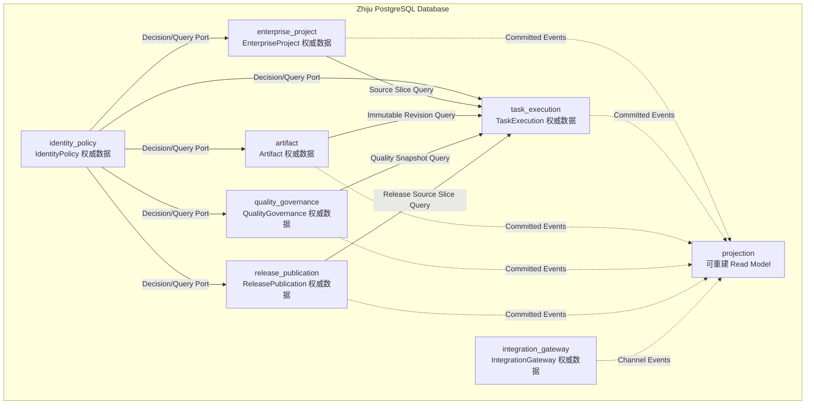
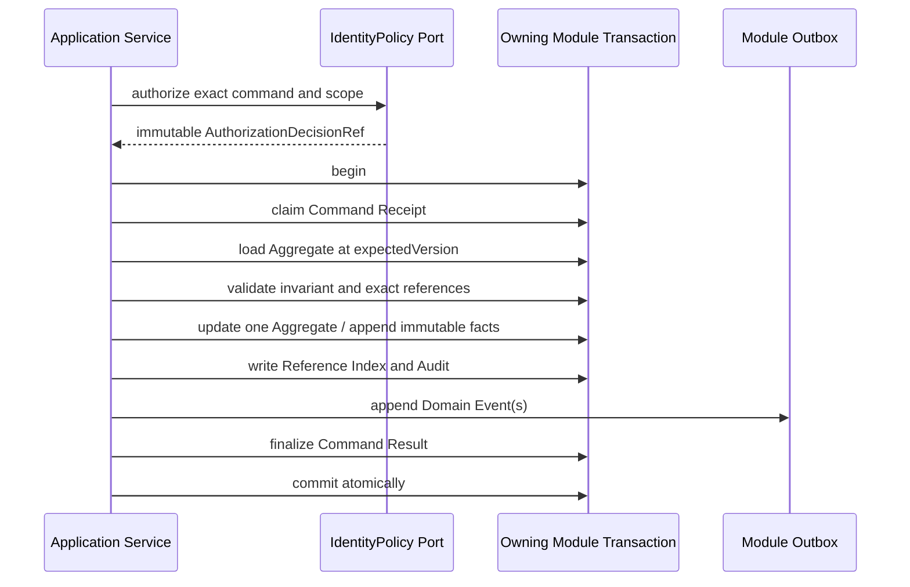

# Zhiju Core PostgreSQL Logical Model v0.1

版本：v0.1
日期：2026-08-12
状态：`CURRENT DATA MODEL BASELINE / IM-02 TECHNICAL TABLES LANDED / IM-03 WI-01–WI-12 IMPLEMENTATION VERIFIED / IM-04 WI-05 V4003 IMPLEMENTATION VERIFIED 2026-08-29 / IM-04 WI-05 PERSISTENCE VERIFIED 2026-08-29 / IM-04 WI-05 GIT DELIVERY COMPLETE PR #110 MERGED 2026-08-29 / ISSUE #94 CLOSED 2026-08-29 / WI-05 FEATURE BRANCH DELETED / IM-04 WI-08 V4004 IMPLEMENTATION VERIFIED 2026-08-29 / IM-04 WI-08 PERSISTENCE VERIFIED 2026-08-29 / IM-05 WI-02 V5002 IMPLEMENTATION AND PERSISTENCE VERIFIED 2026-08-30 / IM-05 WI-02 GITHUB EXACT-HEAD DELIVERY COMPLETE PR #130 MERGED 2026-08-30 / ISSUE #122 CLOSED 2026-08-30 / LOCAL AND REMOTE FEATURE BRANCHES DELETED / IM-05 WI-07 V6002 IMPLEMENTATION AND PERSISTENCE VERIFIED 2026-08-31 / PR #138 MERGED / ISSUE #127 CLOSED / IM-05 WI-08 SYNTHETIC EXIT REVIEW DELIVERED PR #139 / EXACT-HEAD CI PASS 2026-08-31 / ISSUE #128 CLOSED / NO NEW MIGRATION / SYNTHETIC COMPOSED CONTROLLED PERSISTENCE PASS / ISSUE #57–#68 CLOSED / ISSUE #56 EXIT GATE PENDING / INTEGRATED CROSS-AGGREGATE E2E NOT RUN / MANUAL REFERENCE PROJECT NOT RUN / EXTERNAL NOT RUN`

文档角色：PostgreSQL Schema 所有权、逻辑表、关系/JSONB/对象存储、事务技术表、RLS、并发约束和 Projection 的唯一权威。本文不重新定义 Domain 或 Contract 语义。

本文把已冻结的 Domain Model、Typed Reference、Core Contract 和模块边界映射为 PostgreSQL 逻辑数据模型；本文自身不承载可执行 DDL、ORM Model、Repository 或性能结论，实际 Migration 与 Repository 由对应模块实现并在验证记录中引用。

权威输入：

- [`02-zhiju-core-architecture.md`](02-zhiju-core-architecture.md)；
- [`03-core-contracts.md`](03-core-contracts.md)；
- [`04-domain-model-v0.1.md`](04-domain-model-v0.1.md)；
- [`05-cross-aggregate-consistency-module-boundary-v0.1.md`](05-cross-aggregate-consistency-module-boundary-v0.1.md)；
- [`06-typed-references-contract-catalog-v0.1.md`](06-typed-references-contract-catalog-v0.1.md)。

---

## 1. 文档目标

本文回答：

1. 哪些业务事实进入 PostgreSQL，哪些进入对象存储；
2. 七个模块如何拥有独立 Schema、表和 Repository；
3. Aggregate、Entity、不可变 Version、Snapshot 与 Contract 如何落表；
4. Typed Reference 如何保存和验证，又不形成跨模块数据库耦合；
5. 单 Aggregate 事务、Outbox/Inbox、Process Manager 和幂等如何持久化；
6. optimistic concurrency、Lease、Branch、Approval 和 Release 竞态由什么约束承载；
7. Enterprise/Project 隔离、RLS、模块数据库角色和敏感数据边界如何实现；
8. 哪些 Query 读取权威表，哪些读取可重建 Projection；
9. 采购控制程序 Reference Project 如何形成完整可追溯数据链。

### 1.1 非目标

本文不决定：

- 可执行 SQL DDL、Migration 顺序或 ORM 注解；
- PostgreSQL 精确大版本、托管厂商或高可用部署；
- HTTP、MCP、飞书事件或 Runtime Adapter Payload；
- 索引类型、分区阈值、连接池大小或查询性能结论；
- 具体对象存储厂商；
- 审计保留年限、Lease 秒数、重试次数等可配置 Policy 值；
- 通用 Event Sourcing、通用 Workflow Engine 或跨数据库事务。

---

## 2. v0.1 持久化决策

| ID | 决策 |
|---|---|
| PG-001 | v0.1 使用一个 PostgreSQL Database 承载模块化单体。逻辑模块不拆独立数据库。 |
| PG-002 | 七个业务模块各有独立权威 Schema；另设只保存可重建视图的 `projection` Schema。 |
| PG-003 | Core 使用状态模型加不可变版本、业务事实和审计记录，不采用 Event Sourcing 作为完整重建源。 |
| PG-004 | Core ObjectId、VersionId、RevisionId、SnapshotId、CommandId 和 EventId 使用应用生成的 UUIDv7，数据库类型为 `uuid`；文档中的 `PRJ-...`、`REV-...` 是展示别名。 |
| PG-005 | `aggregate_version` 是从 1 递增的并发令牌；业务历史版本使用独立 UUID 和同 Root 内 `version_no`，二者不能互换。 |
| PG-006 | v0.1 不引入 CustomerAccount/Tenant 业务 Aggregate；Enterprise 是企业数据隔离边界，Project 是其下级 Scope。 |
| PG-007 | 所有 Enterprise-owned Row 保存 `enterprise_id`；Project-owned Row 同时保存 `enterprise_id + project_id`，不得只通过 Join 推断 Scope。 |
| PG-008 | Platform Reference 与 Enterprise Data 分表，不用 nullable `enterprise_id` 把全局与客户数据混在同一表。 |
| PG-009 | 模块内强关系使用外键/唯一/检查约束；跨模块关系只保存 Typed Reference，不建立跨 Schema 外键。 |
| PG-010 | 模块不得通过跨 Schema Join 或共享 Repository 完成业务判断；同步业务读取必须经过 owning module Query/Decision Port。 |
| PG-011 | 高频过滤、排序、唯一性、Scope、状态和完整性字段关系化；不可变 Contract Body 使用 Canonical JSONB；大内容和二进制进入对象存储。 |
| PG-012 | 每个 Contract 只有一个 Canonical Payload Source；被提升为列的路由字段是受校验镜像，不成为第二套可编辑内容。 |
| PG-013 | v0.1 Canonical Hash 使用 SHA-256，数据库保存算法、Canonicalization Version 和 32-byte Hash；API 展示使用小写十六进制。 |
| PG-014 | 时间点使用 UTC `timestamptz`；仅真正的业务日历日期使用 `date`；外部 occurredAt 与 Core recordedAt 分开保存。 |
| PG-015 | 业务状态使用 text + closed CHECK/静态注册表，不使用 PostgreSQL native enum，以免 Contract Minor/Major 升级被数据库类型部署绑死。 |
| PG-016 | 不对受控业务记录使用级联删除；撤销、失效、替换、召回和归档均保存为状态或追加事实。 |
| PG-017 | 每个模块拥有自己的 Command Receipt、Outbox、Inbox、Process Manager、Audit 和 Reference Index 技术表。 |
| PG-018 | Domain Event 是至少一次投递；数据库不宣称 exactly-once。Inbox、Command Idempotency 和外部稳定幂等键共同保证业务效果不重复。 |
| PG-019 | Enterprise-owned 表强制 RLS；RLS 是应用授权之外的纵深防御，不替代 IdentityPolicy Decision。 |
| PG-020 | 每个模块使用独立 Migration Owner 与 Runtime Role；Runtime Role 不是表 Owner、无 `BYPASSRLS`，默认无其他业务 Schema 表权限。 |
| PG-021 | Projection 只消费已提交事件，可丢弃重建；Projection 延迟或失败不能作为 Command 成功判据。 |
| PG-022 | Object Type Registry、Contract Schema Registry 和 Human-only Capability Registry v0.1 由构建期静态声明发布；数据库记录所用版本，不提供在线动态改语义功能。 |
| PG-023 | v0.1 强制 Hash 和不可变 Authorization/Actor Snapshot，不强制服务端数字签名；签名能力以后以独立扩展记录增加，不改变既有 Payload。 |
| PG-024 | 数据库不保存长期 Provider Token、共享 Human Credential、模型密钥或 Chain of Thought。 |
| PG-025 | 对象存储与 PostgreSQL 不组成分布式事务；使用 Staging、完整性验证、数据库 Link Commit 和可审计 Orphan Cleanup。 |
| PG-026 | Product 在 v0.1 作为 EnterpriseProject 拥有的独立版本化 Aggregate；Enterprise 只保存关系/投影，不在 Enterprise 事务内整体更新 Product。 |

---

## 3. 数据库拓扑与 Schema 所有权



箭头表示应用 Port 或已提交 Event，不表示跨 Schema 外键或直接表 Join。

### 3.1 Schema 清单

| Schema | 权威内容 | 禁止内容 |
|---|---|---|
| `identity_policy` | Principal、External Identity Link、Role/Capability、Actor/Policy/Authorization Snapshot | Project、Approval、外部 Credential |
| `enterprise_project` | Enterprise、Project、Material、Baseline、Reference Snapshot、Gap、DeliveryPlan | Run、Revision、Gate、Release |
| `task_execution` | Task、ContextSnapshot、WorkOrder、Run、AgentResult、InformationRequest、Usage | Project Fact、Revision Content、Approval |
| `artifact` | Artifact、Revision、Lineage、Representation、EffectiveBinding | Evidence、Gate、Release Attempt |
| `quality_governance` | Evidence、QualityProfile、GateResult、ReviewIssue、Approval、Quality Snapshot | Revision Content、外部发布 |
| `release_publication` | Release、Frozen Package、Destination、Attempt、Formal Receipt、Recall | Renderer/Feishu SDK、EffectiveBinding |
| `integration_gateway` | Inbound Envelope、Channel Binding、Adapter Attempt、Raw Receipt、Quarantine、Health | 任何业务完成、Approval、正式 Release Receipt |
| `projection` | Project Board、Artifact Trace、Feishu Conversation、搜索/运营 Read Model | 权威业务状态、Command Result |

### 3.2 数据库角色

每个权威 Schema 至少定义：

```text
<module>_owner
    NOLOGIN；拥有 Schema/Table；仅 Migration Pipeline 临时 SET ROLE

<module>_app
    LOGIN；只拥有本 Schema 必要 SELECT/INSERT/UPDATE；无 DROP/ALTER/DELETE 默认权限

<module>_dispatcher
    只 Claim/发布本模块 Outbox 并更新投递元数据；不得改业务表绕过 Application Service
```

另外定义：

```text
projection_app
    只写 projection，读取事件投递接口，不直读权威表构造业务结论

audit_reader
    只读经脱敏的审计 View；默认不能读取 Canonical Payload/敏感 ExternalId

migration_runner
    LOGIN；只能在受控部署期间切换到特定 <module>_owner
```

同一个模块化单体进程可以维护多个模块数据源/连接池；这不等于微服务。模块 Repository 必须使用自己的 Role，数据库层也能拒绝意外跨模块写入。

### 3.3 Schema 迁移所有权

- 每个 Migration 文件只改变一个业务 Schema；
- 跨 Schema 发布按 Expand → Producer → Consumer → Contract → Contract Cleanup 顺序执行；
- 不允许一个 Migration 同时重写多个模块业务数据来模拟跨模块事务；
- Projection Migration 可以单独丢弃重建，但不得反向修改权威表；
- Contract Major 并行期间，数据库保存独立 `contract_type + contract_version`，不覆盖旧 Payload。

---

## 4. 通用逻辑列约定

### 4.1 Aggregate Root

所有可变 Aggregate Root 采用下列逻辑列组：

```text
id                         uuid PK
enterprise_id?             uuid Scope
project_id?                uuid Scope
aggregate_version          bigint >= 1
status                     text closed value
created_at                 timestamptz
created_by_principal_id    uuid
created_by_actor_snapshot_id uuid
updated_at                 timestamptz
last_command_id            uuid
retention_class            text
```

规则：

1. `aggregate_version` 每个成功 Command 恰好增加一次；
2. 更新使用 `id + expected aggregate_version` Compare-And-Set；
3. `last_command_id` 用于诊断，不替代 Command Receipt；
4. `created_by_principal_id` 是 PrincipalRef 的 ID 镜像，不建立 IdentityPolicy 外键；
5. Enterprise/Project Scope 创建后不可改变；需要转移时创建新业务对象和显式迁移事实；
6. 不增加通用 `deleted_at` 来掩盖不同业务删除语义。
7. Command 写入的 Outbox Event 与 Reference Edge 必须绑定该 Command 的目标 Aggregate；事件版本必须由 CREATE 初始版本或 CAS 的 expected version 推导，不能由 body 任意声明。
8. `created_by_principal_id` 必须来自当前受信事务 Context 的 Principal，不能由调用者把另一主体写入技术事实。

### 4.2 不可变 Version / Snapshot / Fact

```text
id                         uuid PK
root_id?                   uuid FK within owning schema
version_no?                integer > 0
enterprise_id?             uuid
project_id?                uuid
contract_type?             text
contract_version?          text
canonicalization_version?  text
payload_hash_algorithm     text
payload_hash               bytea
canonical_payload?         jsonb
created_at                 timestamptz
created_by_principal_id    uuid
created_by_actor_snapshot_id uuid
source_command_id          uuid
retention_class            text
```

规则：

- `root_id + version_no` 唯一；
- ID 与 Hash 创建后不可改变；
- 已激活/封存版本不更新 Payload；
- Root 可以保存 `current_version_id` 供 AUTHORITATIVE UI 使用，但可重放 Contract 仍必须保存精确 VersionRef；
- `current_version_id` 不是 `latest` Contract，不能在历史 Payload 中延迟解析；
- 不可变表默认禁止 UPDATE/DELETE；需要撤销时创建 Revocation/Invalidation Fact。

### 4.3 Scope 列

| Scope | 必填列 | 规则 |
|---|---|---|
| PLATFORM | 独立 Platform Reference Table，无 `enterprise_id` | 只由受控平台角色写 |
| ENTERPRISE | `enterprise_id` | RLS 强制匹配当前授权 Enterprise |
| PROJECT | `enterprise_id + project_id` | 模块内组合关系证明 Project 属于 Enterprise |
| OBJECT | 在 Enterprise/Project 基础上增加 owner object ID | 不从目标对象反向推断 Scope |

Project-owned 表需要在同一模块内使用复合唯一键/外键确保：

```text
(enterprise_id, project_id)
    references enterprise_project.project_scope_claim
```

其他模块不能外键到 `enterprise_project.project`，因此各模块通过已验证 Scope Claim 和事件复制最小 Scope Key；该复制是安全路由元数据，不是 Project 业务副本。

### 4.4 时间

```text
occurred_at
    外部或业务事件声称发生的时间；可能不可信

recorded_at / created_at
    Core 数据库接受事实的时间；由受信数据库/应用时钟生成

valid_from / valid_to
    业务有效期；只用于确有有效期语义的 Fact/Binding

expires_at
    Decision、Lease、Request 等到期时间；到期不删除历史
```

不保存无时区 timestamp。外部时区作为来源元数据保存，不能改变 UTC 事实排序。

### 4.5 Hash 与 Canonicalization

逻辑列组：

```text
hash_algorithm             text = SHA-256
hash_bytes                 bytea length = 32
canonicalization_version   text
payload_size_bytes         bigint
```

规则：

- Hash 比较使用原始 bytes，不比较大小写不同的字符串；
- Payload Hash 不包含顶层自身 `payload_hash`；
- 对象存储内容 Hash 与 Contract Payload Hash 分开命名；
- Representation `checksum`、Revision `content_hash`、Package `package_hash` 不得互相替代；
- Hash 不等于授权、签名或加密；读取仍受 RLS/Policy 控制；
- 跨语言 Hash Fixture 在实现阶段成为发布 Gate。

### 4.6 Presence 与不确定性

`ValuePresence` 使用显式列组：

```text
presence_code     KNOWN | UNKNOWN | NOT_APPLICABLE | REDACTED
value_json        jsonb nullable
reason_code       text nullable
evidence_ref_json jsonb nullable
```

检查语义：

- `KNOWN` 必须有 `value_json`；
- `UNKNOWN/NOT_APPLICABLE/REDACTED` 不得在 `value_json` 偷放值；
- `REDACTED` 的 reason 不得包含被隐藏内容；
- `NULL` 只表示数据库层未提供 optional field，不表达业务 Unknown。

### 4.7 Closed State 与扩展字段

- 生命周期状态、Outcome、PrincipalKind、Gate Stage 等使用 closed text constraint；
- Extension 使用有命名空间的 JSONB，只允许 Contract Registry 已知 Key；
- 未知 Required Extension 拒绝写入；
- JSONB 不允许成为绕过 closed state 或权限字段的“备用字段袋”。

---

## 5. 关系数据、Canonical JSONB 与对象存储边界

### 5.1 关系列必须承载

- 主键、Scope、Root/Version 关系；
- Aggregate Version、状态、时间与有效期；
- 唯一性、并发 Claim 和幂等键；
- Contract Type/Version、Hash 和 Payload Size；
- 高频授权、过滤、排序、Join-within-module 字段；
- 对象存储 Locator/Hash/Size/MediaType；
- Outbox/Inbox/Attempt/Receipt 调度字段。

### 5.2 Canonical JSONB 承载

- Project Context Contract Body；
- READY WorkOrder Specification；
- AgentResult Body；
- RevisionAcceptance、ApprovalBundle、ReleaseReadiness Snapshot Body；
- AuthorizationDecision、ActorSnapshot、PolicySnapshot Body；
- Command/Event Payload 和稳定 Result Payload；
- 结构会按 Contract Minor 增加 Optional 字段、但整体必须一起 Hash 的不可变 Value Object。

Canonical JSONB 是原始 Contract 的唯一 Payload Source。若 `enterprise_id`、`project_id`、`run_id`、`outcome` 等字段被提升为列，则 Writer 必须在同一事务校验列值与 Payload 相等；后续 DDL 优先使用 generated/extracted column 或不可绕过的写入函数减少漂移。

### 5.3 对象存储承载

- 客户上传的原始二进制；
- Canonical Document/Workbook 等较大结构化内容；
- DOCX、PDF、XLSX 和预览图等 Representation；
- 超过数据库 Payload Policy 的原始 Adapter Payload；
- 大型验证附件或 Renderer 诊断包。

数据库保存：

```text
storage_provider
storage_bucket
storage_key
object_version_id?
content_hash_algorithm
content_hash
byte_size
media_type
encryption_key_ref?
verified_at
retention_class
storage_state
```

`storage_key` 是内部不透明 Locator，不是公开 URL。下载链接必须临时签发并重新授权。

### 5.4 对象写入协议

```text
upload to staging key
    ↓
virus/type/size/hash validation
    ↓
create immutable object manifest in owning Aggregate transaction
    ↓
mark object LINKED/FROZEN
    ↓
later orphan collector claims due orphan records; completion rechecks link,
retention, legal hold and quarantine before deleting
```

数据库事务失败后对象可能成为 Orphan；对象写失败时不得提交业务 Link。Cleanup 只能删除：

1. 明确处于 staging；
2. 超过安全宽限期；
3. 数据库反向引用检查为零；
4. 不属于 Legal Hold/Quarantine；
5. 删除行为本身写审计结果。

### 5.5 默认 Payload Guard

实现阶段的默认安全 Guard：

- Command/Event Canonical Payload：建议不超过 256 KiB；
- Contract Snapshot Canonical Payload：建议不超过 4 MiB；
- 超限内容必须对象化并在 Payload 中保存 ContentAddressedRef；
- 不允许把附件 Base64、完整 DOCX/PDF 或 Chain of Thought 放入 JSONB。

这些数值是可配置 Guard，不是业务语义，也不影响表结构。

---

## 6. Typed Reference 持久化

### 6.1 逻辑列组

跨模块强引用按用途保存以下列组：

```text
target_module
target_object_type
target_object_id
target_version_id?
target_payload_hash_algorithm?
target_payload_hash?
target_canonicalization_version?
target_enterprise_id?
target_project_id?
reference_purpose
validated_at
validation_snapshot_id?
```

具体强度：

| Ref 类型 | 必填逻辑字段 |
|---|---|
| ObjectRef | objectType + objectId + Scope |
| VersionedRef | ObjectRef + versionId |
| ContentAddressedRef | VersionedRef + hashAlgorithm + payloadHash + canonicalizationVersion |
| SnapshotRef | snapshotType + snapshotId + payloadHash + Scope |
| EvidenceRef | evidenceId + evidenceVersion/validation + source hash + purpose |
| RepresentationRef | representationId + revisionId + checksum + rendererVersion |
| ReleasePackageRef | releaseId + packageId + packageHash |
| PrincipalRef | principalId + principalKind；授权动作另带 ActorSnapshotRef/AuthorizationDecisionRef |
| ExternalRef | adapter/provider/account + external type/id 或 lookup hash + optional payloadHash |

### 6.2 模块内关系

同一 Schema、同一 Aggregate 或明确同模块关系使用外键。示例：

- `artifact_revision.artifact_id → artifact.id`；
- `revision_parent(parent_artifact_id, parent_revision_id)` 组合关系保证同 Artifact；
- `quality_profile_version.profile_id → quality_profile.id`；
- `release_package_item.package_id → release_package.id`。

模块内外键默认 `ON DELETE RESTRICT`，不用 `CASCADE` 删除受控历史。

### 6.3 跨模块关系

跨模块不设置外键。例如：

```text
quality_governance.gate_result
    stores ArtifactRevision ContentAddressedRef
    does not FK artifact.artifact_revision

release_publication.release_record
    stores ApprovalBundleSnapshotRef
    does not FK quality_governance.approval_bundle_snapshot
```

原因：

1. owning module 才能解释生命周期与授权；
2. 跨 Schema FK 会诱导直接 Join/级联删除；
3. 未来模块拆分时不改变业务 Contract；
4. 历史 Ref 即使目标撤销/归档也必须保持原始事实。

### 6.4 Reference Validation Snapshot

写入跨模块 Ref 前，Application Service 通过 owning module Query/Decision Port 完成：

```text
type → resolution → scope → hash → lifecycle → authorization → purpose
```

目标模块返回不可变 Validation Snapshot/Decision，引用方保存：

- 验证结果 ID；
- target exact Ref；
- validator contract version；
- validatedAt；
- purpose；
- caller scope；
- result hash。

这不保证目标永远有效。撤销、失效和召回通过 Event 触发 Impact Assessment；不得静默改写旧 Ref。

### 6.5 每模块 `reference_edge`

每个权威 Schema 保存派生 Reference Index：

```text
owner_object_type
owner_object_id
owner_version_id?
owner_payload_hash?
reference_path
target_module
target_object_type
target_object_id
target_version_id?
target_payload_hash?
reference_purpose
enterprise_id?
project_id?
created_at
source_command_id
```

规则：

- Canonical Payload/业务 Row 是 Ref Source of Truth；`reference_edge` 是同事务生成的派生索引；
- 精确 `owner（含 owner_version_id）+ reference_path + target` 唯一；不同不可变 owner version 的合法 Edge 不互相冲突；
- 不允许手工编辑；可从 Canonical Payload 重建；
- 用于 Impact 查找、Traceability 和数据保留检查；
- 写入时索引与 Payload 不一致则整个事务失败；
- Projection 可以聚合各模块 Edge，但不能反向修复权威 Ref。

---

## 7. 每模块标准技术表

七个权威 Schema 各自拥有同名逻辑表，不建设一个所有模块共享写入的超级技术 Schema。

### 7.1 `command_receipt`

| 逻辑字段 | 用途 |
|---|---|
| command_id | 全局追踪 ID |
| command_type/version | Contract 兼容性 |
| idempotency_scope/key | 业务幂等唯一键 |
| request_payload_hash | 相同 Key 冲突检测 |
| enterprise_id/project_id | Scope 与 RLS |
| target_type/id | Command Owner 与 Aggregate |
| expected_aggregate_version | 并发输入 |
| outcome | COMMITTED / REJECTED / DUPLICATE |
| result_payload/hash | 稳定重放结果 |
| first_seen_at/completed_at | 诊断与时延 |
| correlation_id/causation_id | 端到端链路 |

唯一约束：

```text
(idempotency_scope, idempotency_key)
```

相同 Key + 相同 Hash 返回原结果；相同 Key + 不同 Hash 拒绝并写安全审计。

### 7.2 `outbox_event`

事件 Payload 与路由字段在业务事务中插入：

```text
event_id
event_type/version
aggregate_type/id/version
enterprise_id/project_id
correlation_id/causation_id
payload jsonb
payload_hash
occurred_at/recorded_at
delivery_state
available_at
attempt_count
lease_owner/lease_until
last_error_code
published_at
```

业务 Payload、EventId 和 AggregateVersion 不可改；Dispatcher 只能更新投递元数据。Outbox 发布顺序只保证同 Aggregate 按 `aggregate_version` 有序，不承诺全局顺序。

### 7.3 `inbox_message`

```text
consumer_name
event_id
event_type/version
payload_hash
source_module
enterprise_id/project_id
status
first_seen_at/processed_at
result_command_id?
failure_code?
```

唯一键为 `consumer_name + event_id`。相同 EventId 不同 Hash 进入 Quarantine，不得按重复成功处理。

Inbox Claim、目标 Aggregate 变化、目标 Outbox 和 Inbox `PROCESSED` 必须在同一目标模块事务提交。

### 7.4 `process_instance` 与 `process_step`

`process_instance`：

```text
process_id
process_type/version
correlation_key
enterprise_id/project_id
state
aggregate_version
next_action_at
retry_count
last_consumed_event_id
blocked_reason_code?
created_at/updated_at
```

`process_step` 是不可变步骤事实，保存输入 EventRef、发出 CommandRef、结果、失败与人工介入。相同 `process_type + correlation_key` 只能有一个 active instance。

`process_step.enterprise_id/project_id` 必须与父 `process_instance` 完全一致；只按 `process_id` 建立 FK 不足以防止同一事务允许多个 Project 时形成跨 Scope 关联。

### 7.5 `audit_record`

保存：

- 谁通过哪个 ActorSnapshot/AuthorizationDecision 执行了什么 Command；
- 目标 Scope、对象、expected/current version；
- ALLOWED/DENIED、业务结果和错误码；
- Request/Result Hash，而非默认复制完整敏感 Payload；
- Correlation/Causation、Core recordedAt 和来源 Channel/Runtime Ref；
- break-glass 或人工运维操作的理由和审批引用。

Audit 是追加记录，不允许普通应用角色更新/删除。

`audit_reader` 是跨模块受控审计读取角色：只能通过 masked surface 读取明确列出的非敏感字段。masked surface 必须能返回已提交行；其默认 security-definer owner 是对应 NOLOGIN module owner，底表只为该 owner 配置审计读取策略。`audit_reader` 自身不获得底表或列权限，因此不能绕过 view 执行 `count(*)`、读取敏感列或写入。

### 7.6 `reference_edge`

用于本模块的 Typed Reference 反向查找，规则见第 6.5 节。

### 7.7 `contract_violation`

保存未知 Major、未知 Required Extension、Canonical Hash 不匹配、Scope 冲突、自引用 Hash、Payload 超限等拒绝事实。敏感 Payload 默认只保存 Hash、Schema Error Path 和安全摘要。

### 7.8 nullable Project Scope 的统一 RLS

七模块标准技术表同时容纳 Enterprise-owned 与 Project-owned 行时，策略逐行选择边界：`project_id IS NULL` 只校验当前 Enterprise；`project_id IS NOT NULL` 必须调用 Project helper，同时匹配 Enterprise 与允许的 Project 集合。不得用仅校验 Enterprise 的策略读取或写入 Project-owned 行。

数据库在 WI-04 校验 promoted Scope 镜像、hash 形状、生命周期和不可变写面；Artifact owning service 在写入 Manifest 前完成 Canonical JSON 与 SHA-256 的重算/比对，并由 V4002 Persistence Gate 验证。后续 Revision/Representation 的跨模块内容绑定仍按各自 Gate 单独记录，不能由本切片推断为已完成。

---

## 8. Core Contract 存储模式

### 8.1 通用 Contract Record

每个不可变 Contract 表使用同一逻辑 Header：

```text
contract_id                 uuid PK
contract_type               text
contract_version            text
schema_registry_version     text
enterprise_id               uuid
project_id?                 uuid
canonicalization_version    text
payload_hash_algorithm      text
payload_hash                bytea
payload_size_bytes          bigint
canonical_payload           jsonb
created_at                  timestamptz
created_by_principal_id     uuid
actor_snapshot_id           uuid
authorization_decision_id   uuid
source_command_id            uuid
data_classification         text
retention_class             text
```

表级规则：

- `contract_id` 是主键；同一 ID 的任何 Replay 必须携带相同 Payload Hash，但不同 Contract 可以合法拥有相同内容 Hash；
- Contract 创建后不可 UPDATE/DELETE；
- 任何被提升列必须与 Canonical Payload 匹配；
- Canonical JSONB 不含顶层自身 Hash；
- 未知 Contract Major/Required Extension 不落权威表，只进 Violation/Quarantine。

### 8.2 Project Context

权威表：`task_execution.context_snapshot`。

提升列：

```text
context_snapshot_id
purpose
audience
enterprise_id/project_id
builder_version
policy_snapshot_id
source_manifest_count
context_item_count
omission_count
redaction_count
coverage_state
payload_hash
```

`SourceManifest`、ContextItem、Omission、Redaction 和 Coverage 的完整顺序化内容保存在 Canonical Payload。关键外部 Ref 同事务写入 `reference_edge`。旧 Snapshot 永远解析原精确 Ref，不跟随新 Baseline/Profile。

### 8.3 WorkOrder

权威表：

```text
task_execution.work_order
task_execution.work_order_contract
```

`work_order` 保存 Draft/READY/QUEUED/COMPLETED 等 Aggregate State 和 `aggregate_version`。进入 READY 时一次性插入 `work_order_contract`：

```text
work_order_contract_id
work_order_id
specification_hash
context_snapshot_id
risk_profile_version_id
quality_profile_version_id
execution_policy_version
harness_policy_version
model_policy_version
canonical_payload
payload_hash
```

`specification_hash` 只覆盖冻结 Specification 子集；`payload_hash` 覆盖完整 Contract。两者不能互换。READY 后 Root 只能推进生命周期，不得替换 Contract Row。

### 8.4 AgentResult

权威表：

```text
task_execution.agent_result
task_execution.agent_result_acceptance
task_execution.agent_result_conflict
```

`agent_result` 是不可变 Contract Record，提升：

```text
agent_result_id
run_id
work_order_id
context_snapshot_id
submission_kind = FINAL
outcome
business_output_count
workspace_output_count
usage_record_id?
payload_hash
```

每个 Run 只有一个 final Result Claim。Acceptance 是独立不可变记录；WorkOrder/Task Completion 由 CompletionEvaluator 另存，不向 AgentResult 回写 `accepted/completed`。

### 8.5 Artifact + Quality Gate Contract Family

权威表：

```text
quality_governance.revision_acceptance_snapshot
quality_governance.approval_bundle_snapshot
quality_governance.release_readiness_snapshot
```

提升字段：

| Snapshot | 精确绑定 |
|---|---|
| RevisionAcceptance | artifactRevisionId + revisionContentHash + qualityProfileVersionId |
| ApprovalBundle | revisionAcceptanceSnapshotId/hash + approval decision refs/hash |
| ReleaseReadiness | releaseId + packageId + packageHash + representation checksum/rendererVersion |

三个表互不覆盖。Revision Acceptance 不保存 Release Package Render 通过；Release Readiness 不重写 Revision Acceptance 或 Approval Decision。

### 8.6 Canonical Payload 与查询镜像一致性

写入路径必须按顺序执行：

```text
validate schema and required extensions
    ↓
canonicalize payload
    ↓
calculate payloadHash
    ↓
extract promoted columns and reference_edge
    ↓
verify extracted values equal envelope/header
    ↓
insert Contract + Reference Index + Audit/Outbox atomically
```

任何一步不一致都拒绝整个事务，不允许先保存 JSONB 后异步补关键 Scope/Hash 索引。

---

## 9. `identity_policy` 逻辑模型

IdentityPolicy 的 Principal 可以服务多个 Enterprise，但业务授权永远带 Scope。其他模块只持有 PrincipalRef/ActorSnapshotRef/AuthorizationDecisionRef。

### 9.1 权威表

| 表 | 类型 | 关键列/关系 | 关键约束 |
|---|---|---|---|
| `principal` | Aggregate Root | id、principal_kind、status、aggregate_version、display_name | HUMAN/AGENT/SERVICE/RUNTIME/EXTERNAL_PARTY 不互换；不存 Credential |
| `principal_state_transition` | Immutable Fact | principal_id、from/to、reason、actor_snapshot_id | 追加；不删除历史 Principal |
| `external_identity_link` | Aggregate Root | provider、account_lookup_hash、external_id_lookup_hash、encrypted identifiers、principal_id | provider/account/external lookup 唯一；冲突不覆盖 |
| `role_assignment` | Aggregate Root | principal_id、role_code、scope_kind、enterprise_id/project_id、valid period | 明确 Scope；撤销不删除 |
| `role_revocation` | Immutable Fact | role_assignment_id、revoked_by、reason、effective_at | 一个有效 Assignment 可有一次生效撤销 |
| `capability_grant` | Aggregate Root | principal_id、capability_code、scope、constraints、valid period | Human-only Capability 不授予 Agent/Runtime |
| `capability_revocation` | Immutable Fact | capability_grant_id、reason、effective_at | 追加事实 |
| `policy_snapshot` | Immutable Contract | policy registry/version、payload/hash | 历史 Authorization 永远可解释 |
| `actor_snapshot` | Immutable Contract | actor principal kind、acting_for_ref、channel/runtime source、payload/hash | actingFor 不改变 actor kind |
| `authorization_decision` | Immutable Contract | actor_snapshot_id、capability、command type、scope、decision、expires_at、policy_snapshot_id | ALLOW/DENY 不可改；高风险 Command 使用精确 DecisionRef |

### 9.2 Scope 与 RLS

- `principal` 和 `external_identity_link` 是 IdentityPolicy 内部 Platform Security Data，不直接暴露给企业业务查询；
- `role_assignment`、`capability_grant`、`actor_snapshot`、`authorization_decision` 保存精确 enterprise/project Scope；
- Enterprise Scope 行的 `project_id` 必须为空；Project Scope 行的 `project_id` 必须非空，且 RLS 使用 `context_allows_project(enterprise_id, project_id)`，不得退化为仅校验 Enterprise；
- `role_revocation`、`capability_revocation` 保存并校验父 Assignment/Grant 的 `scope_kind + enterprise_id + project_id` 镜像，防止跨 Scope 伪造撤销事实；
- `actor_snapshot` 的 actor/actingFor Principal Kind 必须与 Principal 记录一致；`capability_grant` 的 grant-policy 引用和 `authorization_decision` 的 Actor/Policy 引用按 id + payload hash 精确绑定；Decision 的 Principal、Kind、认证上下文与 Scope 必须与 ActorSnapshot 的 promoted 列一致；
- Enterprise 用户不能枚举 Principal Directory；只能通过 Identity Query 获取授权后的最小显示信息；
- 平台运维访问使用独立受审计角色，不通过 `enterprise_id IS NULL` 绕过 RLS。

### 9.3 外部身份保护

可查询标识使用密钥化 Lookup Hash，而不是普通 SHA-256：

```text
lookup_hash = HMAC(active_lookup_key, normalized provider/account/external_id)
```

原值仅在确需回传 Provider 时保存为 envelope-encrypted ciphertext，并带 key version。轮换时创建新 lookup/key 版本，不在日志输出原始 open_id、email 或手机号。

### 9.4 必要访问路径

- provider + account lookup + external identity lookup → active Principal；
- principal + enterprise/project + role/capability + effective time；
- authorization_decision_id + payload_hash；
- actor_snapshot_id + payload_hash；
- expiring grant/decision by `expires_at`。

---

## 10. `enterprise_project` 逻辑模型

### 10.1 Enterprise 与长期配置

| 表 | 类型 | 关键列/关系 | 关键约束 |
|---|---|---|---|
| `enterprise` | Aggregate Root | id、display_code、status、aggregate_version | 企业身份不因名称变化而变化 |
| `enterprise_fact` | Aggregate Root/Assertion | enterprise_id、fact_type、presence/value、valid period、status | Fact Value 与来源创建后不覆盖；冲突并存 |
| `enterprise_fact_decision` | Immutable Fact | fact_id、PROPOSED/CONFIRMED/DISPUTED/SUPERSEDED、actor/evidence refs | Human 确认可追溯；Agent 只提议 |
| `enterprise_profile_snapshot` | Immutable Contract | enterprise_id、included fact refs、effective artifact refs、payload/hash | Snapshot 不跟随 Fact/Binding 变化 |
| `product` | Independent Aggregate Root | enterprise_id、product_type、status、aggregate_version、current_version_id | 产品身份长期存在；可独立版本化并跨 Project 精确引用 |
| `product_version` | Immutable Version | product_id、version_no、structured payload/hash | 已引用版本不可覆盖 |
| `qms_configuration` | Aggregate Root | enterprise_id、status、aggregate_version、current_version_id | 一个用途的 active version 由 Root 指针决定 |
| `qms_configuration_version` | Immutable Version | qms_configuration_id、version_no、risk/quality mappings、payload/hash | 激活/回滚只切精确指针并写事件 |

### 10.2 Project Scope

| 表 | 类型 | 关键列/关系 | 关键约束 |
|---|---|---|---|
| `project` | Aggregate Root | enterprise_id、id、display_code、status、aggregate_version | `(enterprise_id,id)` 唯一；Scope 不可移动 |
| `project_scope_claim` | Security/Reference Claim | enterprise_id、project_id、status、scope_version | 给本模块复合关系使用；其他模块不外键 |
| `project_snapshot_binding` | Immutable Entity within Project | project_id、binding purpose、enterprise profile/config/product refs、bound_at、actor ref | 支持 Project 启动/阶段 Gate 冻结精确 Ref，不引入第二个 Context Contract |

### 10.3 SourceMaterial 与 CustomerMaterial

| 表 | 类型 | 关键列/关系 | 关键约束 |
|---|---|---|---|
| `source_material` | Aggregate Root | enterprise/project、content hash、object locator、media type、status、aggregate_version | 原始 bytes 不改；Hash 相同仍可保留不同来源 |
| `source_material_origin` | Immutable Entity | source_material_id、ExternalRef、message/file metadata hash、received_at | 消息撤回不删除来源事实 |
| `source_material_validation` | Immutable Fact | scan/type/hash outcome、validator version、recorded_at | 新验证追加，旧结果不改 |
| `customer_material` | Aggregate Root | enterprise/project、source_material_id、classification、status、aggregate_version、current_version_id | Attachment 不自动确认业务材料 |
| `customer_material_version` | Immutable Version | customer_material_id、version_no、title/type/locator/source refs、payload/hash | CONFIRMED 版本不可改；新解析创建新版本 |
| `customer_material_decision` | Immutable Fact | version_id、proposal/confirmation/dispute、actor/evidence refs | Agent 与 Human 权限分离 |

### 10.4 CustomerBaseline

| 表 | 类型 | 关键列/关系 | 关键约束 |
|---|---|---|---|
| `customer_baseline` | Aggregate Root | project_id、status、aggregate_version、active_version_id | 同项目同 Baseline purpose 只有一个 active pointer |
| `customer_baseline_version` | Immutable Version | baseline_id、version_no、payload/hash、confirmed_by | 已激活版本不修改 |
| `customer_baseline_item` | Immutable Entity | baseline_version_id、requirement/category、presence、customer_material_version_ref | `NOT_PROVIDED != MISSING_CONFIRMED` |
| `baseline_impact_review` | Aggregate Root/Process Result | old/new baseline refs、impacted refs、decision/status | 只产生影响决定，不改写旧下游对象 |

### 10.5 Platform Reference 与 Project Snapshot

Platform Reference 使用独立表，无 `enterprise_id`：

| 表 | 类型 | 关键列/关系 | 关键约束 |
|---|---|---|---|
| `reference_template` | Platform Aggregate | template identity/type/status/current_version_id | 仅平台角色写 |
| `reference_template_version` | Immutable Version | template_id、version_no、content ref/hash、applicability | 发布后不可改 |
| `regulatory_reference` | Platform Aggregate | authority/jurisdiction/reference identity | 不等于客户 Evidence |
| `regulatory_reference_version` | Immutable Version | source locator、effective period、content hash、verification | 历史法规版本保留 |

Project Snapshot：

| 表 | 类型 | 关键列/关系 | 关键约束 |
|---|---|---|---|
| `template_baseline` | Aggregate Root | enterprise/project、status、aggregate_version、active_version_id | 项目冻结后不跟随平台 current version |
| `template_baseline_version` | Immutable Version | baseline_id、version_no、payload/hash、confirmed_by | 精确选择集合 |
| `template_selection` | Immutable Entity | baseline_version_id、template/version ContentAddressedRef、purpose | 禁止 `latest` |
| `regulatory_profile` | Aggregate Root | enterprise/project、jurisdiction/product scope、active_version_id | 项目适用性决策 |
| `regulatory_profile_version` | Immutable Version | profile_id、version_no、payload/hash、confirmed_by | Evidence 来源引用精确版本 |
| `regulatory_profile_item` | Immutable Entity | profile_version_id、regulatory ref/version/hash、applicability/presence | 模板不得冒充 Evidence |

### 10.6 GapAnalysis

| 表 | 类型 | 关键列/关系 | 关键约束 |
|---|---|---|---|
| `gap_analysis` | Aggregate Root | enterprise/project、status、aggregate_version、accepted_version_id | 输入变化只标记 STALE/新分析，不覆盖旧版本 |
| `gap_analysis_version` | Immutable Version | baseline/template/regulatory snapshot refs、analysis policy、payload/hash | 完成版本不可变 |
| `gap_finding` | Immutable Entity | gap_version_id、requirement ref、current state、gap severity、recommendation、evidence refs | Finding 不自动变成项目承诺 |
| `gap_analysis_decision` | Immutable Fact | version_id、accept/reject/request revision、Human actor | Agent 不接受正式分析 |

### 10.7 DeliveryPlan 与 DeliveryItem

| 表 | 类型 | 关键列/关系 | 关键约束 |
|---|---|---|---|
| `delivery_plan` | Aggregate Root | enterprise/project、status、aggregate_version、active_version_id | 计划批准/激活需 Human Decision |
| `delivery_plan_version` | Immutable Version | gap_analysis_version_ref、scope、payload/hash、approved_by | Approved/Active 内容不变 |
| `delivery_item` | Entity within Plan | plan_version_id、item_id、artifact purpose、completion criteria、risk level、status projection、current_completion_evaluation_id | 范围更新必须走 DeliveryPlan Aggregate |
| `delivery_item_artifact_requirement` | Immutable Entity | plan_version_id、item_id、artifact purpose/type、required cardinality、acceptance/release criteria | 支持 0..N Artifact，不预设永久一对一 |
| `delivery_item_dependency` | Entity | plan_version_id、from/to item、dependency type | 同 Plan Version 内无非法环 |
| `delivery_item_completion_evaluation` | Immutable Fact | item_id、criteria version、input refs、outcome、evaluator version/hash | Completion 只由 Evaluator 产生 |
| `delivery_item_impact_review` | Aggregate Root/Process | item ref、upstream change refs、decision、status | 不自动修改已批准范围 |

DeliveryItem 的 `status` 是 Aggregate 内当前派生缓存；权威解释来自 Root 明确指向的 `current_completion_evaluation_id`，不是运行时查询 `latest`。直接更新为 COMPLETED 的 SQL 路径不对 Repository 开放。

### 10.8 必要访问路径

- enterprise/project display code；
- enterprise Fact by type/status/valid period；
- project active baseline/template/regulatory/plan pointer；
- source material by content hash、external origin lookup 和 status；
- immutable version by root + version_no 或 version_id + payload_hash；
- Gap/Plan by project + status + updated_at；
- DeliveryItem by plan version、risk、completion state；
- downstream Event Ref by `reference_edge` target。

---

## 11. `task_execution` 逻辑模型

### 11.1 Task

| 表 | 类型 | 关键列/关系 | 关键约束 |
|---|---|---|---|
| `task` | Aggregate Root | enterprise/project、delivery_item_ref?、status、risk、aggregate_version、current definition 指针（`snapshot_id` + payload hash） | Task 完成不由 Run 自报；Scope 列创建后不可变 |
| `task_dependency` | Entity | task_id、depends_on_task_id、type | 同 Project；禁止非法环 |
| `task_completion_evaluation` | Immutable Fact | task_id、criteria/input refs、outcome、evaluator version | Completion 可重算但旧结果保留 |
| `task_state_transition` | Immutable Fact | task_id、from/to、reason、command/event refs | 看板历史可解释 |

### 11.2 ContextSnapshot

`context_snapshot` 使用第 8.2 节的不可变 Contract 模式。可选的 `context_snapshot_build` 保存 Builder Attempt、输入 Source Slice Hash、失败原因和重试；成功 Build 只产生一个精确 Snapshot。

Context Item 不拆为可编辑业务表。若需要检索，使用同事务派生的 `reference_edge` 和可重建 Projection；Canonical Payload 保持唯一顺序和 Hash。

新入口产出的 Snapshot 行使用 canonical `zhiju.execution.context_snapshot` 身份，并通过 `reference_edge` 记录 `object_id`、`snapshot_id` 与 `content_hash` 三元组，使 `build_initial_context_snapshot` 返回的引用和 `get_context_snapshot` 的请求/结果能够按完整 SnapshotRef 逐字段验证，而不是只按 `object_id` 关联。历史 Core v1.0 契约中的 `zhiju.project.context_snapshot` 仍是只读回值，不由新入口写入，也不与 canonical 行互换。返回引用必须指向本次事务已提交的 Snapshot；幂等同键异 Hash 与未提交引用由 Handler 拒绝，不在本阶段实现。

### 11.3 WorkOrder

| 表 | 类型 | 关键列/关系 | 关键约束 |
|---|---|---|---|
| `work_order` | Aggregate Root | task_id、status、aggregate_version、ready_contract_id、active_run_ref? | READY 后 contract ref 不变 |
| `work_order_contract` | Immutable Contract | objective/scope/input/output/policy/budget/version pins payload/hash | specificationHash 与 payloadHash 都保存 |
| `work_order_completion_evaluation` | Immutable Fact | work_order_id、contract id/hash、accepted result refs、criteria outcomes | AgentResult 不拥有 Completion |
| `work_order_state_transition` | Immutable Fact | from/to、reason、actor/event refs | Retry 不抹掉旧状态路径 |

### 11.4 Run 与 Lease

| 表 | 类型 | 关键列/关系 | 关键约束 |
|---|---|---|---|
| `run` | Aggregate Root | work_order_id、context_snapshot_id、runtime policy refs、status、aggregate_version、final_result_id? | Context/Policy/Fencing Token 创建后不变 |
| `work_order_run_claim` | Lease/Reservation | work_order_id、run_id、claim_no、fencing_token、lease_until、state | 同 WorkOrder 条件唯一 active claim |
| `run_capability_binding` | Immutable Security Binding | run_id、capability set hash、grant/authorization refs、opaque secret-manager handle ref、expires_at | 只存 Token Handle/Hash，不存 Capability Token Secret；不可跨 Run 复用 |
| `run_heartbeat` | Immutable Operational Fact | run_id、fencing_token、observed_at、source | 旧 token heartbeat 不续期 |
| `run_state_transition` | Immutable Fact | run_id、from/to、cause、recorded_at | terminal Run 不恢复 |
| `runtime_usage_record` | Immutable Fact | run_id、provider/model、input/output/cache/tool usage、source authority、payload/hash | Runtime/Provider 权威优先；未知为 Presence |

`work_order_run_claim` 不通过删除释放历史 Claim；把旧 Claim 标记为 RELEASED/EXPIRED，并插入新的 Claim。条件唯一约束只限制 `state=ACTIVE`。

### 11.5 AgentResult

| 表 | 类型 | 关键列/关系 | 关键约束 |
|---|---|---|---|
| `agent_result` | Immutable Aggregate/Contract | run/work order/context refs、outcome、payload/hash | 每 Run 一个 FINAL claim |
| `agent_result_acceptance` | Immutable Fact | result ref/hash、acceptance outcome、validator/evaluator version、issues | Acceptance 不修改 Result |
| `agent_result_conflict` | Security/Audit Fact | run_id、accepted result/hash、conflicting submission hash/source | 冲突隔离，不覆盖 final ref |

业务输出只保存 Typed Ref。Workspace path、scratch file 和 Runtime session 只能作为 ExternalRef/WorkspaceOutput，不能填入 BusinessOutputRef。

### 11.6 InformationRequest

| 表 | 类型 | 关键列/关系 | 关键约束 |
|---|---|---|---|
| `information_request` | Aggregate Root | work_order/run origin、question/schema、authorized responder rules、status、aggregate_version、expires_at | OPEN/DELIVERED/ANSWERED/RESOLVED 分开 |
| `information_delivery` | Immutable Fact | request_id、channel destination ref、attempt ref、receipt ref、status | 投递成功不等于已回答 |
| `answer_submission` | Immutable Fact | request_id、responder Principal/Actor/Auth refs、answer payload/hash、external message ref | 飞书消息只是来源，不是答案身份 |
| `answer_resolution` | Immutable Fact | request_id、accepted answer refs、resolution outcome、resolver、context impact | ANSWERED 不自动 RESOLVED |
| `information_request_transition` | Immutable Fact | from/to、cause、actor/event | 超时与取消历史保留 |

final `BLOCKED_INPUT` 解决后创建新 ContextSnapshot 与新 Run；不得把已终结 Run 改回 RUNNING。

### 11.7 必要访问路径

- Task Board authoritative slice by enterprise/project/status/risk/updated_at；
- WorkOrder by task/status/ready contract；
- unique active Run Claim by work_order；
- Run by status/lease_until/runtime adapter；
- AgentResult by run + final submission；
- InformationRequest by authorized responder scope/status/expires_at；
- Context/Contract by id + payload_hash；
- Usage by run/provider/model/time。

---

## 12. `artifact` 逻辑模型

### 12.1 Artifact 与 Branch

| 表 | 类型 | 关键列/关系 | 关键约束 |
|---|---|---|---|
| `artifact` | Aggregate Root | enterprise/project?、artifact_type、purpose、status、aggregate_version、default_branch_id? | 长期业务身份不等于文件 |
| `artifact_branch` | Entity within Artifact | artifact_id、branch_id/name、working_head_revision_id、head_version、status | 同 Artifact branch name 唯一；CAS 移动 head |
| `approved_revision_binding` | Entity/Fact | artifact_id、purpose、revision ref/hash、approval bundle ref、status | Draft 不改变批准绑定 |

#### 12.1.1 IM-04 WI-03 Artifact Root 物理切片

WI-03 以 `V4001` forward-only 落地 `artifact.artifact` 与 `artifact.artifact_branch`。当前公开 `ArtifactDefinition` 没有独立业务键，因此 Root 额外保存不可变的 `identity_hash`；它由 `businessScope`、精确 Enterprise/Project Scope、`artifactType` 和创建时的 initial `title` 组成的 canonical payload 计算，`(enterprise_id, identity_hash)` 负责同 Scope 重复身份冲突。标题更新不重算该指纹。

`PROJECT_DELIVERABLE` Root 必须保存非空且 shape/Enterprise/Project Scope 一致的 `origin_project_ref`；只有 `ENTERPRISE_CONTROLLED` Root 可以省略 Origin，且省略值在 PostgreSQL 中必须是 SQL `NULL`，不能是 JSONB `null`。该不变量由 Handler/Repository 校验并由 V4001 数据库约束在 owner write boundary 再次承载。

Root 的 `business_scope`、`enterprise_id`、`project_id`、`origin_project_ref`、`artifact_type`、`delivery_item_refs`、`default_branch_id`、approved/effective 占位和 `identity_hash` 不可改变；`title`、`classification`、`metadata` 只能通过 expected `aggregate_version` 更新。Root 同时维护 `metadata_version`，每次成功 Metadata Update 加一；Root 生命周期当前只允许 `ACTIVE -> ARCHIVED`，Archive 时将现有 Branch 标记为历史，保留 Root/Branch/Receipt/Audit/Reference Edge/Outbox 行。

默认 Branch 的 `branch_name` 固定为 `main`，Branch UUIDv7 由创建 Command 生成并只写入一次；没有 Revision 时 `working_head_ref IS NULL`、`head_version=0`。Branch 名称在同一 Artifact 内唯一，Revision/head CAS 留给后续 WI。

`artifact_app` 通过 RLS 读取 Root/Branch，但不拥有业务 Root/Branch 的 `UPDATE/DELETE`；创建、Metadata CAS 和 Archive 经过 Artifact-owned security-definer 函数，并由函数重验 transaction Context、Scope 和归因。Root/Branch 使用 FORCE RLS，`artifact_owner` 仅作为受控函数执行主体。Root 到 Branch 的 `default_branch_id` 外键采用 deferred check，以支持一个创建事务内的双向身份绑定；Branch 到 Root 的外键仍为 `ON DELETE RESTRICT`。Artifact 不对 EnterpriseProject 或其他 owning Schema 建立跨 Schema FK/Join。

Approved Revision 与 Effective Binding 在本切片只保留空 JSONB 指针占位，不创建后续 binding 表，不允许 Root Metadata/Archive Command 修改；后续 WI 必须以 additive migration 创建对应事实表和精确 Ref 校验。

#### 12.1.2 IM-04 WI-04 Canonical Content Object 物理切片

WI-04 以 `V4002` forward-only 新增 `artifact_content_object`、单一精确 owner link、quarantine 记录和 orphan cleanup 记录。`artifact_content_object` 保存 Enterprise/Project Scope、Canonical SchemaRef、closed content type、canonicalization version、SHA-256、byte size、media type、opaque provider/locator/version、`storage_state`、独立 `finalization_state`、retention/legal-hold 和创建/验证归因；数据库不保存 Canonical body、公开 URL 或秘密。

应用先向 Object Storage staging locator 写入对象，再用 provider 的 authoritative readback 重新取得 bytes、media type、size、locator、version 和 provider metadata。Repository 只接受经过 executable Canonical Schema、Canonical JSON bytes、SHA-256、size 和 media type 重算/比对后的 Manifest；调用方声明的 hash、路径、文件名或 storage metadata 不能成为事实来源。`STAGING -> LINKED` 与精确 future `ArtifactRevision` owner link 在同一 Artifact security-definer transaction 中提交；`FROZEN` 只允许在 external finalize 明确成功后由另一个受控写边界推进。

PostgreSQL 与 Object Storage 不建立分布式事务。DB Link Commit 在 finalize 前失败时不得产生业务 link，应用在独立事务写入不含 raw locator 的 masked Orphan Audit/记录；finalize error/unknown 保持 Manifest `LINKED` 并记录可重试的 finalization state。Orphan collector 只领取超过 24 小时 grace 且到达 next-attempt 的 orphan，随后在完成事务中再次检查 reverse link、retention、legal hold 和 `QUARANTINED`；受保护对象不得删除并转为 `HELD/RETRY`。claim lease 为 5 分钟，使用 fencing token，删除 unknown/异常保留为 `UNKNOWN` 并从 5 分钟指数退避至 24 小时封顶。`DELETED` 与 `NOT_FOUND` 是幂等终态，所有 claim、fence、retry、hold/retention 拒绝和删除结果写入 masked Audit。

#### 12.1.3 IM-04 WI-05 Revision/Lineage/Branch CAS 物理切片

WI-05 以 `V4003` forward-only 新增 Revision 与治理事实表。`artifact_revision` 保存 Revision identity、Artifact/Branch、单调 revision number、revision kind、`FROZEN` Manifest 的不可变身份快照、Provenance 和创建归因；`revision_parent` 只保存同 Artifact 的有序 parent relation；`revision_conflict` 保存 Branch CAS 或 Merge conflict 的 base/head/candidate、payload hash 和 resolution refs；`revision_withdrawal`、`revision_invalidation` 只追加治理事实。数据库不保存 Canonical body，不创建跨 Schema FK 或 Join。

Revision owner function 在同一事务中锁定 Artifact、验证 Root/Branch Scope 和生命周期，读取精确 `FROZEN` Manifest，验证 Parent 的 ID/Hash/Scope/Artifact、重复和递归 DAG，再插入 immutable Revision/Parent rows。Initial/ordinary/merge 的 Parent cardinality 分别为 0/1/至少 2；创建 Revision 不自动移动 Branch Head。`artifact_app` 只获得 Scope-filtered SELECT，Revision/Parent/Conflict/Governance Fact 的写权限只通过 security-definer owner functions；ACL、immutable trigger 和 relation constraints 共同拒绝 direct UPDATE/DELETE。

Branch Head 是独立的可变 CAS 投影：`artifact_branch.head_version=0` 是合法初始 token，`working_head_ref` 可空。Head owner function 对 Branch 行加锁，同时比较 expected version 和 expected exact head ref；成功时一次更新 head/version，失败时不改 Head，追加 `revision_conflict` 并返回稳定冲突。该函数不修改任何旧 Revision，因而两个并发候选始终可被历史查询发现。

Lineage Query 以 exact RevisionRef 或 ArtifactRef 为起点使用 recursive CTE 返回 ancestor nodes、parent edges 和 root refs；不接受 `latest/current`，Hash 不匹配或 Scope 不匹配统一拒绝。Diff Inputs 只读取并返回两个 exact Revision Snapshot 和可选 common ancestor，不计算或保存 Diff。Snapshot 的 content/parent/provenance 字段从 immutable rows 读取，disposition 由 withdrawal/invalidation append-only facts 派生。

本 WI 的 V4003 已在 pinned PostgreSQL 18.6/Flyway 11.20.3 的 `pnpm persistence:gate` 中通过：全量 30 条迁移成功，二次 migrate 为 no-op，25 个 Persistence 测试文件的 278 个测试通过，容器已清理。应用层 `pnpm verify` 另通过 29 个测试文件、376 个测试；PR #110 已合并、Issue #94 已关闭、原 feature branch 已删除。

### 12.2 ArtifactRevision 与 Lineage

| 表 | 类型 | 关键列/关系 | 关键约束 |
|---|---|---|---|
| `artifact_content_object` | Entity / Object Manifest | content_object_id、enterprise/project、content_type、schema_ref、canonicalization_version、content_hash、object_locator、byte_size、media_type、storage_state、retention/quarantine、aggregate_version | Artifact-owned；`STAGING -> LINKED -> FROZEN`；Hash/Schema/大小/媒体类型复验；未链接对象可审计清理 |
| `artifact_revision` | Aggregate Root | artifact_id、revision_no、state、content_object_id、frozen locator/content type/content hash/canonicalization/schema version/byte size/media type snapshot、provenance、aggregate_version | 只引用 FROZEN Manifest；SEALED 后内容/Hash/Provenance 不改；Canonical body 不直接写入业务表 |
| `revision_parent` | Immutable Relation | artifact_id、child_revision_id、parent_revision_id、parent_order/type | parent/child 同 Artifact；child sealed 后不改 |
| `revision_conflict` | Immutable Fact | base/head/candidate refs、conflict payload/hash、resolution revision ref? | 冲突不 last-write-wins |
| `revision_invalidation` | Immutable Fact | revision ref/hash、reason、actor/upstream refs | 不删除 Revision |

普通 Revision 至少一个 Parent（Initial 除外）；Merge Revision 至少两个 Parent。DAG 无环由 Command Handler 使用递归查询验证，后续 DDL/测试必须覆盖并发下的重复验证。

IM-DG-005 的 Canonical Content 持久化边界：

1. `STRUCTURED_DOCUMENT` 与 `WORKBOOK_SPEC` 的 Hash 输入固定为 `{schemaRef, contentType, canonicalizationVersion, body}` 的 Canonical JSON bytes，`contentHash = SHA-256(canonicalize(payload))`；Hash 自身、locator、大小、媒体类型和 storage state 不进入 Hash 域。
2. `artifact_content_object` 保存精确 locator、content type、SchemaRef、Canonicalization Version、SHA-256 content hash、大小、媒体类型和 storage state。Canonical object 在完成 Schema、大小、媒体类型和 Hash 验证后才允许从 `STAGING` 转为 `LINKED/FROZEN`；数据库事务失败时不得创建业务 Link，遗留对象只能进入受审计的 Orphan Cleanup。
3. `artifact_revision` 只能引用 `FROZEN` Content Object Manifest，并保存其不可变内容身份快照；可变对象 storage state 不写入 SEALED Revision，避免对象生命周期与 Revision 不可变性冲突。
4. 同一 Artifact lineage 内的 Document Unit、Workbook Sheet/Column/Row/Cell 使用稳定业务 ID；Excel 坐标和 DOCX/OOXML 私有版式只属于 Representation 映射，不作为 Canonical 身份。
5. Canonical Content Hash、Representation checksum 和 Release packageHash 分域保存；不能使用其中任一 Hash 代替其他 Hash。

### 12.3 Representation

| 表 | 类型 | 关键列/关系 | 关键约束 |
|---|---|---|---|
| `representation` | Immutable Aggregate/Fact | artifact/revision/scope、format/media type、object locator、output checksum、renderer ID/version、render attempt ref、request payload hash、input hash、raw receipt ref、created_at/attribution | 同一 RenderAttempt 只有一个 exact immutable identity；相同事实重放复用，替换字段冲突；文件 bytes 不入库 |
| `representation_validation` | Immutable Fact | representation id、Binding Query/validator version、outcome、request/result/raw receipt 摘要、validated_at | 每个首个 Representation 只追加一个权威 Binding 验证事实 |

Canonical Content 与 Representation 使用不同 Hash 域。DOCX/PDF Checksum 不能证明 Canonical Revision 内容语义相同；二者通过精确 RevisionRef 关联。

V4004 对两表启用 `FORCE ROW LEVEL SECURITY`；`artifact_app` 只有 Scope-filtered SELECT 与 `artifact.register_representation(...)` owner function EXECUTE，不能直接 INSERT/UPDATE/DELETE。Owner function 在写入前重验可信 Context、Artifact/Revision 生命周期与 Scope、公开 lowercase Revision Ref、Canonical content/input hash、RenderAttempt/Raw Receipt exact ref 和 attribution。Representation、Validation、三条 Reference Edge、Receipt/Audit 与唯一成功 Outbox Event 同事务提交；注入故障全部回滚。

### 12.4 EffectiveBinding

| 表 | 类型 | 关键列/关系 | 关键约束 |
|---|---|---|---|
| `effective_binding` | Aggregate Entity | enterprise_id、artifact_id、purpose、revision ref/hash、release ref/package hash、valid_from/to、status、aggregate_version | 同 Enterprise/Artifact/Purpose 有效期不重叠 |
| `effective_binding_transition` | Immutable Fact | binding_id、activate/supersede/recall、source release event ref、actor | 替换不删除旧 Binding |

`CUSTOMER_DELIVERY` Release 只有在 Policy 明确映射为对应 Binding Purpose 时才可创建 Binding；默认不创建 `INTERNAL_EFFECTIVE_USE`。

### 12.5 必要访问路径

- Artifact by enterprise/project/type/status；
- Branch by artifact/name and head version；
- Revision by artifact/revision_no、revision_id/content_hash；
- Parent/child lineage；
- Representation by revision/format/renderer/checksum；
- active EffectiveBinding by enterprise/artifact/purpose/effective date；
- Impact reverse lookup via reference_edge。

---

## 13. `quality_governance` 逻辑模型

### 13.1 Evidence

| 表 | 类型 | 关键列/关系 | 关键约束 |
|---|---|---|---|
| `evidence` | Aggregate Root | enterprise/project?、evidence_type、source snapshot ref/hash、locator、status、aggregate_version | Evidence 内容来源不可替换 |
| `evidence_validation` | Immutable Fact | evidence_id、validator kind/principal、method/version、outcome、valid period | 新验证追加；撤销不改旧结果 |
| `evidence_revocation` | Immutable Fact | evidence_id、reason/upstream ref、effective_at、actor | 触发 Impact Event |
| `evidence_link` | Immutable Relation/Fact | evidence ref/hash、target claim type/id/version/hash、support type、scope | Claim 改变不迁移旧 Link |

### 13.2 QualityProfile

| 表 | 类型 | 关键列/关系 | 关键约束 |
|---|---|---|---|
| `quality_profile` | Aggregate Root | enterprise_id、profile_code、artifact/risk applicability、status、aggregate_version、active_version_id | Active pointer 受 expectedVersion 控制 |
| `quality_profile_version` | Immutable Version | profile_id、version_no、payload/hash、activated_by | ACTIVE 内容不可修改 |
| `gate_spec` | Immutable Entity | profile_version_id、gate_code/version、evaluation_stage、mandatory、runner/evaluator policy、input rules | Stage 是 closed value |
| `gate_dependency` | Immutable Entity | profile_version_id、from/to gate、condition | Gate DAG 无环 |
| `approval_requirement` | Immutable Entity | profile_version_id、role/capability、count/order、separation rules | Human-only 显式 |

### 13.3 ChangeImpact 与 GateResult

| 表 | 类型 | 关键列/关系 | 关键约束 |
|---|---|---|---|
| `change_impact` | Immutable Aggregate/Contract | base/candidate revision refs、changed sections、affected evidence/gates、analysis policy/version、payload/hash | 增量复用必须引用 |
| `gate_result` | Immutable Aggregate/Contract | gate spec ref、stage、target refs/hash、input snapshot refs、outcome、execution provenance、payload/hash | Outcome/Target 不更新；重跑新 Row |
| `gate_result_reuse` | Immutable Fact | new gate_result_id、source result ref/hash、change_impact ref/hash、coverage proof | 复用仍产生新 Result |
| `gate_invalidation` | Immutable Fact | result ref/hash、reason/upstream event ref、recorded_at | 不删除旧 PASS |

Gate Target 使用 stage-specific 约束：

```text
REVISION_ACCEPTANCE
    requires revisionId + revisionContentHash
    forbids packageHash-only target

RELEASE_READINESS
    requires releaseId + packageId + packageHash
    render gate also requires representation checksum + rendererVersion
```

WI-03 还要求 Gate Target 持久化完整的 `representationRef` 或 `releasePackageRef`，包括 revision content hash、representation checksum/rendererVersion 和 package hash；不能只保存文件名或 package id。`change_impact` 必须保存 base/candidate exact ref/hash、changed section/claim 集合、affected Evidence/Gate 集合、analysis policy/version 和 coverage proof；`gate_result_reuse` 与 `gate_invalidation` 都是不可变事实，分别证明新 Result 的复用来源和旧 Result 的失效来源。

### 13.4 ReviewIssue

| 表 | 类型 | 关键列/关系 | 关键约束 |
|---|---|---|---|
| `review_issue` | Aggregate Root | original target ref、severity/blocking、status、aggregate_version | Issue 身份跨 Revision 保留 |
| `issue_observation` | Immutable Fact | issue_id、revision/gate/evidence refs、finding payload/hash | 原发现不改 |
| `resolution_proposal` | Immutable Fact | issue_id、candidate revision ref/hash、proposer actor、payload/hash | Agent 可提议，不可自验证 |
| `verification_record` | Immutable Fact | issue_id、proposal ref、verifier actor/auth、outcome、evidence refs | 职责分离检查 |
| `issue_state_transition` | Immutable Fact | from/to、cause/verification ref、actor | Close 必须有有效验证 |

### 13.5 Approval

| 表 | 类型 | 关键列/关系 | 关键约束 |
|---|---|---|---|
| `approval` | Aggregate Root | target revision ref/hash、requirement ref、status、aggregate_version | 每个 Requirement/Target 的有效决定受唯一约束 |
| `approval_request` | Immutable/Expiring Fact | approval_id、requested role/capability、expires_at、requested_by | 过期不删除 |
| `approval_decision` | Immutable Contract | approval_id、decision、Human principal kind、actor/auth refs、revision hash、revision acceptance snapshot ref/hash、payload/hash | `actor_kind=HUMAN`；Agent 永久拒绝 |
| `approval_revocation` | Immutable Fact | approval decision ref/hash、revoker actor/auth、reason/upstream refs | 不改原 Decision |

数据库 `actor_kind=HUMAN` CHECK 只是最低防线。Command Handler 仍必须向 IdentityPolicy 验证 ActorSnapshot、AuthorizationDecision、角色、Scope、有效期和职责分离。

### 13.6 Quality Snapshot

三个不可变表遵循第 8.5 节。Root/Projection Pointer 可以指向当前有效 Snapshot，但历史 Release/WorkOrder 永远保存精确 SnapshotRef。

### 13.7 必要访问路径

- Evidence by source hash/status/validity；
- EvidenceLink by target exact ref；
- active QualityProfile Version by enterprise/profile code；
- GateSpec execution order/dependency；
- GateResult by exact target + profile version + stage + gate code；
- blocking ReviewIssue by target/status；
- effective Approval Decisions by target hash/requirement；
- Quality Snapshot by id + payload hash；
- invalidation/impact targets through reference_edge。

### 13.8 IM-05 WI-02 Evidence/Profile 物理切片

WI-02 在 `quality_governance` Schema 以 forward-only `V5002` 落地以下业务表：`evidence`、`evidence_validation`、`evidence_revocation`、`evidence_link`、`quality_profile`、`quality_profile_version`、`quality_profile_gate_spec`、`quality_profile_gate_dependency`、`quality_profile_approval_requirement` 和 `quality_profile_release_requirement`。模块只保存精确 Typed Reference、canonical payload/hash、immutable source snapshot 与治理事实，不建立跨模块外键或跨 Schema Repository 读取。

Evidence root 的 candidate payload hash 与 source `capturedContentHash` 分列保存；validation/revocation/link 为 append-only fact，owner 直接 UPDATE/DELETE 也由 immutable trigger 拒绝。QualityProfile root 的 ACTIVE pointer 只指向精确 version，版本行及其 gate/dependency/approval/release 子行在激活后不可更新。应用写入必须经 owner SECURITY DEFINER function；app role 仅有 RLS 控制下的 SELECT，直接 write、跨 Enterprise/Project Scope 和 owner-only function 调用必须拒绝。2026-08-30 的 pinned PostgreSQL 18.6/Flyway 11.20.3 gate 已验证空库 V5002 migration、second no-op、RLS/direct-write、CAS、rollback、immutable guard、history replay 与 exact query：30 个 persistence 文件、298 个测试通过，容器已清理。Provider、公开 HTTP、跨模块业务 E2E、生产和独立人工验收保持 `NOT RUN`。

### 13.9 IM-05 WI-03 GateResult/Impact/Readiness 物理切片

WI-03 在 `quality_governance` Schema 以 forward-only `V5003` 落地 `change_impact`、`gate_result`、`gate_result_reuse`、`gate_invalidation`、`revision_acceptance_snapshot`、`release_readiness_snapshot` 及其引用/失效事实。所有业务表均保留 Enterprise/Project scope mirror、canonical payload/hash、actor/authorization/source-command attribution；六张事实表及 owner function 沿用既有 QualityGovernance 物理列 `created_authorization_decision_id`，表列、函数参数、Repository 和类型不得引入 `created_by_authorization_decision_id` 变体；跨 Schema Revision、Representation、ReleasePackage、ApprovalBundle 和 Recipient Scope 只保存精确 Typed Reference，不建立跨 Schema FK。

`gate_result`、`change_impact` 和三类 Snapshot 的 immutable trigger 同时拒绝 owner UPDATE/DELETE；受控 owner function 执行 stage-specific target、exact hash/profile/gate/source/coverage 约束。`gate_result_reuse` 必须与 source Result、ChangeImpact、new target 和 coverage proof 一起追加，不能改写 source Result。`gate_invalidation` 只追加 reason/impact/trigger facts，不能删除旧 PASS。RAS 只收录 `REVISION_ACCEPTANCE` Gate；RRS 只收录 `RELEASE_READINESS` Gate，并以冻结 `ReleasePackageRef` 的 package hash、Representation checksum/renderer、recipient/destination 快照作一致性边界。业务写入和 QualityGovernance 技术 Receipt/Audit/Outbox/Reference Edge 需在同一事务中整体提交或回滚；直接 app DML、跨 Scope 访问、错误 exact ref/hash/stage 和 append-only history 改写必须 fail-closed。Provider、实际 Renderer、ReleasePublication、公开 HTTP、生产和跨模块业务 E2E 在 WI-03 中仍为 `NOT RUN`。

2026-08-30 本地物理验证：V5003 在 pinned PostgreSQL 18.6/Flyway 11.20.3 空库成功应用，正式 persistence gate 为 31 files/303 tests，二次 migrate no-op、tag→digest 校验、RLS/ACL、immutable guard、exact ref、readiness stale/not-ready、rollback 和容器清理通过。首轮真实写入发现 V5003 两张表与 V5002 通用 guard 使用的授权归因列名不一致，已将六张 WI-03 表和对应类型统一沿用既有 `created_authorization_decision_id`；该修复已由空库首次 ChangeImpact/GateResult 写入回归。当前实现待用户检查后再 commit/push。

### 13.10 IM-05 WI-06 Release/Package 物理切片

WI-06 以 forward-only `V6001` 在 `release_publication` Schema 落地 `release_record`、`release_package`、`release_package_item` 和 `release_destination`。`release_record` 保存 exact artifact/revision/quality profile/RAS/ABS 引用、release purpose/number、DRAFT/PREPARED/CANCELLED 状态、draft selections/destinations、aggregate version 和冻结 Package identity；`release_package` 保存版本化 canonical manifest、packageHash、完整 package definition 的 payload hash 与 frozen timestamp；Item/Destination 行保存不可变的 representation checksum/renderer、display metadata、recipient scope 和 destination policy/ref。

Package Hash 由应用层以 `release-package-manifest/1.0` canonical JSON 计算：Header 的 Release/Revision/ABS/Recipient Scope，加上按 ordinal 与 representation identity 稳定排序的 Items，以及按 destinationId 稳定排序的 Destinations。`packagePayloadHash` 由规范化完整 `ReleasePackageDefinition`（含已重算的 packageHash）计算。数据库不依赖 `pgcrypto` 复算哈希，而是以 32-byte check、owner function 参数和测试中的 canonical readback 约束应用层；caller hash、object locator、filename、temporary URL、message ID 不属于可信 Hash 输入。

四张业务表均保留 Enterprise/Project scope mirror，不建立跨 Schema FK。app role 只能通过 RLS 读取精确 Scope，并执行创建 Draft、替换 DRAFT selection/destination、原子 Prepare、Cancel 的受控 owner function；直接 app DML、无 Context 读取、跨 Scope、错误 expected version、错误 exact ref/hash、重复 destination/representation 和 PREPARED 后更新均 fail-closed。Prepare 在一事务内追加 Package/Item/Destination 与 ReleasePrepared Outbox/Reference Edge/Audit/Receipt，任何故障整体回滚；Cancel 不删除已冻结 Package 历史。Release Readiness、Authorization、Attempt、Receipt、Recall 和外部 Provider 仍是后续 WI-07/后续模块边界。

2026-08-31 本地物理验证：固定 PostgreSQL 18.6（server_version `180006`）/Flyway 11.20.3 空库应用 V6001 成功，ReleasePublication persistence gate 为 34 files/313 tests PASS；二次 migrate 返回 `Schema "public" is up to date. No migration necessary.`，并通过 CAS/idempotency、canonical hash、RLS/ACL、immutable guard、cross-scope、Reference Edge path separation、技术事实同事务与 rollback 探针。Provider、公开 HTTP、跨模块业务 E2E、生产和独立人工验收仍为 `NOT RUN`。

### 13.11 IM-05 WI-07 Release Authorization、Publication、Receipt 与 Recall 物理切片

WI-07 以 forward-only `V6002__release_publication_authorization_publication_receipt_recall.sql` 扩展 `release_publication` Schema，不修改已应用的 `V6000`/`V6001`。`release_record` 追加 exact RRS、ActorSnapshot、AuthorizationDecision、`release.release_authorization` ref、authorizedAt、Recall pointer 和可受控的后续状态；新增 `publication_attempt`、`publication_observation`、`publication_receipt`、`publication_failure`、`release_recall`、`release_impact_review`，分别保存每个 Destination 的稳定 Attempt、权威观察、Formal Receipt、FAILED/UNKNOWN 失败、Recall 和影响评估事实。

所有 WI-07 表均保存 Enterprise/Project scope mirror、canonical payload/hash、actor/authorization/source-command attribution 和时间戳。Observation 的 canonical payload hash 由应用层计算为 32-byte SHA-256 后传入 owner function，数据库只做长度和归因防线，不依赖 `pgcrypto` 或占位值。WI-07 的 Reference Edge path 按具体事实 ID 隔离，避免同一 Release 下不同 Attempt/Receipt/Failure/Completion/Recall 再次引用相同 Package 或 Authority fact 时触发唯一键冲突。Attempt 由 owner function 将 stable key 绑定到 Release/Package/Destination，`(release_id, package_id, destination_id, attempt_number)` 保证每次 Attempt 行唯一，同一 stable key 可在后续 retry 复用；Receipt 通过 exact Attempt 唯一和 Raw Receipt content digest 唯一保护重复事实。Attempt identity、Observation/Failure/Receipt/Recall/ImpactReview 均 append-only，Attempt outcome/raw/formal/failure projection 只能由 owner SECURITY DEFINER function 按合法迁移更新，禁止 app 直接 INSERT/UPDATE/DELETE。owner function 负责授权、Attempt Claim、观察/失败/Receipt promotion、Completion 和 Recall；app role 只可经 RLS 查询并执行显式 owner function。

授权 owner function 必须锁定 Release，要求 expected aggregate version，并只接受 Application 已完成的 exact frozen Package、Representation、Recipient Scope、Destination、RAS/ABS/RRS、可信 Human ActorSnapshot 与 AuthorizationDecision 校验结果。数据库 guard 继续保护 scope、状态迁移、冻结字段、唯一 stable key 和不可变事实；授权、Attempt/Outbox、Receipt/Failure/Recall、Audit、Reference Edge 和 Command Receipt 必须同事务提交或整体回滚。

Publication Attempt 提交后才能调用外部 Adapter；timeout 只能落为 `UNKNOWN`，Reconciliation 只能读取同一 stable key/Attempt 的权威观察或 RawExternalReceipt，不得盲目重发。Formal Receipt 行必须保存 exact Release/Package/Destination/PublicationAttempt/AdapterAttempt provenance、成功 outcome、Raw Receipt ref、payload hash 和权威 occurredAt；providerResult 进入持久化/Event/Error/Log 前由应用 allowlist/redaction，不能将 PII 或原始消息正文写入正式事实。普通 Feishu/file send、message ID、伪造或不完整 Raw Receipt 不满足 provenance。

Completion 由事实表按 Destination 独立计算：成功 Receipt 永不因其他目标失败而删除；FAILED/UNKNOWN 可独立重试；全部 purpose-specific required receipt 成功才转 `RELEASED`，部分成功保持 `PARTIALLY_RELEASED`，全失败转 `FAILED`。Recall 只追加 affected destinations、reason、actions、impact 和外部事实，不删除历史，不自动建立替代 Release 或 EffectiveBinding。V6002 的空库迁移、二次 no-op、RLS/ACL、并发/幂等、late receipt、PII、ordinary-send provenance、append-only 与 rollback 已在本切片验证；真实 Provider、生产、公开 HTTP、跨模块业务 E2E 和独立人工验收保持 `NOT RUN`。

2026-08-31 物理实现与验证结果：精确 `pnpm verify` 的 PostgreSQL Persistence Gate 使用 PostgreSQL 18.6（`server_version=180006`）/Flyway 11.20.3，通过 V6002 空库迁移、34 个文件/314 个测试、二次 `No migration necessary`、tag→digest、容器清理以及 RLS/ACL、append-only、CAS、跨 Scope、rollback 和 Observation hash readback。WI-07 Handler readback 为 3 个 Attempt、6 条 Observation、2 个 Formal Receipt、1 个 Failure、1 个 Recall 和 1 个 ImpactReview，所有 Observation 均由 canonical payload 逐条重算为相等的 32-byte SHA-256。该证据属于 disposable PostgreSQL 技术范围；真实 Provider、公开 HTTP、跨模块业务 E2E、生产和独立人工验收仍为 `NOT RUN`。

### 13.12 IM-05 WI-08 合成退出复核的持久化边界

WI-08 不新增 PostgreSQL Schema、业务表或 Migration。QMS 复核复用已应用的 `V5000`–`V5004`，Renderer/Representation 复用 `V4004` 与 `V7001`，Release/Package/Attempt/Receipt/Recall 复用 `V6000`–`V6002`；报告模式只通过公开 Application/Query Port 读取或调用这些已经验证的事实，不以直接 SQL 变更跨模块 fixture。

本 WI 的 Persistence `PASS` 仅表示既有 owning Schema 在 disposable PostgreSQL 中的空库迁移、二次 no-op、RLS/ACL、CAS、immutable/append-only、canonical hash 和 rollback 证据可以被父级复核引用。Quality、Artifact、IntegrationGateway 和 ReleasePublication 在同一跨 Schema 业务事务中的统一编排器不属于当前实现，因此统一跨 Aggregate E2E、生产数据库、真实 Provider 和独立人工 Reference Project 继续为 `NOT RUN`。

2026-08-31 GitHub 交付状态：WI-08 最终审阅 head `306cdbc3b8c8201994a57097038c4c3f784b0412` 已通过 [PR #139](https://github.com/qzhike/zhiju-business-core/pull/139) 合入 `main`，merge commit 为 `07fc6a083897c01924f842d12dffe06fd6068261`；GitHub Actions `verify` run `33355948473` 在该精确 head 上通过，Issue #128 已关闭。本 WI 没有新增 Migration，父级和外部边界不因 CI 通过而自动升级。

---

## 14. `release_publication` 逻辑模型

### 14.1 Release 与 Frozen Package

| 表 | 类型 | 关键列/关系 | 关键约束 |
|---|---|---|---|
| `release_record` | Aggregate Root | enterprise/project、purpose、revision ref/hash、status、aggregate_version、package_id、approval/readiness refs | PREPARED 后 frozen refs 不变 |
| `release_package` | Immutable Aggregate/Contract | release_id、package_hash、canonical payload/hash、prepared_at | 一个 Release 一个冻结 Package |
| `release_package_item` | Immutable Entity | package_id、ordinal、representation ref/checksum/renderer version、display metadata | 顺序和 checksum 参与 packageHash |
| `release_destination` | Immutable Entity after PREPARED | package_id、destination type、encrypted/lookup external refs、recipient purpose、required receipt kind | Destination/Recipient 参与 packageHash |

Package Hash 基于稳定排序后的 Package Header、Items 和 Destinations 计算。改变任一内容必须创建新 Release，而不是更新 Package。

### 14.2 Authorization 与 Readiness

`release_record` 保存：

- ApprovalBundleSnapshotRef/hash；
- ReleaseReadinessSnapshotRef/hash；
- Authorizing Human ActorSnapshotRef；
- AuthorizationDecisionRef；
- authorization recorded_at；
- expected aggregate version。

Authorize 事务重新验证 exact packageHash、Approval 未撤销、Readiness 未失效和 Human-only Capability。先前查询结果不能替代事务时验证。

### 14.3 PublicationAttempt 与 Receipt

| 表 | 类型 | 关键列/关系 | 关键约束 |
|---|---|---|---|
| `publication_attempt` | Entity/Attempt | release/package/destination、attempt_no、stable idempotency key、status、aggregate_version、external attempt ref | destination + package + attempt no 唯一；同一 stable key 可在绑定的 destination 上产生后续 retry |
| `publication_observation` | Immutable Fact | attempt_id、observed status、occurred/recorded time、raw receipt ref/hash | TIMEOUT 只形成 UNKNOWN |
| `publication_receipt` | Immutable Formal Fact | release/package/destination/attempt、raw receipt ref/hash、provider result fields、payload/hash | 同 exact destination/package 成功 Receipt 唯一 |
| `publication_failure` | Immutable Fact | attempt_id、error classification、retryability、provider ref、recorded_at | 不覆盖历史失败 |
| `release_recall` | Aggregate/Immutable Decision | release/package、reason、Human actor/auth、notification status | Recall 不删除 Receipt |
| `release_impact_review` | Process Result | upstream invalidation ref、affected destinations、decision/required action | 部分发布后由 Human 决定 |

IntegrationGateway 的 Raw Receipt 不是外键目标；本模块保存精确 ExternalReceiptRef/hash，并经业务验证后创建 Formal Receipt。

### 14.4 必要访问路径

- Release by enterprise/project/purpose/status/updated_at；
- Package by release + package_hash；
- Destination by package/type/lookup hash；
- active/retryable Attempt by available_at/status；
- Formal Receipt by release/package/destination；
- Release affected by approval/readiness/revision target through reference_edge；
- Recall/Impact requiring Human action。

---

## 15. `integration_gateway` 逻辑模型

### 15.1 Inbound

| 表 | 类型 | 关键列/关系 | 关键约束 |
|---|---|---|---|
| `inbound_envelope` | Immutable Fact | adapter/account、external event lookup hash、event type、occurred/received time、payload/hash/object locator、auth metadata | same external event + same hash 幂等 |
| `inbound_processing` | Aggregate/Operational | envelope_id、state、resolved principal ref、target command ref、attempts/errors | 不复制目标业务状态 |
| `inbound_quarantine` | Immutable/Security Fact | envelope/conflict refs、reason、hashes、safe diagnostic | same external id + different hash |
| `channel_binding` | Aggregate Root | enterprise/project、channel/thread/topic external refs、purpose、status、aggregate_version | Binding 不授予成员业务权限 |

Inbound 唯一 Claim：

```text
(adapter_code, account_lookup_hash, external_event_lookup_hash)
```

`external_event_lookup_hash` 是 Provider 语义幂等标识的通用列名，不强制等于事件头 eventId。飞书 `im.message.receive_v1` 使用 `app + tenant + message_id` 归一化后计算该 Hash；其他 v0.1 飞书事件使用 `app + tenant + header.event_id`。原始 eventId/messageId 只以 HMAC Lookup Hash 和必要的字段级加密 ExternalRef 保存。

Payload Hash 冲突必须 Quarantine；不能更新首个 Envelope。

### 15.2 Outbound/Adapter Attempt

| 表 | 类型 | 关键列/关系 | 关键约束 |
|---|---|---|---|
| `channel_delivery_attempt` | Attempt Aggregate | target ExternalRef、message/file payload ref、stable key、status、lease/fencing、aggregate_version | 重放复用 stable key |
| `runtime_dispatch_attempt` | Attempt Aggregate | work order/run refs、adapter/session external ref、payload hash、status | Session 不是业务 Run ID |
| `render_attempt` | Attempt Aggregate | revision/representation request refs、renderer/version、input hash、status | Render 成功仍需 Artifact 登记 Representation |
| `raw_external_receipt` | Immutable Fact | attempt type/id、provider receipt external ref、payload/hash、occurred/recorded time | 只表达 Adapter 观察事实 |
| `adapter_registration` | Platform Config | adapter code/version/capabilities/status | 不存业务 Policy |
| `adapter_health_observation` | Immutable Operational Fact | adapter/version、outcome、latency/error、recorded_at | Health 不是业务完成 |

### 15.3 外部副作用顺序

```text
committed business event
    ↓
IntegrationGateway Inbox transaction
    creates Attempt + Integration Outbox
    ↓ commit
Adapter claims Attempt with fencing token
    ↓
external call with stable idempotency key
    ↓
record raw receipt/UNKNOWN/failure in new transaction
    ↓
publish Integration Event
    ↓
owning business module validates and advances its Aggregate
```

任何网络调用都不在业务数据库事务内执行。

### 15.4 必要访问路径

- inbound event unique lookup；
- unresolved/quarantined inbound by received_at；
- channel binding by enterprise/project/adapter/external context lookup；
- dispatchable attempts by status/available_at/lease_until；
- attempts by stable idempotency key；
- raw receipts by attempt and provider request lookup；
- adapter health by adapter/version/time。

---

## 16. `projection` 逻辑模型

Projection Schema 只保存可重建 Read Model：

| 表 | 来源 | 用途 |
|---|---|---|
| `project_board` | EnterpriseProject + TaskExecution + Artifact + Quality + Release Events | 项目/任务/交付可视化 |
| `artifact_trace_node` | Artifact/Quality/Release Events | Artifact、Revision、Evidence、Gate、Approval、Release 节点 |
| `artifact_trace_edge` | 各模块 reference_edge/event | Traceability Graph |
| `feishu_conversation` | Integration + TaskExecution Events | Channel 话题、InformationRequest、Run/Task 状态摘要 |
| `enterprise_profile_view` | EnterpriseProject + Artifact EffectiveBinding Events | 当前企业知识摘要 |
| `projection_checkpoint` | Consumer/partition/event position | 重建与延迟判断 |
| `projection_failure` | Event Ref、consumer version、error | 运维修复/死信，不改权威状态 |

所有企业 Projection Row 仍保存 `enterprise_id` 并强制 RLS。Read Model 返回：

```text
consistency = PROJECTION
as_of_event_id
as_of_recorded_at
projection_lag
projection_status
```

需要批准、发布、完成或授权的 Query 必须读取 owning module AUTHORITATIVE Port，不能依赖 Projection。

---

## 17. Command 事务与可靠消息

### 17.1 单 Aggregate Command



事务内允许：

- 一个目标 Aggregate Root 与其 Entity/Value Object；
- 同一 Aggregate 创建的 immutable Version/Snapshot；
- 本模块唯一性 Claim/Reservation；
- Command Receipt、Audit、Reference Edge 和 Outbox；
- 同一 Process Manager 的状态推进，前提是它是该消费事务的目标 Aggregate。

事务内禁止：

- 修改另一个模块的权威表；
- 调用飞书、Runtime、Renderer、对象存储 Publish 或其他网络副作用；
- 把 Projection 更新作为成功条件；
- 为“方便原子性”同时更新多个独立 Aggregate；
- 使用先查后写而没有唯一 Claim/expectedVersion 的竞态路径。

### 17.2 Command Idempotency

处理顺序：

1. 按 `idempotency_scope + idempotency_key` 原子 Claim；
2. 已存在且 request hash 相同：返回已保存 Result；
3. 已存在但 request hash 不同：拒绝 `IDEMPOTENCY_PAYLOAD_CONFLICT` 并写安全审计；
4. 新 Command：继续 Aggregate 事务；
5. COMMITTED/REJECTED Result 与 Hash 持久化；
6. 进程在响应前崩溃时，Client Replay 读取原 Result。

不得仅依赖 `command_id` 防重复，因为同一业务操作可能被不同 Channel Retry 生成新 CommandId。业务稳定幂等键由 Command Contract 明确。

### 17.3 Business Rejection

业务拒绝不修改 Aggregate，但应保存：

- Command Receipt `REJECTED`；
- 稳定错误码与安全摘要；
- current aggregate version；
- Actor/AuthorizationDecision Ref；
- request payload hash；
- Audit Record。

不得保存 Chain of Thought 或把敏感字段复制进错误消息。

### 17.4 Outbox Dispatcher

- 只 Claim 已提交 Outbox；
- 使用 `FOR UPDATE SKIP LOCKED` 或等价 Lease 模式的具体 SQL留到物理设计；
- Lease 带 owner、until 和 fencing token；
- 发布成功后记录 broker/transport receipt；
- 发布超时保持 UNKNOWN 并按同 EventId 重试；
- 不能生成新 EventId 来掩盖同一事件重试；
- 超过 Policy 阈值进入可见失败队列，但 Event Payload 和业务事实不变。

### 17.5 Inbox Consumer

目标模块消费流程：

```text
begin target module transaction
    claim inbox(consumer, eventId)
    compare payloadHash
    validate supported event major/extension
    load target Aggregate/Process at expected state
    execute idempotent target Command
    persist target state + target outbox + audit
    mark inbox PROCESSED
commit
```

同 EventId/Hash 重放返回原处理结果；同 EventId 不同 Hash 隔离。若业务效果已提交而 Transport 未收到 ACK，Replay 由 Inbox/Command Receipt 吸收。

### 17.6 Process Manager

Process Manager 是显式业务进度 Aggregate，不是通用 Workflow Row。每种 Process 具有：

- 独立 `process_type/version`；
- 业务 correlation key；
- closed state；
- 允许消费的 Event Type/Major；
- 允许发出的 Command Type/Major；
- timeout/retry/Human intervention Policy Ref；
- immutable step history；
- optimistic `aggregate_version`。

Process Manager 不直接写目标 Aggregate；它只发公开 Command。所谓“补偿”通常是发出 Withdraw/Invalidate/Recall/RequestHumanReview，而不是删除已发生事实。

---

## 18. 并发与数据库约束承载

### 18.1 Optimistic Concurrency

所有 Aggregate Command 使用：

```text
UPDATE owning.aggregate
SET ..., aggregate_version = expected + 1
WHERE id = :id
  AND aggregate_version = :expected
  AND enterprise_id = :authorized_enterprise
```

影响行数为 0 时区分：

- Scope 不可见：返回 NOT_FOUND/ACCESS_DENIED 的安全统一语义；
- AggregateVersion 冲突：返回 CONCURRENCY_CONFLICT；
- 生命周期不允许：返回稳定业务错误。

不得自动读新版本后悄悄重放高风险 Approval/Release Command。调用方必须重新获取状态并重新确认。

### 18.2 Current Version Pointer

Root 激活新不可变 Version 的事务：

```text
insert immutable version(root_id, version_no, payload/hash)
    ↓
validate activation authorization/invariant
    ↓
CAS update root.current_version_id and aggregate_version
    ↓
append VersionActivated event
```

Version 插入成功但 Root CAS 失败时事务整体回滚；不产生孤立“已激活”版本。Draft Version 是否允许保留由具体 Aggregate 定义。

### 18.3 Run Claim 与 Fencing

约束：

- 同 WorkOrder 只有一个 `ACTIVE` `work_order_run_claim`；
- fencing token 单调增加；
- Adapter Callback 必须携带当前 Run/Token 或受信 Attempt Ref；
- 旧 token 的 Heartbeat、Result、Cancel ACK 不能推进新 Run；
- Lease 过期只允许创建新 Claim/Run，不复活 terminal Run；
- late result 进入 conflict/late observation，不覆盖 final result。

### 18.4 AgentResult Final Claim

使用 Run 维度唯一 Claim：

```text
unique(run_id) where submission_kind = FINAL and accepted_as_claim = true
```

同 Hash Replay 返回原 Result；不同 Hash 写 `agent_result_conflict`。数据库唯一性负责防竞态，Application 负责解释错误。

### 18.5 Artifact Branch Head

- `artifact_branch.head_version` 是 CAS 令牌，不是 ArtifactRevision 业务版本；
- 创建候选 Revision 不自动移动 Head；
- Head CAS 失败时保留候选 Revision，并创建 Branch/Conflict 事实；
- Merge 创建新 Revision，Parent Edge 至少两个；
- 不允许更新原 Revision 来“解决冲突”。

### 18.6 EffectiveBinding 非重叠

逻辑唯一维度：

```text
enterprise_id + artifact_id + purpose + effective_period
```

同维度有效期不得重叠。物理设计优先评估 PostgreSQL range + exclusion constraint；若目标部署不启用所需扩展，则使用 Artifact Aggregate advisory/application lock 加受控唯一 Claim。无论实现方式，都必须有并发测试，不能只做预查询。

### 18.7 Approval 竞态

- Approval Decision 绑定 exact revision hash、RevisionAcceptanceSnapshot hash、requirement 和 Human actor；
- 同 Requirement 是否允许多决定由 QualityProfile 决定；有效决定集合有唯一/计数约束；
- Revocation 创建追加 Fact，并以 Approval Aggregate expectedVersion 推进；
- Release Authorize 必须在自己的事务前重新取得/验证 ApprovalBundle Snapshot；
- Approval 与 Release 不共享数据库事务。

### 18.8 Release Package 与 Receipt

- Release 只有一个 frozen package；
- PREPARED 后 package rows 无 UPDATE/DELETE 路径；
- `(release_id, package_hash, destination_id, attempt_no)` 唯一；
- stable external idempotency key 对同 package/destination 稳定；
- Formal successful Receipt 对 exact package/destination 唯一；
- 同 Key 不同 receipt/package hash 是安全冲突；
- 部分成功保持真实状态，不回滚已送达外部事实。

### 18.9 External Event Claim

Inbound Event 使用 Adapter Account 范围的唯一 Claim。并发收到同 externalEventId：

- 同 Payload Hash：只有一个 Envelope 成为权威，其他返回 Duplicate；
- 不同 Payload Hash：保留首个，冲突进 Quarantine；
- 不允许 last-write-wins 更新 Payload。

---

## 19. Enterprise/Project 隔离与 RLS

### 19.1 安全边界

MVP 中：

```text
Enterprise
    = 客户业务数据与访问隔离边界

Project
    = Enterprise 内的业务授权和工作范围
```

这是一项持久化/安全决定，不把 Enterprise 改名为 Tenant，也不提前创建 Commercial CustomerAccount。

### 19.2 事务安全上下文

每个业务事务在执行任何表查询前，由受信 Application 层建立：

```text
principal_id
actor_snapshot_id
authorization_decision_id
enterprise_id
allowed_project_scope
correlation_id
```

WI-03 将物理机制固定为 `platform_security.tx_context` 事务事实行，以
`(pg_backend_pid(), txid_current())` 键控，不使用 transaction-local 自定义 setting 作为凭证。
普通七模块 `<module>_app` 与 `projection_app` 只能调用只读 RLS helper，不能建立或清理
Context；唯一写入口仅授予 NOLOGIN 的 `platform_context_establisher`。受信事务协调器须先以
该角色建立 Context，再切换为目标 Runtime Role 执行业务 SQL；直接以普通 App Role 调用
写入口必须被数据库权限拒绝。`EVENT_CONSUMER` 必须同时携带 `source_event_id` 和至少一个
Project，空数组不能利用 SQL `CHECK UNKNOWN` 绕过。

具体函数、权限、清理机制与威胁模型以
[`../im-02-workitem-issues/rls-context-design-wi-03.md`](../decisions/rls-transaction-context.md)
为唯一权威。WI-03 校验 Decision 引用形状、hash 长度、有效期和同事务一致性；
AuthorizationDecision 的业务真实性、Scope/Purpose/Intent 与持久化事实比对仍由 WI-09 的
IdentityPolicy Decision Port 负责，在其落地前保持 `NOT RUN`。

#210 的范围升级进一步固定一个**向后兼容的未来增量**：`tx_context` 增加可空的
`principal_kind`，保留既有 10 参数 establish 入口作为 kind=NULL 的 legacy 路径，并新增要求
闭集 PrincipalKind 的 11 参数重载与 `context_principal_kind()` 只读 helper。需要数据库证明完整
`PrincipalRef` 的新写入（首个消费者为 WorkOrder DRAFT）必须使用新入口并对 helper 的 NULL
fail closed；既有调用方不被隐式赋予 kind，也不因本设计被强制一次性迁移。精确签名、权限、
混用冲突和验证场景由 [RLS 事务上下文决定 §3.5](../decisions/rls-transaction-context.md#35-210-principalkind-的向后兼容增量设计提案) 拥有。该增量已由 [Issue #212](https://github.com/qzhike/zhiju-business-core/issues/212) 以 forward-only `migrations/bootstrap/V0004__platform_principal_kind.sql` 实现：`platform_security.tx_context` 增加可空 `principal_kind`（闭集 CHECK 只允许 `HUMAN`/`AGENT`/`SERVICE`/`RUNTIME`/`EXTERNAL_PARTY`），既有 10 参数 `establish_transaction_context` 以原签名、原权限重建并写入 NULL kind，新增以 `p_principal_kind` 为第三个参数的 11 参数重载与 `platform_security.context_principal_kind()`（`STABLE SECURITY DEFINER`，与 `context_principal_id()` 相同的逐 statement 过期重验与 EXECUTE 授权集合），两条 establish 入口的 EXECUTE 仍只授予 `platform_context_establisher`，`tx_context` 表权限不变；`V0003` 逐字节不变。首个消费者是 WorkOrder DRAFT 创建：TaskExecution 的该路径使用 11 参数入口，其他模块继续使用 10 参数入口（隐式 kind=NULL，行为不变）。该增量已随 PR [#213](https://github.com/qzhike/zhiju-business-core/pull/213) 以 merge commit `f0dccc9601316752dca15b393ef24f31199929f8`（2026-09-18T03:28:23Z）合入 `main`（[Issue #212](https://github.com/qzhike/zhiju-business-core/issues/212) 已关闭为 `COMPLETED`），`V0004` 的空库、历史升级与二次 no-op 迁移证据随 exact-head 验证记录保存。

### 19.3 RLS 基本策略

- Enterprise-owned Row：`enterprise_id = current authorized enterprise`；
- Project-owned Row：同时检查 enterprise 和允许的 project；
- Runtime Role 不是表 Owner，并启用 `FORCE ROW LEVEL SECURITY`；
- 无 Enterprise Context 默认返回零行/拒绝，而不是全表；
- Background Consumer 从 Event Scope 建立受限 Context，不能进入 unrestricted service mode；
- Platform Reference 通过独立表和专用只读 Grant 暴露；
- Projection 使用同样的 Enterprise RLS；
- 运维 break-glass 使用独立短期角色、强认证、理由、审批和不可变审计。

### 19.4 RLS 不负责的内容

RLS 不能单独判断：

- Human-only Capability；
- Approval 职责分离；
- 当前业务状态能否执行 Command；
- Typed Reference Purpose；
- Contract Major/Hash；
- 某 ExternalParty 是否能回答特定 InformationRequest。

这些仍由 IdentityPolicy 与 owning Aggregate 不变量控制。

### 19.5 跨模块 Scope 复制

每个模块在创建本地 Aggregate 时保存已验证 `enterprise_id/project_id`，并记录 Scope Validation DecisionRef。以后不通过跨 Schema Join 动态推断 Scope。

如果收到 Event 的 Scope 与本地 Aggregate Scope 不同：

1. Inbox 标记 `SCOPE_CONFLICT`；
2. 不执行目标 Command；
3. 写安全 Audit/Violation；
4. 不把 Event 自动移动到另一个 Enterprise；
5. 需要人工调查 Producer 或绑定错误。

---

## 20. 敏感数据、审计与保留

### 20.1 数据分类

沿用 Contract 分类：

```text
PUBLIC_AUTHORITY
INTERNAL
CUSTOMER_CONFIDENTIAL
RESTRICTED_PERSONAL
REGULATED
```

每个 Contract/Object Manifest/Audit Record 保存分类和 `retention_class`。分类决定：访问角色、是否允许出现在日志、是否需字段级加密、是否允许进入外部模型、对象存储区域和导出流程。

### 20.2 不保存的内容

- Provider/模型长期密钥；
- 飞书共享 Human Credential；
- Runtime 内部 Chain of Thought；
- 无业务必要的完整聊天历史；
- 对象存储临时签名 URL；
- 在错误堆栈中复制客户文档正文；
- Agent 自报但 Runtime 无法验证的敏感 Usage 细节作为权威值。

### 20.3 保留分类

| Retention Class | 内容 | v0.1 行为 |
|---|---|---|
| `REGULATED_AUDIT` | Approval、Gate、Release、Receipt、关键 Audit | 不自动硬删；期限待正式 Policy |
| `CUSTOMER_RECORD` | 客户材料、Baseline、Artifact、Evidence | 受合同/法规/客户请求共同约束 |
| `OPERATIONAL` | Outbox delivery metadata、健康观测、Lease history | 可按 Policy 归档，先保留关联 Audit/Hash |
| `QUARANTINE` | 冲突外部事件、恶意/未知 Payload | 隔离访问；期限与安全调查绑定 |
| `EPHEMERAL_PROJECTION` | Read Model、搜索索引 | 可随时丢弃重建 |

精确保留年限尚未冻结，不写死在表定义；但 Schema 必须保存 retention class、legal hold、eligible_at 和 disposal decision ref。

### 20.4 删除与撤销

业务语义优先使用：

```text
REVOKED
INVALIDATED
SUPERSEDED
WITHDRAWN
RECALLED
ARCHIVED
```

硬删除只能由独立 Retention/Disposal 流程执行，并满足：

1. 没有 Legal Hold；
2. 到达 Policy 允许日期；
3. Reference Index 没有必须保留的入站引用，或 Policy 明确允许保留 Tombstone；
4. 对象存储删除和数据库 Tombstone 分步骤记录；
5. 删除结果写不可变审计；
6. 不使用级联删除清除审批、发布或审计链。

### 20.5 客户删除请求

客户删除请求不是直接 SQL DELETE。它创建受控 Disposal Case，区分：

- 可以删除的重复/暂存对象；
- 必须保留的监管/合同记录；
- 可以去标识化的个人字段；
- 仍被 Artifact/Evidence/Approval/Release 精确引用的内容；
- 需要客户/法务/质量负责人决定的冲突。

具体法定规则留给后续 Policy，不在技术模型中假设。

### 20.6 审计完整性

- Audit Row 追加，不由普通业务角色修改；
- 每条记录保存 Request/Result/Event Hash 与关联 ID；
- 可选的 Hash Chain/外部 WORM Archive 留到安全设计，不把普通 SHA-256 宣称为防管理员篡改；
- 数据库备份、PITR 和对象存储版本化是运行要求，但不替代业务审计；
- 所有人工修复、Replay、Dead-letter Resume 和 break-glass 都产生 Audit Record。

---

## 21. Query、索引与 Projection 规则

### 21.1 AUTHORITATIVE Query

下列判断必须由 owning Schema 的权威 Query Port 返回：

- 当前授权、Human-only Capability；
- Active Baseline/Profile/Plan 的精确 ID；
- WorkOrder/Run/InformationRequest 当前状态；
- Revision 内容 Hash、Lineage、Representation Checksum；
- Gate/Issue/Approval readiness；
- Release Package、Readiness、Attempt、Receipt；
- EffectiveBinding。

结果必须标记：

```text
consistency = AUTHORITATIVE
aggregate_version
resolved_exact_refs
recorded_at
```

### 21.2 Projection Query

适合 Projection：

- Project Board；
- 全局搜索；
- Artifact Trace 图；
- Feishu 对话摘要；
- Dashboard、运营统计、Agent 工作列表；
- Enterprise Profile 的跨模块汇总。

Projection 必须暴露 Checkpoint/Staleness；不可在 UI 中把 `PROCESSING` 显示为成功完成。

### 21.3 逻辑访问路径

所有权威表至少评估以下逻辑访问路径：

| 类别 | Key 顺序 |
|---|---|
| Scope | enterprise_id → project_id → object/status |
| Aggregate | id → aggregate_version |
| Business Version | root_id → version_no；version_id → payload_hash |
| Current Pointer | root_id → current_version_id |
| Idempotency | idempotency_scope → idempotency_key |
| Outbox | delivery_state → available_at → recorded_at |
| Inbox | consumer_name → event_id；status → first_seen_at |
| Lease/Attempt | state → lease_until/available_at；stable_key |
| External Lookup | adapter/provider → account_lookup_hash → external_id/event_lookup_hash |
| Impact | target_object_type/id/version/hash via reference_edge |
| Time feed | enterprise/project → updated_at/recorded_at → id |

具体 B-tree、GIN、BRIN、GiST、partial index 或 covering index 留到物理设计与真实查询验证。

### 21.4 Pagination

权威列表使用稳定排序键加 UUID Tie-breaker，例如：

```text
(recorded_at DESC, id DESC)
```

Cursor 只保存排序位置与 Query Scope/Filter Hash；签名、防篡改和有效期在 API Contract 阶段定义。Offset 仅允许小型管理列表，不用于高增长审计/Event 表。

### 21.5 分区候选

可能按时间/Scope 分区，但 v0.1 不在无数据量证据时提前实施：

- outbox_event / inbox_message；
- audit_record；
- authorization_decision；
- runtime_usage_record；
- inbound_envelope / adapter attempts；
- immutable Gate/health observations。

进入物理设计前需要：预估日写入量、最大 Enterprise、保留期、常用查询窗口、PITR/归档策略和 Vacuum 观测。业务 Root/Version 表默认不分区。

### 21.6 Projection 重建

重建步骤：

1. 创建新 Projection Version；
2. 从可用的 committed Event Archive/权威模块导出接口重放；
3. 对比 Checkpoint、行数与领域校验和；
4. 原子切换 Read Alias/View；
5. 保留失败记录；
6. 不停止权威 Command，除非 Projection 是人工操作的必要只读辅助且 UI 明确降级。

Domain Event 不是完整 Event Sourcing，因此长期 Projection 重建必须有受控权威 Snapshot Export + Event Delta 方案，不能假设 Outbox 永久保存了每个字段变化。

---

## 22. Reference Project 持久化链

“采购控制程序”案例映射如下：

| 业务对象 | Owning Schema / Table | 关键持久化事实 |
|---|---|---|
| Enterprise `ENT-001` | `enterprise_project.enterprise` | 企业隔离 Scope |
| Project `PRJ-2026-014` | `enterprise_project.project` | enterprise_id + project_id |
| 客户 PDF | `source_material` + `source_material_origin` | object locator + content hash + Feishu ExternalRef |
| Customer Baseline `CB-003` | `customer_baseline_version/item` | immutable version + confirmed facts |
| Template/Regulatory Snapshot | `template_baseline_version` / `regulatory_profile_version` | exact version/hash refs |
| Gap `GAP-007` | `gap_analysis_version/finding` | frozen inputs + immutable findings |
| DeliveryPlan/Item | `delivery_plan_version/delivery_item` | Human approval + completion criteria |
| Context `CTX-302` | `task_execution.context_snapshot` | Canonical payload/hash + reference edges |
| WorkOrder `WO-201` | `work_order` + `work_order_contract` | READY frozen specification/specificationHash |
| Run | `run` + `work_order_run_claim` | context/policy refs + fencing token |
| AgentResult `AR-303` | `agent_result` + `agent_result_acceptance` | final payload/hash + independent acceptance |
| Artifact `ART-023` | `artifact.artifact` | long-lived identity |
| Revision `REV-003` | `artifact_revision` + `revision_parent` | canonical object locator/content hash/lineage |
| Gate/Evidence/Issue | `quality_governance.*` | exact targets and immutable results |
| `RAS-501` | `revision_acceptance_snapshot` | revision hash + profile/gate result refs |
| `ABS-701` | `approval_bundle_snapshot` | RAS hash + Human Decision refs |
| Release/Package `REL-801` | `release_record` + `release_package/item/destination` | frozen packageHash |
| `RRS-801` | `release_readiness_snapshot` | packageHash + representation checksum/rendererVersion |
| Adapter Attempt/Raw Receipt | `integration_gateway.*_attempt/raw_external_receipt` | external facts only |
| Formal Receipt | `release_publication.publication_receipt` | validated exact release/package/destination |
| Delivery Completion | `enterprise_project.delivery_item_completion_evaluation` | exact ReleaseCompleted ref and criteria outcome |
| Enterprise Effective Version | `artifact.effective_binding` | CUSTOMER_DELIVERY 默认不改变 INTERNAL_EFFECTIVE_USE |

### 22.1 事务链

```text
EnterpriseProject material/baseline/plan transactions
    ↓ committed events
TaskExecution context/work/run/result transactions
    ↓ Artifact Command
Artifact revision transaction
    ↓ committed revision event
Quality gate/issue/approval transactions
    ↓ approval bundle event
Release prepare transaction
    ↓ frozen package event
Quality release-readiness transaction
    ↓ readiness event
Release authorize/attempt transactions
    ↓ Integration external side effect
Release formal receipt/completion transaction
    ↓ EnterpriseProject completion evaluation
```

没有任何一步依赖跨 Schema 同步写入或分布式事务。每个箭头都由精确 EventId、Payload Hash、Inbox 和目标 Command Receipt 连接。

### 22.2 Traceability Query

完整链路通过各 owning module AUTHORITATIVE Query 与 `reference_edge` 聚合获得。`projection.artifact_trace_*` 提供快速视图，但高风险核验必须逐个解析：

```text
CTX-302 hash
→ WO-201 specificationHash/payloadHash
→ Run fencing/context
→ AR-303 payloadHash
→ REV-003 contentHash
→ RAS-501 payloadHash
→ ABS-701 payloadHash
→ REL-801 packageHash
→ RRS-801 payloadHash
→ formal receipt payloadHash
```

任何一处 Hash/Scope/Version 不匹配，链路状态为 `BROKEN/STALE/INVALIDATED`，不得自动改用当前版本补齐。

---

## 23. 逻辑模型验证场景

以下是实现前必须转成数据库/Repository 测试的用例：

| 用例 | 类型 | 输入 | 预期输出 | 实际输出 |
|---|---|---|---|---|
| PG-U-001 | Unit | Project Row enterprise_id 与本地 Scope Claim 不一致 | 组合关系/写入验证拒绝 | PASS：WI-03 真实 PostgreSQL Project-owned RLS 写入拒绝子场景（2026-08-24） |
| PG-U-002 | Unit | Enterprise A RLS Context 读取 Enterprise B Row | 返回零行或安全拒绝；不泄漏对象存在性 | PASS：WI-03 真实 PostgreSQL A/B 隔离与空结果（2026-08-24） |
| PG-U-003 | Unit | 使用 aggregateVersion 作为 Baseline versionId | 类型/Contract 验证拒绝 | NOT RUN：设计阶段 |
| PG-U-004 | Unit | 两个事务以相同 expectedVersion 更新 Aggregate | 仅一个提交，另一返回 CONCURRENCY_CONFLICT | NOT RUN：设计阶段 |
| PG-U-005 | Unit | UPDATE/DELETE immutable Contract Snapshot | 数据库权限/不可变保护拒绝 | NOT RUN：设计阶段 |
| PG-U-006 | Unit | Canonical Payload Hash 与保存 hash_bytes 不匹配 | 整个事务拒绝，不写 Reference Index/Outbox | NOT RUN：设计阶段 |
| PG-U-007 | Unit | Promoted project_id 与 Canonical Payload Scope 不同 | 写入校验拒绝 | NOT RUN：设计阶段 |
| PG-U-008 | Unit | 跨模块 ContentAddressedRef objectId 正确但 hash 错 | Reference Validation 拒绝，不创建跨 Schema FK 替代 | NOT RUN：设计阶段 |
| PG-U-009 | Unit | 相同 idempotency key/相同 request hash 重放 | 返回原 Command Result，无第二次 Aggregate 变化 | NOT RUN：设计阶段 |
| PG-U-010 | Unit | 相同 idempotency key/不同 request hash | 拒绝并写安全 Audit | NOT RUN：设计阶段 |
| PG-U-011 | Unit | 同 consumer/eventId/不同 payload hash | Inbox Quarantine，不执行目标 Command | NOT RUN：设计阶段 |
| PG-U-012 | Unit | Aggregate 更新事务在 Outbox Insert 后回滚 | Aggregate、Receipt、Outbox 全部不提交 | NOT RUN：设计阶段 |
| PG-U-013 | Unit | 两个事务竞争同 WorkOrder active Run Claim | 条件唯一约束只允许一个 active Claim | NOT RUN：设计阶段 |
| PG-U-014 | Unit | 旧 fencing token 提交 Heartbeat/Result | 拒绝或记录 late observation，不推进当前 Run | NOT RUN：设计阶段 |
| PG-U-015 | Unit | 同 Run 两个不同 Hash final AgentResult 并发提交 | 一个成为 final claim，另一个进入 conflict | NOT RUN：设计阶段 |
| PG-U-016 | Unit | 两个事务移动同 Artifact Branch Head | 一个 CAS 成功，另一个保留候选并产生冲突 | NOT RUN：设计阶段 |
| PG-U-017 | Unit | 同 Artifact/Purpose 有效期重叠 EffectiveBinding | 排他约束/受控 Claim 拒绝 | NOT RUN：设计阶段 |
| PG-U-018 | Unit | PREPARED Release 更新 Package Item/Destination | 不可变保护拒绝，要求新 Release | NOT RUN：设计阶段 |
| PG-E-001 | E2E | CB-003 Context 已冻结后激活 CB-004 | CTX-302 仍解析 CB-003 exact ref/hash | NOT RUN：设计阶段 |
| PG-E-002 | E2E | BLOCKED_INPUT 经飞书回答并恢复 | 原 Run terminal；新 Answer/Resolution、ContextSnapshot、Run 全部可追溯 | NOT RUN：设计阶段 |
| PG-E-003 | E2E | REV-003 通过 Gate、Human Approval、Package Render 和 Release | RAS/ABS/RRS 分表且精确 Hash 链完整 | NOT RUN：设计阶段 |
| PG-E-004 | E2E | Consumer 提交目标状态后 Transport 未收到 ACK 并重放 | Inbox/Command Receipt 吸收重复，不产生第二业务事实/外部副作用 | NOT RUN：设计阶段 |
| PG-E-005 | E2E | Enterprise A/B 同 Object Display Code 与相似 ExternalId | RLS、Scope Key、HMAC Lookup 均不串租户 | PARTIAL：WI-03 真实 PostgreSQL 同 Display Code 的 RLS 子场景 PASS；ExternalId/HMAC Lookup 等待 WI-05，NOT RUN（2026-08-24） |
| PG-E-006 | E2E | 对象上传成功但数据库 Link 事务失败 | 业务对象不存在；Staging Object 仅在安全宽限和零引用检查后清理并审计 | NOT RUN：设计阶段 |

---

## 24. 实现前仍需冻结的物理参数

以下项目不改变本逻辑模型，但必须在 DDL/Migration 阶段确定：

1. 已冻结：PostgreSQL 18.6；允许 `btree_gist` 与运维用 `pg_stat_statements`，`pgcrypto` 暂不启用；`pg_stat_statements` 的 View 与只读查询函数只授予预定义 `pg_read_all_stats`，统计重置函数不授予该观测角色；
2. UUIDv7 的应用库、时钟回退和跨语言 Fixture；
3. Canonicalization v1 实现库与 Hash Fixture；
4. 已冻结：Flyway CLI + 手写版本化 SQL、Forward-only Expand/Contract；精确文件命名在 IM-02 固定；
5. 每个 Schema Role、连接池和凭证轮换方式；
6. RLS Transaction Context 的具体实现和防伪测试；
7. 已冻结 OpenBao KV v2/Transit、独立 HMAC Lookup Key 与字段级加密边界；Ceph RGW 的 Vault-compatible Transit 集成仍须 IM-04 spike；
8. 已冻结 MicroCeph/Ceph RGW Provider 与 S3/versioning/object-lock 边界；Bucket/Prefix、WORM/Legal Hold 与 Orphan 宽限期在 IM-04 固定；
9. text CHECK、静态 Registry Table 或生成约束的具体方式；
10. EffectiveBinding 非重叠使用 exclusion constraint 还是受控 Claim；
11. JSONB promoted field 使用 generated column、trigger 还是唯一 Writer Function；
12. Outbox Transport、lease/fencing、重试和归档参数；
13. 高增长表分区阈值、Vacuum、归档和 PITR 参数；
14. Retention Class 的正式期限与 Disposal 审批角色；
15. Contract Payload Guard 的最终值；
16. 备份恢复目标、跨 PostgreSQL/对象存储一致性核对流程；
17. 实际 Query Plan、索引与负载基准。

不应在 API 或 Repository 中先行硬编码这些参数；它们必须进入对应实施任务和可执行测试。

数据访问同步冻结为 Node.js `pg` + Kysely；Kysely 只提供类型安全 SQL，不拥有 Schema/Migration/Domain。Migration 由部署 Job 使用 Migration Owner 执行，不由应用启动或 Runtime Role 执行。完整技术记录见 [`../implementation-milestone-plan-v0.1/Technology-Baseline-v0.1.md`](../implementation-milestone-plan-v0.1/Technology-Baseline-v0.1.md)。

---

## 25. 下一阶段 Gate

进入 Command / Query / Event API Contract 前，应完成以下基准审阅：

1. 一个 Database、七个权威 Schema、一个可重建 Projection Schema；
2. Enterprise 是 MVP 数据隔离边界，不新增 Tenant 业务 Aggregate；
3. 跨模块 Typed Reference 不使用跨 Schema FK/Join；
4. Canonical Contract 使用 JSONB + Hash，二进制/大内容进入对象存储；
5. 状态模型 + 不可变版本/事实，而非 Event Sourcing；
6. 每模块独立 Command Receipt/Outbox/Inbox/Process/Audit/Reference Index；
7. 强制 RLS + 模块 Role，但 IdentityPolicy 仍是授权 Source of Truth；
8. Approval/Release 等历史不级联删除；精确保留期限以后由 Policy 决定；
9. 采购控制程序的完整持久化链没有重大业务遗漏。

推荐顺序：

```text
PostgreSQL Logical Model v0.1
    ↓ 基准审阅
Command / Query / Event API Contract v0.1
    ↓
Feishu Channel Contract v0.1
    ↓
Runtime Adapter Contract v0.1
    ↓
DDL / Migration / Repository Milestone Plan
```

---

## 26. 结论

PostgreSQL 在 Zhiju Core 中不是一个共享数据袋，而是模块边界的第二道执行线：

```text
one Command
    → one owning module
    → one Schema/Repository Role
    → one Aggregate transaction
    → state + immutable facts + audit + outbox atomically committed

cross-module progress
    → exact Domain Event
    → Inbox + idempotent Command
    → target module transaction

external side effect
    → committed Attempt
    → stable idempotency key
    → real external observation
    → owning business module validates formal fact
```

Enterprise/Project Scope、精确 Version/Hash、不可变 Contract、Human Authorization 和正式 Release 始终由权威模块保存。JSONB、对象存储、Projection、飞书消息、Runtime Session 和 Domain Event 都不能成为绕过业务规则的第二套 Source of Truth。

## 27. IM-03 WI-01 数据边界修正

Issue #57 的决策记录见 [EnterpriseProject Capability 决策](../decisions/enterprise-project-capabilities.md)。本阶段必须区分两类状态：

- IM-02 已落地并验证的 `enterprise_project` 标准事务技术表（Command Receipt、Outbox、Inbox、Process、Audit、Reference Edge、Contract Violation）是后续业务事务的基础，已有独立 `PASS` 证据；
- Product、QMSConfiguration、EnterpriseProfileSnapshot、ProductScopeSnapshot、Platform Reference 及其业务表、Repository、Handler 和 Application Capability 仍未实现，保持 `NOT RUN`。

业务切片不得用 Migration seed、测试 fixture 或跨 Schema Join 直接生成这些前置对象。后续业务 DDL 必须由 EnterpriseProject owning schema 通过唯一 Application 写入口承接版本、Scope、Hash、授权、Audit 和 Outbox 语义；平台参考表无 `enterprise_id`，Enterprise Runtime 只获得已发布版本的受控读取权限。

## 28. IM-03 WI-08 TemplateBaseline 与 RegulatoryProfile 物理边界

WI-08 新增的 Platform Reference 表属于受控平台数据面，`reference_template`/`reference_template_version` 与 `regulatory_reference`/`regulatory_reference_version` 均不含 `enterprise_id`、`project_id` 或业务 Enterprise Scope。导入版本是 `DRAFT`，发布仅允许精确版本进入 `PUBLISHED`；已发布内容、hash、source、applicability、authority 与 effective period 均不可原地修改。平台写入由独立 Reference Writer 角色承担，普通模块 app role 只读已发布事实。

Project 侧新增 `template_baseline`、`template_baseline_version`、`template_selection`、`regulatory_profile`、`regulatory_profile_version`、`regulatory_profile_item` 六表。Root 是唯一 Project identity，Version/Selection/Item 是不可变事实；Root current/active pointer 只能以 expected aggregate version CAS 推进。所有业务表使用 FORCE RLS、Enterprise/Project Scope mirror、组合外键和 deferred pointer guard；平台保留技术 Scope 只出现在技术 Receipt/Audit/Outbox/Reference Edge 中，不能成为平台业务 Scope。

TemplateSelection 的 `template_ref` 必须精确指向已发布 Platform Template Version；RegulatoryProfileItem 的 `regulatory_reference_ref` 必须精确指向已发布 Platform Regulatory Version。两者都校验 object id、immutable/version id、canonicalization、SHA-256 和 `{}` platform scope。EvidenceRef 只能指向独立 Evidence 对象；数据库 CHECK 与 Handler 共同拒绝模板/法规版本冒充 Evidence、缺 evidence、latest/label-only 和跨 Project 引用。

## 29. IM-03 WI-09 GapAnalysis 物理边界

WI-09 的 Project-owned Schema 新增以下表，均使用 Enterprise/Project Scope mirror、组合外键、FORCE RLS 和不可变/受控更新 trigger：

| 表 | 主要列 | 持久化规则 |
|---|---|---|
| `gap_analysis` | root id、enterprise/project、current/accepted version pointer、status、aggregate_version | Root identity 不可迁移；pointer/status 只经 expected-version CAS 更新 |
| `gap_analysis_input_snapshot` | version/root、七个 exact ref JSON、normalized object/version ids、snapshot hash | INSERT-only；作为 `GapInput` Snapshot 的唯一事实 |
| `gap_analysis_version` | root/version no、mode、input snapshot、requested scope、summary、payload/hash、status、stale metadata | 内容不可变；只允许合法状态迁移和 `STALE` impact metadata |
| `gap_finding` | version/root、subject、gap status、severity、recommendation、evidence/information refs | INSERT-only；不因输入更新而覆盖 finding |
| `gap_analysis_decision` | root/version、review snapshot、disposition、justification、Human actor、decision hash | INSERT-only；只有 Human ACCEPT 可以移动 accepted pointer |

Root 的 deferred guard 必须确保 current version 属于同一 Scope；accepted pointer 非空时必须指向同一 Root 且 Version 状态为 `ACCEPTED`。Version 的 trigger 只允许 `COMPLETED/UNDER_REVIEW → ACCEPTED|CHANGES_REQUIRED|REJECTED` 以及受控的任意可影响状态 `→ STALE`；已完成内容、Finding、InputSnapshot 和 Decision 不允许 UPDATE/DELETE。Stale metadata 只保存安全的 trigger ref/reason，不保存客户正文。

GapAnalysis 的 InputSnapshot normalized ref 既用于 Reference Edge/Traceability，也用于 Baseline/Profile 激活后的 stale Impact 查询；新版本只插入新 Root/Version，不重写旧行。数据库 Gate 必须覆盖空库迁移、二次 no-op、RLS、ACL、hash/scope/check、CAS、幂等、并发、回滚和旧 finding 保留；PostgreSQL/Flyway 镜像必须以 tag 与 manifest digest 双重固定，并在 Gate 中拒绝 tag 解析结果漂移。
## 30. IM-03 WI-10 DeliveryPlan/DeliveryItem 物理边界

WI-10 在 EnterpriseProject owning Schema 新增以下业务事实表。表名、Scope mirror、组合 FK、FORCE RLS 和受控写入能力必须与既有业务表保持一致；不能通过测试 seed、跨 Schema Join 或公共 Contract 生成交付承诺。

| 表 | 主要事实 | 不可变/受控边界 |
|---|---|---|
| `delivery_plan` | Plan identity、Project Scope、current/approved/active version pointer、status、aggregate version | identity 不可迁移；pointer/status 只经 expected-version CAS 更新；同一 Project 只允许一个 active pointer |
| `delivery_plan_version` | exact accepted Gap ref、baseline refs、assumptions/exclusions、Policy ref、payload/hash、version status | 内容 INSERT-only；只允许受控 Draft→Approved/ChangesRequired/Rejected、Approved→Active/Superseded 等状态迁移；Approved/Active 内容不可改 |
| `delivery_item` | item key/type/title/objective、source GapItem refs、target artifact types、QualityProfile ref、criteria、criteria hash、commitment/execution projection | 同一 Plan Version 内 item id/key 唯一；内容 INSERT-only；criteria/hash 与 version 同事务冻结 |
| `delivery_item_artifact_requirement` | item 的 artifact purpose/type、cardinality、acceptance/release criteria | INSERT-only；本切片只登记要求，不创建 Artifact |
| `delivery_item_dependency` | Plan Version 内 from/to item、dependency type | INSERT-only；禁止 self/unknown/cross-version edge；Handler 做环检测，数据库做键与 Scope 约束 |
| `delivery_plan_decision` | exact Plan Version、Review Snapshot、closed decision、justification、Human actor、decision hash | INSERT-only；Decision ref 必须绑定目标 Plan Version；只有 Human APPROVE 可成为 activation authority |

Plan Version 的 `accepted_gap_analysis_ref` 必须通过精确 `(enterprise_id, project_id, gap_analysis_id, gap_analysis_version_id)` 组合 FK 指向已存在 GapAnalysis Version；Handler 还必须确认该 Version 当前状态为 `ACCEPTED`，并要求 supplied baseline refs 的集合恰好等于该 Version 的 InputSnapshot 五个 normalized baseline refs。Baseline、Policy、QualityProfile、Review Snapshot、Impact Policy、GapItem 和 Artifact type 的 typed ref 必须逐项验证 object/version/hash/canonicalization/scope，禁止 `latest`、`current`、label-only、混用或省略 active baseline 和跨 Project 替代。Repository 不提供模糊查询来补齐缺失引用。

Root deferred guard 必须保证 current/approved/active pointer 与同一 Scope、同一 Plan Root 和对应 Version status 一致；approved pointer 只能指向 `APPROVED` 或当前 `ACTIVE` 版本，active pointer 只能指向 `ACTIVE` 版本。激活旧计划时只把旧 Root/Version 标为 `SUPERSEDED` 并清除其 active/approved pointer，旧 Item、Dependency、Requirement、Decision 和 hash 全部保留。

`project.DeliveryPlanActivated` 只保存精确 Plan/Project/item refs、可选 previous active ref；`project.DeliveryItemActivated` 只保存精确 Plan/Item ref、criteria hash 和 QualityProfile ref。Event payload 不复制 Gap finding、客户材料、baseline 正文或 criteria JSON。Plan Event、Item Events、Receipt、Audit、Reference Edge、Root CAS 和 Version status 必须同事务提交；触发故障时数据库中不得留下半个激活结果。

Persistence Gate 必须覆盖：空库迁移与二次 no-op、Scope/RLS/ACL、输入拒绝无副作用、Gap/Item/baseline exact ref、duplicate item key、unknown/cyclic dependency、Agent/actingFor/伪造 actor、非 APPROVE 无 approved pointer、Human Decision exact match、criteria/hash/版本不可变、单 active CAS race、幂等、event minimality 和 rollback。Provider、公开 HTTP、跨模块 Process Manager、生产与独立人工验收保持 `NOT RUN`。

## 32. IM-03 合成 Reference Project 技术数据边界

用户已确认采用 `SYNTHETIC / TECHNICAL ONLY` Fixture。WI-03 至 WI-12 的 owning Schema、Migration、RLS/ACL、不可变保护和受控 PostgreSQL fixture 已通过 composed Gate：`21` 个 persistence 测试文件、`256` 个测试通过，空库迁移、V2013、二次 no-op 和容器清理通过。

该结果不创建或暗示真实客户业务数据；统一跨 Aggregate runtime chain、Provider、公开 HTTP、生产数据库、真实跨模块 Event Bus/Process Manager 和独立人工 Reference Project 仍为 `NOT RUN`。Fixture 记录见 [`Verification-Record.md`](../archive/im-03-synthetic-reference-fixture/Verification-Record.md)。

WI-10 exact-head closeout（2026-08-27）：实现 head `054480ebac29cd820e7893df5844ad23a6940f3b` 已通过 [PR #83](https://github.com/qzhike/zhiju-business-core/pull/83) 的 [GitHub Actions verify run 33029833203](https://github.com/qzhike/zhiju-business-core/actions/runs/33029833203)，并以 merge commit `71e527b110b7c65d6a73ba16aca4ed1b334bf89d` 合入 `main`；Issue [#66](https://github.com/qzhike/zhiju-business-core/issues/66) 已读回为 `closed`，原始远端和本地 feature branch 均已删除，`origin/main` 已验证包含实现 head。Provider、公开 HTTP、跨模块 Process Manager、生产与独立人工验收保持 `NOT RUN`。
## 31. IM-03 WI-12 Delivery Completion 物理边界

WI-12 在 V2013 只增加 EnterpriseProject owning Schema 的正式事实与派生结果表；V2012 `projection` 不参与 Completion 判定，也不允许通过 Projection 行把 Item 直接改成 `COMPLETED`。

| 表/列 | 主要事实 | 不可变/受控边界 |
|---|---|---|
| `delivery_item.current_completion_evaluation_id` | DeliveryItem Root 当前精确 Completion Evaluation pointer；Completion aggregate version 初始为 `1` | 仅同一 Item 的 CAS 指针、aggregate version、更新时间和 last command 可更新；criteria/content/execution status 仍不可变；pointer 必须指向同 Scope 精确 Evaluation |
| `delivery_item_completion_fact` | Event identity/type/version、source module、aggregate、exact synthetic/fact refs、payload hash、watermark、ACTIVE/REVOKED lifecycle、revocation subjects | INSERT-only；不允许 UPDATE/DELETE；撤销和上游新版本只追加新 fact |
| `delivery_item_completion_evaluation` | 精确 Plan/Item、criteria hash、evaluator ref/version/hash、fact set/ref hash、watermarks、derived outcome、source command/event、payload hash | INSERT-only；同一 fingerprint 唯一；outcome 不来自 caller；不允许覆盖旧 Evaluation |
| `delivery_item_impact_review` | exact Item、triggering ref、prior/new Evaluation ref、reason、affected refs/watermarks、payload hash | INSERT-only；Impact 只记录影响，不改写批准 Plan/Item/旧 Evaluation |
| `inbox_message` (consumer) | `(consumer_name,event_id)`、payload hash、status、source module、result command | 相同 hash/watermark replay 为 `DUPLICATE`；不同 hash/watermark 为 `QUARANTINED` + `contract_violation`，不能覆盖首条 |
| `process_instance`/`process_step` | completion consumer correlation、last event、ordered processing steps | ProcessInstance 受 scope/CAS 约束；ProcessStep append-only；事实与 Inbox/Process 同事务提交 |

Completion Fact 的 payload 和 promoted Scope mirror 必须由 Application 计算/校验，hash 长度固定 32 bytes；Event Consumer 只接受 `TaskCompleted`、`ReleaseCompleted`、`RevisionFullyApproved`、`RevisionApprovalLost`、`ReleaseRecalled` 的精确 v1.0 Envelope。Producer/source module、event payload integrity hash、Scope、TypedReference kind/version/hash/lifecycle 和 SourceWatermark 必须闭集校验；late watermark 可以保留但不得覆盖更高事实或改写旧 Evaluation。

`delivery_item_completion_evaluation` 与 `delivery_item_impact_review` 的所有事实列使用 FORCE RLS、Enterprise/Project Scope mirror、组合外键/trigger 和 app role 最小 INSERT/SELECT 权限；事实表不授予 UPDATE/DELETE。`delivery_item` 的 V2011 immutable guard 在 V2013 仅允许受控 current pointer 列更新，任何其他列（特别是 `execution_status`）的直接 SQL UPDATE 继续拒绝。Persistence Gate 必须覆盖空库迁移、二次 migrate no-op、RLS/ACL、Inbox replay/hash conflict/quarantine、Process Step、criteria/hash、direct COMPLETED denial、Task-only unsatisfied、Release-complete satisfied、revocation/late/new-version history、CAS 和 rollback；Provider、真实跨模块 Event Bus/Process Manager、生产和人工验收保持 `NOT RUN`。

## 33. IM-06 持久化技术设计

状态：`TECHNICAL DESIGN APPROVED 2026-09-08 / #165 CONTRACT STORAGE BOUNDARY SYNCED 2026-09-11 / #168 INITIAL CONTEXT EXPIRY BOUNDARY SYNCED 2026-09-12 / #176 POLICY VERSION BINDING STORAGE APPROVED 2026-09-12 DESIGN VERIFIED / ENTERPRISE_PROJECT context_source_slice IMPLEMENTED (#188, V2014) / ENTERPRISE_PROJECT resolution_receipt_material IMPLEMENTED (#191, V2015) / #202 TASK DRAFT CREATION FACT BOUNDARY APPROVED AND IMPLEMENTED (#204, V3001) / #206 TASK READINESS JUDGMENT AND READY TRANSITION STORAGE BOUNDARY DESIGN MERGED 2026-09-16 (PR #207) AND IMPLEMENTED AND MERGED BY #208 (V3002, PR #209, merge commit 0dc1bcef9a9f1e21219a015ac0f8b5d6768fe250) / #212 WORKORDER DRAFT CREATION, EXACT DRAFT READ AND THE PRINCIPAL-KIND BOOTSTRAP INCREMENT IMPLEMENTED AND MERGED 2026-09-18 (PR #213, merge commit f0dccc9601316752dca15b393ef24f31199929f8; V0004 + V3003, TE-P210-001–023 EXECUTED ON REAL PostgreSQL 18.6, TWO SUB-BRANCHES NOT RUN) / #214 INITIAL CONTEXT SNAPSHOT AND BUILD METADATA STORAGE BOUNDARY DESIGN APPROVED 2026-09-18 (PR #215) AND IMPLEMENTED 2026-09-19 BY Issue #216 (V3004 ASSIGNED AND APPLIED, TE-214-D-001–018 EXECUTED ON REAL PostgreSQL 18.6; VERIFY FULL PASS 2026-09-19; PR #217 CORRECTIONS IMPLEMENTED 2026-09-20 PER §35 (V3004 AMENDED, NO V3005), NEW VERIFY FULL PASS 2026-09-20, RE-REVIEW PENDING) / REMAINING TASK_EXECUTION TD-01–TD-04 TABLES NO MIGRATION IMPLEMENTED`。本节为 #152–#154、TD-01–04 的持久化设计，保留 §11/§17–19 的 ownership与单 Aggregate规则。#151只使用现有 V3000，不包含本节新表；后续须独立 forward migration，不能改已应用的 V3000/V2007/V7001。迁移编号在实际分支执行时分配；#191 已按实际交付分配 `V2015`（不重编号、不改已应用迁移）。#210 的 WorkOrder DRAFT 创建与精确 Draft 读取存储边界（`work_order` 与不可变 `work_order_draft_snapshot` 的列、身份/拼写镜像、双 guard、RLS/ACL、无 Outbox）已作为设计提案加入本节，并已由 [Issue #212](https://github.com/qzhike/zhiju-business-core/issues/212) 以 forward-only `V3003__work_order_draft_creation.sql` 实现：状态 `IMPLEMENTED AND MERGED 2026-09-18 BY Issue #212（PR #213，merge commit f0dccc9601316752dca15b393ef24f31199929f8；V3003；TE-P210-001–023 EXECUTED ON REAL PostgreSQL 18.6）/ INDEPENDENT REVIEW AND HUMAN TECHNICAL REVIEW RECORDED ON 4deffa472bfb5f96f85224d3ec930b43a0e61ba8`，不修改 `V3000`/`V3001`/`V3002`。

#191 的 `resolution_receipt_material` 只保存 EnterpriseProject 自己以不可变记录持有的确认事实（命令身份、Scope/target、request hash、candidate/confirmed version、source selections、confirmation BusinessDecision、Human actor、commit 时刻），ActorSnapshot/AuthorizationDecision 只保存并返回精确身份；因此历史 confirmation 的规范 payload 与 Hash 可由 COMMITTED `command_receipt`、其创建的 CONFIRMED `customer_material_version` 与对应 CONFIRMED `customer_material_decision` 精确重算，材料不足的历史不 backfill 并保持不可用。

| owning Schema / 设计表 | Aggregate/事实与关键列 | 必须由数据库/应用共同证明的约束 |
|---|---|---|
| task_execution / task（已实现：`V3001`，#204） | Aggregate Root：`task_id`（取自已校验的 CREATE `targetRef.objectId`）、`enterprise_id`/`project_id`、`status='DRAFT'`、`aggregate_version=1`、`current_definition_snapshot_id` + `current_definition_hash`、可选 `delivery_item_id`/`delivery_item_version_id` 镜像、`created_at`/`created_by_principal_id` | 同一 Project Scope 内 `task_id` 唯一；Scope 列创建后不可变；指针组合 FK `(task_id, current_definition_snapshot_id, current_definition_hash)` 只向同 Task 的 snapshot 行；Receipt/Audit/Reference Edge 同事务，且**不写 Outbox**（无已注册的创建事件）；并发同目标由唯一约束与事务裁决为单一成功 |
| task_execution / task_definition_snapshot（已实现：`V3001`，#204） | Task附属不可变 definition id、task_id、schema_version、canonical payload/hash | Task创建同事务写；完整Scope镜像；Root pointer组合FK只向同Task事实；业务snapshotId独立于CAS版本。`#202` 增量：`schema_version` 记录产生它的 CREATE 版本（`1.0` = `TaskDefinition`、`2.0` = `TaskDefinitionV2`）；`canonical_payload` 逐字节保留本次命令 payload（`projectRef`/`definition`/可选 `initialAssignee`）并含字段存在性；`snapshot_id` 由应用生成、独立于 `aggregate_version`；提升列（Scope、`delivery_item_*`、`schema_version`、`payload_hash`）必须与 canonical payload 逐项一致，Hash 为 32 字节 canonicalization v1；app 角色无 UPDATE/DELETE |
| task_execution / work_order_draft_snapshot（已实现：`V3003`，#212） | WorkOrder附属不可变 snapshot_id、work_order_id、payload/hash、可空 expires_at 镜像；@1.1 DRAFT payload 使用 InitialWorkOrderDraft/DraftVersionPins | DRAFT创建同事务写；Root current pointer组合FK；@1.1 DRAFT 不含 projectContextContractRef；Freeze锁Root复验；期限存在性/值与Root一致并受完整payload Hash保护；不对同一id换Hash |
| task_execution / context_snapshot_build | Context目标的build_kind、draft_snapshot_ref或frozen_contract_ref、slice_refs、purpose/audience、canonical builder_policy_ref、policy_content_hash、effective_from/superseded_at、可空 request_expires_at/effective_expires_at | INITIAL/FROZEN输入闭集CHECK；success metadata与Snapshot同事务；Policy ref/hash/validity 与 ProjectContext projection、请求及最终 VersionPins 逐项一致；INITIAL 期限镜像与 ProjectContext expires_at 及请求逐项一致；payload与normalized refs/hash一致；查询不可只信body |
| task_execution / execution_judgment | 独立Readiness/Validation Bundle root；id、kind、subject refs、policy/evaluator、valid_until、payload/hash | 不可变；id+kind+Scope唯一；subject/payload mirrors、规范Hash校验；失败判断可保存但无权限请求不能制造事实 |
| task_execution / result_validation_fact | Bundle内五类不可变子事实，bundle_id、validation_kind、result_ref、payload/hash | unique(bundle_id,kind)；五种kind完整性在final bundle提交时检查；FK含Scope；子payload不引用父Hash避免递归 |
| task_execution / judgment_invalidation | 精确judgmentId/hash、原因、sourceEvent/DecisionRef、occurred_at | append-only；失效不覆盖原结果；重评估新identity；跨模块来源TypedRef无FK |
| task_execution / run_final_submission_claim | Run维度reservation、result_id/hash、Scope、recorded_at | unique(run_id)；与Result同事务；submit/record/cancel/expiry锁同Run。不得借此修改RunRoot；冲突事实另存 |
| task_execution / run + work_order_run_claim | §11.4既有逻辑表的具体写边界 | create_run原子创建Run/ACTIVE Claim；unique(work_order_id,attempt_number)，unique ACTIVE work_order；fencing严格递增；terminal+Claim释放同Run事务；不写WorkOrderRoot |
| task_execution / completion evaluation与state_transition | §11.1/11.3现有表，保存完整输入集合Hash/版本/watermark与outcome | 目标Root CAS、Evaluation、成功Event/Receipt/Audit同事务；精确历史只追加；无独立通用共享业务状态表 |
| enterprise_project / context_source_slice（已实现：`V2014`，#188） | 独立Slice Aggregate：`slice_id`（取自已校验 CREATE `targetRef`）、payload/hash、Scope、purpose/audience/policy、captured_at/valid_until，以及当次 Policy 解析观察（`policy_version_ref`、`policy_set_version`、`policy_content_hash`、`policy_effective_from`、可空 `policy_superseded_at`、`policy_checked_at`） | FORCE RLS；Source来自EP owning事实；不可变（app 角色无 UPDATE/DELETE，mirror trigger 校验 payload↔提升列）；Capture结果与Receipt/Audit/Reference Edge同事务；不复制其他Schema数据；观察为附属 metadata，不进入公开 payload 字段；同一 CREATE identity 只能提交一次（savepoint 冲突映射为稳定业务码），候选结果须先通过注册 read Result 预算 |
| enterprise_project / resolution_receipt_material（已实现：`V2015`，#191） | 精确`command_id`、`receipt_payload`（规范 Receipt payload）/`receipt_payload_hash`、命令 identity/type/version、Project Scope、`target_ref`、`request_payload_hash`、`candidate_version_ref`/`confirmed_version_ref`/`source_material_refs`/`decision_ref`/`actor_ref`/`actor_snapshot_ref`/`authorization_decision_ref` 投影、`committed_at` | FORCE RLS；一命令一个不可变规范Receipt（`command_id` 主键 + scope unique，命令身份/outcome/actor=HUMAN/非空 source refs 由 CHECK 固定）；`source_material_refs` 是 exact SourceMaterialRef 的唯一集合（同一 exact source 以不同 role/locator 重复出现时按首次出现去重，live 构造、读取重建与 backfill 同一规则）；与真实confirmation同事务提交，mismatch payload 使整事务回滚；mirror guard 逐项核对投影列、拒绝自身 payload 重复 exact ref 的 Receipt，并用 schema 内 canonicalization v1 函数重算 `sha256(canonical_jsonb_text(receipt_payload))`，使规范 Hash 与内容地址在数据库侧独立成立（canonicalizer 为 owner-only，guard 以 `SECURITY DEFINER` 属主身份执行该重算）；app 角色无 UPDATE/DELETE；已有历史只按真实不可变材料由 `backfill_resolution_receipt_material()` 精确重算并保持幂等，材料不足拒绝，不猜当前Root；`canonical_jsonb_text`/backfill 两个 maintenance function 显式 `REVOKE EXECUTE ... FROM enterprise_project_app`（V0002 default privileges 仍向 app 授权 owner 新建函数），仅 schema owner/admin 可执行 |
| integration_gateway / runtime_attempt_binding | 独立RuntimeAttempt的原request、requestHash、invocation binding/hash、状态、稳定键Hash | same scope/stable key同Hash重放；先提交Attempt才调用Driver；RuntimeBinding/lease/fencing/Capability来源锁定，禁止更新 |
| integration_gateway / runtime_attempt_observation | Attempt附属不可变observation、source、ack/result/receipt Ref、observed_at、payload/hash | source与固定Driver一致；success只由真实ack证明；UNKNOWN调和追加；Raw Receipt复用既有存储，不能替换Renderer provenance |

#202 设计（`T2 / APPROVED 2026-09-15 / HUMAN DESIGN APPROVAL RECORDED / IMPLEMENTED BY #204（V3001）`）为 Task DRAFT 创建固定上表的 Root 与 Snapshot 事实集合：同一 owning 事务写 Root、不可变 Snapshot、Receipt、Audit 与仅指向已证明存在的引用的 Reference Edge，且**不写 Outbox**（DRAFT 创建不发布公开业务 Event，`TaskCreated` 未注册）。幂等沿用 §7.1 的 `(idempotency_scope, idempotency_key)` 唯一约束与 request payload hash 判定，但创建入口必须额外保证：`idempotency_scope` 由服务端组合（含精确 `commandType@commandVersion` 与 Project Scope），且在返回历史 Receipt 前比较持久化的 `command_type`/`command_version` 与 target 镜像——v1 的通用 `objectRef` 允许 v1 与 v2 的规范 payload 逐字节相同，仅靠 request hash 无法区分版本；镜像不一致即按幂等冲突拒绝并写安全审计，不返回另一版本的 Receipt。Project/DeliveryItem 的存在性与生命周期证明由 EnterpriseProject owning 只读 Port 在取得幂等 Claim 之后、首个业务写入之前完成（[Spec 002 §13.1](../module-specs/Module-Spec-002-EnterpriseProject.md#131-task-创建期的-projectdeliveryitem-校验-port202-提案)），依赖不可用时 fail closed 且不留 PENDING Receipt 或部分事实。迁移编号已按实际交付分配为 `V3001__task_draft_creation.sql`：新增 `task` 与 `task_definition_snapshot`，Root 组合指针以 deferrable 组合 FK 指向同 Task 快照；快照 Scope/DeliveryItem 镜像与内容地址由 `SECURITY DEFINER` guard 依 schema 内 canonicalizer 重算 `sha256(canonical_jsonb_text(canonical_payload))` 并逐项核对；`schema_version` 由 `SECURITY INVOKER` creation-identity guard 绑定到 `source_command_id` 所属在途 `command_receipt` 的 `command_version`、target/Scope 与 `request_payload_hash`（必须等于快照 `payload_hash`），v2 形状由 NULL-safe CHECK 闭合；定义指针变化必须是 `aggregate_version` 前进的 CAS 转换；canonicalizer 与共享内核 canonicalization v1 等价，包含 NFC 键碰撞拒绝。两表 FORCE RLS、Project Scope 分支与最小角色权限沿用 §33 约定，不修改已应用的 V3000。

#206 设计（`T2 / APPROVED AND IMPLEMENTED BY #208（V3002__task_readiness_judgment.sql, 2026-09-16）`）为上表的 `execution_judgment` 固定首个可实现切片的列与约束，并固定 Task READY 转换的存储边界。该设计的两个存储决定已按原样实现：判断表是本切片唯一的 TaskExecution 新增表，READY 转换不新增 Task Root 列。`execution_judgment` 的判断 payload 除本节列出的镜像外还记录当次 Policy 版本键（`policyRef`）与 Task 观察版本，使 `mark_task_ready@1.0` 能在自己的提交点重新解析 Policy 并比较观测，见 [Spec 003 §17.11](../module-specs/Module-Spec-003-TaskExecution.md#1711-实现事实与验证边界2082026-09-16)。字段级权威见 [Spec 003 §17](../module-specs/Module-Spec-003-TaskExecution.md#17-task-readiness-生产与-ready-转换边界206-设计)，结论见[决定 §16](../decisions/task-execution-human-operated.md#16-task-readiness-生产与-ready-转换边界提案206)。

`task_execution.execution_judgment`（首个切片只写 kind `TASK_READINESS`；`result_validation_fact` 与 `judgment_invalidation` 留待各自切片，本项不建）：

- 列：`judgment_id`（= 已校验 CREATE `targetRef.objectId`，主键）、`judgment_kind`（closed 五类，本切片只允许 `TASK_READINESS` 写入）、`enterprise_id`/`project_id`（Project Scope 镜像，创建后不可变）、subject 镜像 `task_id` + `task_definition_snapshot_id` + `task_definition_hash`、`policy_version_ref` + `policy_content_hash` + `policy_effective_from` + 可空 `policy_superseded_at`、`evaluator_ref`、`input_hash`、`evaluated_at`/`valid_until`、`ready`、`canonical_payload` + `payload_hash` + `canonicalization_version`、`request_payload_hash`、`source_command_id`、`created_at`/`created_by_principal_id`。
- 约束：`task_definition_hash`/`payload_hash`/`input_hash`/`request_payload_hash` 均为 32 字节；同一 Project Scope 内 `judgment_id` 唯一（重复 CREATE identity 映射为稳定业务码，不穿透 `23505`）；判断 identity 独立于任何 CAS 版本，**没有** current pointer、取代边或可变状态列。
- 不可变与权限：app 角色 `REVOKE UPDATE, DELETE`；Scope、subject、Policy/Evaluator 绑定、`input_hash`、`evaluated_at`/`valid_until`、`ready` 与 payload 创建后不可改写。
- RLS：每行显式 `enterprise_id`/`project_id`，`FORCE RLS` + `context_allows_project`（与 `V3001` 同族）；无跨 Schema FK/Join。
- 双 guard：`SECURITY DEFINER` 的 mirror guard 由 `canonical_payload` 重算 Scope/subject/Policy 镜像与 `payload_hash`（复用 `V3001` 的 owner-only `task_execution.canonical_jsonb_text`，app 角色不可执行）；`SECURITY INVOKER` 的 creation-identity guard 要求 `source_command_id` 指向仍为 `PENDING` 的 `execution.build_task_readiness` Receipt，其 `command_version='1.0'`、target type/id 与 Project Scope 等于本判断的 `zhiju.execution.task_readiness` 身份与 Scope、`request_payload_hash` 等于本行同名列。判断 payload 是命令产出的**结论**而非请求 payload，因此绑定请求 Hash 与 target/Scope，而不要求 payload 逐字节等于请求（这与 `V3001` 对定义快照的处理不同，原因见 Spec 003 §17.7）。
- 事件与 Root：判断写入**不写** `outbox_event`（无已注册的 `TaskReadinessBuilt` 事件）。

Task READY 转换（`execution.mark_task_ready@1.0`，设计）：**不新增 Task Root 列**，也不新增 Root 行；转换是单条受 guard 的 `UPDATE`，`WHERE` 同时含 `task_id`、`enterprise_id`、`project_id`、`status='DRAFT'`、`aggregate_version = expectedAggregateVersion`、`current_definition_snapshot_id`、`current_definition_hash`，置 `status='READY'` 并把 `aggregate_version` 加一；0 行时按回读结果区分 `NOT_FOUND`/`EXECUTION_TASK_NOT_EXECUTABLE`/`CONCURRENCY_CONFLICT`/`EXECUTION_JUDGMENT_STALE`。同一事务写 Receipt、Audit、Reference Edge 与**恰一条** `execution.TaskReady@1.0` Outbox 行（aggregate version 为转换后版本）。并发 READY 由该单条 CAS 裁决为单赢家；判断与转换没有共享的可变指针，因此不存在“只改指针不改事实”的伪造转换路径。迁移编号已由 [#208](https://github.com/qzhike/zhiju-business-core/issues/208) 在实现分支分配为 `V3002__task_readiness_judgment.sql`；本项不修改已应用的 `V3000`/`V3001`。授权组成侧不新增 IdentityPolicy 存储：Spec 001 §15.5 的生产者与消费者两个条目都复用 V1006 已增加的 `target_object_type`/`target_object_id` 列——生产者的 target 是被创建的 `zhiju.execution.task_readiness` 身份，消费者的是既有 Task 的两个已发布拼写；两者的 target Scope 必须与 Decision 自身的 `enterprise_id`/`project_id` 以及 canonical payload 的 `targetRef.scope` 一致（由既有 mirror guard 强制），且各自另需自己的 covering Grant 与当前 Policy。

同一事务创建Bundle和五个子事实符合“一个Root及Entity”；不能把Task readiness和WorkOrder validation放进一个跨Root事务。

TD-02 的合成 ack 先以既有 RawExternalReceipt Aggregate 独立提交，再在 RuntimeAttempt 事务追加 Observation、设置成功状态与 Outbox；两者不共享一个写事务。Worker 在 Receipt 提交后崩溃时，恢复必须读回并核验原调用/Receipt，而非再次 dispatch；Observation identity/原 payload Hash 的重放不追加第二次成功事件。同身份异 Hash 或绑定不符时拒绝，孤立 Raw Receipt 不足以通过 Attempt Binding Query 的成功条件。该约束沿用既有 Receipt/Attempt 所有权，不增加公开 Command 或新的共享表；具体字段映射见 [Spec 007](../module-specs/Module-Spec-007-IntegrationGateway.md#im-06-runtime-binding-query-设计)。

TD-01 的 `context_snapshot_build` 成功记录必须精确关联输出 Snapshot id/hash；INITIAL 仅有非空 draft_snapshot_ref，FROZEN 仅有非空 frozen_contract_ref，禁止两者同时存在或同时为空。两类都保存完整 slice_refs、purpose/audience/policy；FROZEN 另保留请求的 answeredInformationRefs，INITIAL 不接受答案分支。Scope、输入 Ref/Hash 与 canonical metadata 镜像逐项校验；metadata 与 Snapshot 同事务提交并保持不可变，不能把失败 Build Attempt 当成功绑定。此记录是 ContextSnapshot 附属事实，不是另一个需要共同提交的业务 Root，不把自身 Hash 递归写入 Context payload。

#165 的存储边界沿用上述单 Aggregate 顺序：@1.1 DRAFT 的 Draft Snapshot 只持久化不含 `projectContextContractRef` 的 `DraftVersionPins`；CTX-1 成功提交后，Freeze 才能在 WorkOrder Contract 中同时保存顶层 `contextSnapshotRef` 与嵌套 `versionPins.projectContextContractRef`。应用 owner function 和 Freeze guard 必须比较两处 Ref 的 canonical object type、objectId、snapshotId、Scope 和 contentHash 全字段，缺失、错 Hash/Scope、Draft current pointer stale、重试输入改变或任何预分配/placeholder/latest ref 均 fail closed。该增量只同步持久化设计约束，不分配 migration，不宣称真实首次业务链已执行；对应 PostgreSQL 业务验收保持 `NOT RUN`。

WI-02 的 `policy` 字段具体拆为 `builder_policy_ref`（`zhiju.identity.policy` 的 VersionedRef）、`policy_content_hash`、`effective_from` 和可选 `superseded_at`。Root/metadata/candidate 的 Builder Policy ref 必须在应用层按 objectType、objectId、versionId、enterprise/project Scope 逐字段比较；Hash 三元组和有效期也必须与 IdentityPolicy exact snapshot 当前解析相等。缺失、legacy/任意 namespace、错 key、同 key 异 Hash、过期或尚未生效均 fail closed。旧 Core v1.0 的 `zhiju.context.policy` fixture 只走兼容读回，不改变已有物理表，不新增跨 Schema FK。

Builder 按既定锁顺序对 WorkOrder 取只读依赖行锁，持有至 Context 事务结束；在发布前核验 DRAFT/current pointer/Scope。Freeze 在另一个 WorkOrder 事务锁 Root 并 CAS，校验同一 Draft、candidate Hash、Context metadata 和 Validation，再一次性插入 `work_order_contract` 与 READY/frozen pointer/技术事实。初次创建 Draft 与 pointer 同事务，不可能先引用尚未提交的 Snapshot。并发 Freeze 只能产生一个绑定；Snapshot 已提交而 Freeze 失败时保留可审计历史，不回滚或删除其他已提交 Aggregate。具体恢复矩阵见 [Spec 003 §11.2](../module-specs/Module-Spec-003-TaskExecution.md#112-首次-context-的精确输入)。这些本地锁不替代 EP owning Query 的当前授权检查，也不声称跨模块同时刻一致性。

所有新增 Project-owned行显式保存 enterprise_id/project_id，FORCE RLS、最小模块app角色与精确Actor/Decision guard沿用现行安全基准。跨模块只存TypedRef，不跨Schema FK/Join；同模块FK需绑定Scope和parent identity。immutable facts禁止UPDATE/DELETE，mutable Root/Attempt state通过owning runner/受控guard CAS更新，canonical payload↔Hash及normalized refs不能只检查Hash长度。

TD-01 期限补充（`APPROVED 2026-09-09 / NO MIGRATION IMPLEMENTED`）：create_work_order 在同一 WorkOrder 事务保存 Root.expires_at 与 Draft Snapshot 期限，后续不更新期限。数据库可空列的 NULL 对应 canonical payload 字段缺省，禁止用 JSON null 代替缺省；比较镜像时使用明确的 null-safe 相等语义，不能让普通 SQL 相等比较产生 UNKNOWN 后绕过 guard。Snapshot payload 的字段存在性和值均纳入完整 Hash；Draft Query 从已核验事实返回同一可选期限。

Freeze 锁 Root 并核验 Root/Snapshot/candidate 期限完全一致且未到期，将同一期限写入不可变 work_order_contract payload/镜像和 WorkOrderBecameReady Outbox。成功 Receipt/Root 状态/Contract/Outbox 仍同事务，失败不能留下部分绑定。后续消费从 owning 权威读取 Root/Contract 期限及当前受信时间，不依赖 status/Projection；判断 valid_until 不得晚于已提供的 WorkOrder 期限。期限镜像伪造、SQL NULL/JSON 缺省混淆、长事务跨过期限、提交回滚及到期重放均须由对应 persistence 场景覆盖，见 [Spec 003 §11.2.4](../module-specs/Module-Spec-003-TaskExecution.md#1124-创建期限与冻结期限) 和 Module Test 003 TE-WI02-D-009–012。此补充不修改现有 V3000 或分配 migration 编号。

#168 的 INITIAL 期限链路在同一 `context_snapshot_build` metadata 记录可空 `request_expires_at`（请求上界原样观察，缺省与 JSON null 不等价）与可空 `effective_expires_at`（Request 有期限时等于该期限，否则为 WorkOrder 期限、被消费 Slice `valid_until` 与 Builder Policy 有限上界的最小值；无有限上界时为空）。数据库只保存组合结果与请求观察，不保存推导出的第二份输入；Slice/Policy/WorkOrder 期限仍由各自 owning 事实持有。应用层 owner function 必须按同一组合规则重算并逐项比较：请求超过任一有限上界、metadata 缺记或改写请求期限、effective 被静默截断或放宽、ProjectContext payload 的 `expires_at` 与 effective 不一致均 fail closed，且 `expires_at`/`effective_expires_at` 的存在性与值必须进入对应 payload Hash。空值比较使用明确的 null-safe 相等语义，不能让 SQL NULL、JSON null 与缺省三者互相冒充；已提交 metadata 不可变，重放不重新赋予消费资格，长事务在提交前以受信当前时间重验。FROZEN 分支只使用其自身 Contract/Context 期限，不继承 INITIAL 的 effective 值。本项只同步存储设计，不分配 migration 编号，不宣称真实首次业务链已执行。

#214 的 INITIAL Context 存储增量（`T2 / DESIGN APPROVED 2026-09-18（PR #215，exact design revision `d0d060fbacb98a6e9fdac1d098792a6222de4cff`）/ IMPLEMENTED 2026-09-19 BY Issue #216，migration 编号分配为 `V3004` / VERIFY FULL PASS 2026-09-19 / PR #217 CORRECTION IMPLEMENTED 2026-09-20 PER §35（V3004 AMENDED）/ NEW VERIFY FULL PASS 2026-09-20 / RE-REVIEW PENDING`）保留 `task_execution.context_snapshot` 与 `task_execution.context_snapshot_build` 的历史实现事实；PR #217 发现缺少 legacy identity 的真实存储，该阻断已由 §35 修正实现。行为契约见 [Spec 003 §19.6](../module-specs/Module-Spec-003-TaskExecution.md#196-持久化与事务边界r-214-6)：

- `task_execution.context_snapshot`：不可变 Contract Record（§8.1/§8.2 模式）。promoted 列：`object_id`（= 已校验 CREATE `targetRef.objectId`）、`snapshot_id`（应用生成、独立于 CAS）、`purpose`、`audience`、`enterprise_id`/`project_id`、`builder_version`（`'1.1'`）、`policy_snapshot_id`、`source_manifest_count`、`context_item_count`、`omission_count`、`redaction_count`、`coverage_state`、`payload_hash`（32 字节）、`canonicalization_version`、`canonical_payload`（ProjectContext v1.0 全量）、可空 `expires_at`/`effective_expires_at` 镜像、`source_command_id`、`created_at`/`created_by_principal_id`（V0004 受信 Context 归属，kind NULL fail closed）。提升列与 canonical payload 逐项一致，Hash 为 owner-only canonicalizer 的 cv1 SHA-256（含 NFC 键碰撞拒绝，与共享内核逐字节一致）。`policy_snapshot_id := canonical_payload.projection.builderPolicyRef.versionId`（payload 内唯一可镜像的 Policy 身份；完整 policy_version snapshot 观察由 build metadata 的 `builder_policy_ref`/`policy_content_hash`/`effective_from`/`superseded_at` 与 Snapshot→Policy `reference_edge` 承载，mirror guard 重算复核）。
- `task_execution.context_snapshot_build`：本切片只写 INITIAL 成功行。`build_kind` 闭集只允许 `'INITIAL'`，`draft_snapshot_ref` 非空且 `frozen_contract_ref` 必须为 NULL（两者不得同时非空或同时为空，§33 上表约束原样）；完整 `slice_refs`、purpose/audience、`builder_policy_ref`（`zhiju.identity.policy` VersionedRef）、`policy_content_hash`、`effective_from`、可空 `superseded_at`、可空 `request_expires_at`/`effective_expires_at`（#168 组合规则与 null-safe 语义原样）；Policy ref/hash/validity 与 ProjectContext projection、请求及 DRAFT `DraftVersionPins.contextBuilderPolicyRef` 逐项一致；成功 metadata 与 Snapshot 同事务且不可变，失败不留 metadata 行（Receipt 以 REJECTED 同事务收尾）。
- guards：`SECURITY DEFINER` mirror guard 以 owner-only `canonical_jsonb_text` 重算 payload hash 与全部提升列；`SECURITY INVOKER` creation-identity guard 要求 `source_command_id` 指向仍为 `PENDING` 的 `execution.build_initial_context_snapshot` Receipt（`command_version='1.1'`、target type/id 与 Project Scope 等于本行 `zhiju.execution.context_snapshot` 身份与 Scope、`request_payload_hash` 绑定），并把来源 DRAFT 的 `draft_schema_version='1.1'` 与 canonical 拼写闭为同一事实（§19.1）；immutable guard 禁 UPDATE/DELETE。`reference_edge` 同事务写 DRAFT→Snapshot、Snapshot→Policy snapshot 与 Snapshot→每片 Slice（跨模块 TypedRef 无 FK/Join）。
- 事件与 Receipt：成功恰写一条 `execution.ContextSnapshotBuilt@1.0` Outbox，aggregate 硬绑定 target 与创建后版本、`source_command_id` 盖章；Receipt/Audit/Edge/Outbox 与 Snapshot/metadata 同一事务，任一失败整体回滚，无部分事实。
- RLS/ACL：每行显式 `enterprise_id`/`project_id`，`FORCE RLS` + `context_allows_project`，最小模块 app 角色，归属列绑定受信 Context；app 角色不可执行 owner-only canonicalizer。
- 迁移：forward-only `migrations/task_execution/V3004__context_snapshot.sql`（编号由 Issue #216 分配），不改 `V3000`–`V3003`；scratch 库已应用 `V0001`–`V0004` + `V3000`→`V3004` 并完成正/负探针，`TE-214-D-001`–`018` 已在真实 PostgreSQL 18.6 执行（guard/RLS/ACL、direct SQL、回滚、并发、池复用与长事务期限矩阵见 Module-Test 003 `TE-214-D-*`；空库应用、历史升级与二次 no-op 属持久化门禁自身证据）；`vibe verify full --json` 已 PASS（2026-09-19，空库应用至 V6004 含 `V3004`、V6003/V6004 升级路径与二次 migrate no-op 均执行）。PR #217 独立实现审查曾得出 `PLANNING_REQUIRED`；§35 的 legacy compatibility store 已按批准设计于 2026-09-20 实现（`V3004` 修订，无 `V3005`），`TE-217-D-001` 已在真实 PostgreSQL 18.6 执行 PASS（见 §35 实现事实与 Module-Test 003）；新 `vibe verify full --json` 已 PASS（2026-09-20，空库应用至 V6004 含修订后 `V3004`、二次 migrate no-op），新 head 复审待完成。

#176 提案（`TECHNICAL DESIGN APPROVED 2026-09-12 / DESIGN VERIFIED / NO MIGRATION ALLOCATED`）新增一张 IdentityPolicy 企业级版本事实表，并同步两个消费侧观察字段：`identity_policy.policy_version`（新增，不可变）保存版本键 `(policy_object_id, policy_key_version_id)`、`scope_kind`/`enterprise_id`/`project_id`、`policy_set_version`、`policy_schema_refs`、`effective_from`、`policy_document`/`canonical_payload`、`payload_hash` 与成对的 `supersedes_object_id`/`supersedes_version_id`。约束为：版本键 `UNIQUE (policy_object_id, policy_key_version_id, enterprise_id, project_id) NULLS NOT DISTINCT` 覆盖全部行；后继唯一性只作用于真实取代边，使用部分唯一索引 `UNIQUE (supersedes_object_id, supersedes_version_id, enterprise_id, project_id) NULLS NOT DISTINCT WHERE supersedes_object_id IS NOT NULL AND supersedes_version_id IS NOT NULL`（`supersedesRef` 可选，无前驱的初始版本两列均 NULL；无条件唯一约束会使同一 Scope 下不同 Policy 的首版折叠为同一键而互相冲突）。两者都必须 `NULLS NOT DISTINCT` 或使用等价 COALESCE 表达式，否则 Enterprise 行的 `project_id IS NULL` 会让比较失效；并以 CHECK 约束 supersedes 成对为空或非空使部分谓词良定义；Scope shape CHECK（Enterprise 行 `project_id IS NULL`、Project 行非空且 `enterprise_id` 非空）；`REVOKE UPDATE, DELETE`、trigger 镜像校验与 payload↔Hash 校验。RLS 使用与既有 scoped 表相同的 `context_allows_enterprise` / `context_allows_project` 分支，**不采用 Platform 表的 `context_is_valid()`-only 分支**；被取代版本的 `superseded_at` 由唯一后继的 `effective_from` 派生返回，不 UPDATE 任何不可变行，也不提供"列出全部版本/当前版本"的访问路径。旧的 `identity_policy.policy_snapshot` 表、`policy_snapshot_select`/`policy_snapshot_insert`、`REVOKE UPDATE`、`policy_snapshot_set_unique` 与 `get_policy_snapshot@1.0` 的读回语义完全不变，新表不与旧表建立 FK/join，也不把 scoped 行写入旧表。`enterprise_project.context_source_slice` 在同一提交事务内保存 capture policy 解析观察（policy content hash、effective_from、可选 superseded_at 与当次 `policy_version_ref`）；`task_execution.execution_judgment` 保存同源的 policy 观察与当次解析 Version Ref，使判断可用性可解释。非法 shape、镜像与 canonical payload 不一致、跨 Scope 绑定、重复版本键、非唯一后继或倒序取代都在写入前拒绝并转换为稳定模块错误（不穿透 `23505`）。本节已获设计批准，Schema、migration 与 Handler 仍须后续实现交付，编号在实现分支分配；迁移须覆盖空库、升级、二次 no-op、角色 ACL/RLS 的四类隔离场景（同 Scope、另一 Enterprise、同 Enterprise 另一 Project、旧 Platform 兼容读回）与并发版本键/后继竞争；对应 SQL/RLS/唯一约束回归、真实 PostgreSQL 业务链与人工验收保持 `NOT RUN`。

并发设计：Task/WorkOrder child创建先对parent作只读锁和Scope/lifecycle校验；Task completion/reconcile锁目标Task并重读完整child集合，防止本模块新child/Request插入绕过Completion。锁顺序固定 Task→WorkOrder→Run→Claim→附属事实；操作只锁其所需祖先和目标，不反序持有锁。所有事务仅修改一个目标Root；跨Root推进通过已提交事实和显式owning Command。

迁移验证必须覆盖空库、升级、二次no-op、角色ACL/RLS、payloadHash/Scope mirror、immutable/direct SQL、原子回滚、双连接CAS/Claim/取消/expiry竞态、池复用与长事务Decision过期。具体业务fixture使用owning命令产生输入，不能用直写伪造成功验收。此表是设计，不是物理migration完成证明。

### IM06-AUTH-01 AuthorizationDecision target 绑定提案

状态：`APPROVED 2026-09-15 / V1006 IMPLEMENTED 2026-09-15（#200）`。该设计只服务 [Spec 001 §15](../module-specs/Module-Spec-001-IdentityPolicy.md#15-im06-auth-01-taskworkorder-创建授权组成提案) 的四个 Task/WorkOrder CREATE 版本，不改历史 Decision 读回、公开 `authorize_command@1.0` 或现有 RLS。

`identity_policy.authorization_decision` 在 forward-only 迁移中增加可空 `target_object_type text` / `target_object_id uuid`。历史行保持 NULL；经 `TaskExecutionCreationAuthorizationPort` 新建的 Decision 两列均非空，并由 INSERT/UPDATE mirror guard 强制与 canonical payload 的 `targetRef.objectType/objectId` 相等。targetRef.scope 必须与现有 `scope_kind/enterprise_id/project_id` 列完全一致；payload Hash 覆盖完整 targetRef。该 Port 的读取路径必须拒绝 target 两列为 NULL、只有一列、镜像不一致或 Hash 不一致的事实；通用历史读回不因此受限。

迁移验证需覆盖空库、含历史 Decision 的升级、二次 no-op、新事实的 target/payload/Scope 镜像、所有者直 SQL 篡改及回滚。迁移编号已由 #200 在实现分支分配为 `V1006__identity_policy_creation_decision_target.sql`：新增可空 `target_object_type text` / `target_object_id uuid`、`authorization_decision_target_pair` 成对约束，并以 `CREATE OR REPLACE` 更新镜像 guard，使 canonical payload 的 `targetRef`（objectType/objectId 与 Decision 自身 Project Scope）与提升列强一致。空库迁移、含历史行的 `V1005 → V1006` 升级、二次 no-op、owner 直写 SQL 篡改与事务回滚已在真实 PostgreSQL 覆盖。


`#210 设计（T2 / DESIGN APPROVED / IMPLEMENTED 2026-09-18 BY Issue #212，`V3003`）` 为上表 `work_order` 与 `work_order_draft_snapshot` 两行固定 WorkOrder DRAFT 创建与精确读取的物理边界。字段级权威见 [Spec 003 §18](../module-specs/Module-Spec-003-TaskExecution.md#18-workorder-draft-创建与精确-draft-读取边界210-设计)，结论见[决定 §17](../decisions/task-execution-human-operated.md#17-workorder-draft-创建与精确-draft-读取边界提案210)；下列设计已落地为 `migrations/task_execution/V3003__work_order_draft_creation.sql`，实现事实、偏差与未运行边界见 Spec 003 §18.14。

`task_execution.work_order`（Aggregate Root，已实现：`V3003`，#212）：

- 列：`work_order_id`（= 已校验 CREATE `targetRef.objectId`，主键）、`enterprise_id`/`project_id`（Project Scope 镜像）、`work_order_object_type`（该 WorkOrder 唯一被接受的公开拼写，由创建 `command_version` 派生）、`task_id` + `task_object_type`（绑定 Task 的 identity 与创建 Major 拼写镜像）、`status`/`aggregate_version`（创建为 `DRAFT`/`1`）、`current_draft_snapshot_id` + `current_draft_snapshot_hash`（组合指针）、`draft_schema_version`（`1.0` = `WorkOrderDraft`、`1.1` = `InitialWorkOrderDraft`）、可空 `expires_at`、`created_at`、`created_by_principal_id`、`requested_by_principal_id`。
- 约束：Scope、身份与拼写列创建后不可变；指针变化必须是 `aggregate_version` 前进的 CAS 转换（该移动路径仍由后续 Freeze/转换切片实现，本切片只落 root-update guard）；`expires_at` 的 NULL 只对应 canonical payload 字段缺省，禁止用 JSON null 冒充，存在性与值进入完整 payload Hash。

`task_execution.work_order_draft_snapshot`（不可变事实，已实现：`V3003`，#212）：

- 列：`snapshot_id`（应用生成的 UuidV7，独立于 `aggregate_version`）、`work_order_id`、`draft_schema_version`、`canonical_payload`（`WorkOrderDraftSnapshot` 规范 JSON：`snapshotId`、`workOrderRef`、`taskRef`、`scopeRef`、`draft`、可空 `expiresAt`、`capturedAt`、`createdBy`）、提升镜像（`work_order_object_type`、`task_object_type`、Scope、`expires_at`、`payload_hash` 与 `canonicalization_version`）、`request_payload_hash`、`source_command_id`。
- 双 guard：`SECURITY DEFINER` 的 mirror guard 由 `canonical_payload` 重算 Scope/拼写/期限镜像与 `payload_hash`（复用 `V3001` 的 owner-only `task_execution.canonical_jsonb_text`，app 角色不可执行）；`SECURITY INVOKER` 的 creation-identity guard 要求 `source_command_id` 指向仍在途（`PENDING`）的 `execution.create_work_order` Receipt，其 `command_version` = `draft_schema_version`、target type/id 与 Project Scope = 本 WorkOrder、`request_payload_hash` 只能由 `canonical_payload` 的**创建请求投影**重建并与该 Receipt 的 `request_payload_hash` 相等（投影只含 `draft` 与可选 `expiresAt` 两个成员，成员存在性与值原样取自 payload，经 canonicalization v1 与 `sha256`；同名列本身不是证据），并强制 payload 内 `workOrderRef.objectType` 与 `work_order_object_type`、被绑定 Task 的创建事实与 `task_object_type` 逐项一致（与 §16.9 的 `V3001` guard 同法；差异在于快照 payload 是请求的超集，必须重建投影而不能只比较同名列），同时把 Task 身份闭合为**同一事实**：`canonical_payload->'draft'->'taskRef'`、`canonical_payload->'taskRef'`、Root 的 `task_id`/`task_object_type`/`enterprise_id`/`project_id` 与被查验 `task` 行（含其创建定义快照 `schema_version` 派生的拼写）在 `kind`/`objectType`/`objectId`/Project Scope 上全等；guard 在同一事务内读取 Root 行，因此“保留原 draft、只改顶层 header 与 Root 镜像指向另一 Task”不能被接受；同时（或由 Root 侧 guard）把归属闭合到**受信 Context 的完整 PrincipalRef**：两份 payload 的 `principalId`/`principalKind` 分别等于 `platform_security.context_principal_id()`/`context_principal_kind()`，Root 的 `created_by_principal_id`/`requested_by_principal_id` 与来源 Receipt 的 `created_by_principal_id` 等于 Context principal id，Receipt/Root Scope 等于本 WorkOrder 的 Project Scope，两表 INSERT policy 的 `WITH CHECK` 复用 id 等式。Receipt 的 creator 列**不是**受信锚；Context kind helper 为 NULL（含旧 10 参数入口）或任一 id/kind 不等均拒绝。TaskExecution WorkOrder 路径必须使用 RLS 决定 §3.5 的 11 参数 establish 重载。实现（#212，`V3003`）除双 guard 外还落 creation-identity guard、mirror guard 与 root-update guard：请求投影 Hash 由新增的 `task_execution.work_order_draft_request_hash(jsonb)` 计算并授予 `task_execution_app` EXECUTE（纯函数、不读表），owner-only 的 `task_execution.canonical_jsonb_text` 仍不授予 app 角色；`work_order_update` policy 只检查 Project Scope（`V3001` 的 `task_update` 同此形态）：创建归属在 INSERT 时锚定到 Context 并随后由 root-update guard 判为不可变列，不由 UPDATE policy 表达，因为创建归属不是对象所有权——非创建者的后续授权主体（例如获准的 Validator 或 Process Manager）必须能在自己的当前授权与 Project Scope 下推进 Root，否则后续生命周期转换在 RLS 层即被阻断（PR #213 第 1 轮审查finding）；PostgreSQL 的 trigger 名称顺序使 creation-identity guard 在两个 guard 都比较的维度上先于 mirror guard 求值。
- 不可变与权限：app 角色无快照 `UPDATE`/`DELETE`、Root 无 `DELETE`；组合指针 FK 只指向同一 WorkOrder 的快照行且必须同时绑定 id 与 hash。两表都显式保存 `enterprise_id`/`project_id`、`FORCE RLS` + `context_allows_project`，且 INSERT policy 的 `WITH CHECK` 必须额外要求 `created_by_principal_id`/`requested_by_principal_id = platform_security.context_principal_id()`（沿用 EnterpriseProject `V2001`/`V2003` 的既有写法；TE 既有 `V3001`/`V3002` 策略目前只检查 Scope，本表不回填历史行）；无跨 Schema FK/Join。payload PrincipalKind 的数据库闭合由新 helper + creation guard 承担，不复制 IdentityPolicy 表或跨 Schema 查询。
- 写入**不写** `outbox_event`（无已注册的 WorkOrder 草案事件）；幂等沿用 §7.1 的 `(idempotency_scope, idempotency_key)` 唯一约束与 request hash 判定，并在返回历史 Receipt 前比较持久化的 `command_type`/`command_version` 与 target 镜像（两个创建 Major 共用 Purpose，不能只靠 request hash 区分）。
- 本项不修改已应用的 `V3000`/`V3001`/`V3002`；实现编号已由 Issue #212 以 forward-only `V3003__work_order_draft_creation.sql` 分配，平台侧的 `principal_kind` 增量见 §19.2 的 `V0004`。读取两表的唯一公开路径是 `execution.get_work_order_draft@1.1`/`@2.0` 的 exact identity 读取；DRAFT 读取不赋予任何执行资格，已过期的 DRAFT 仍按当前读取授权返回历史事实。

## 34. IM-06 TD-05 Task Board 存储提案

状态：`HUMAN DESIGN APPROVED 2026-10-05 (B-01–05) / DESIGN TECHNICAL REVIEW PASSED 2026-10-05 / IMPLEMENTED AND REVIEW-REVISED 2026-10-05 (Issue #248; PR #249 五轮共 32 项) / CONTRACT+UNIT PASS / PG STORAGE-BOUNDARY+SQL GUARD+REACHED FENCE BARRIER+PROOF/CONFIRM RECOVERY PASS / 真实 v1+v2 身份、SNAPSHOT_AT_LEAST 入口与 G1→G2 分页 PASS / 其余 BOARD-D 与 IP-BOARD-D 矩阵、外部与人工验收 NOT RUN`，精确化见本文IM06-BOARD段，详细语义见 [Spec 003 §12](../module-specs/Module-Spec-003-TaskExecution.md#12-td-05-query--task-board-补充设计)。本节不改变 §33 TD-01–04 批准状态，不分配 migration 编号，不修改既有 EnterpriseProject Board 表。

| Owner / 逻辑存储 | 内容与约束 |
|---|---|
| task_execution / task_board_dirty | owning 业务事务附带的技术 dirty identity、Enterprise/Project、source Root/version、createdAt；只追加，业务回滚一并回滚；只确认 export 明确覆盖的 identities，不按最大分配号跳过未提交事务 |
| task_execution / task_board_export_dispatch | 每 Project 的 worker lease/fencing、exportId/hash、完整安全 manifest、covered dirty ids 与完成确认；同 exportId 只重放原 manifest，新快照用新 identity；技术事务不修改业务 Root；派发器从 owning 只读 Export Port 取 manifest，不授予 projection_app TE 表权限 |
| projection / task_board_generation 与 task_board_row | generationId、exportId/hash、Scope、Policy、snapshotAt、rowCount/rowsHash、发布 sequence；行 INSERT-only，(generationId,taskId) 唯一；保存完整 TaskBoardSnapshotRow（公开 item 与内部 filterKeys.deliveryItemRef）；Ref 可选性与源一致，精确版本/Scope完整保留；rowsHash/manifest hash覆盖两部分 |
| projection / task_board_alias 与 checkpoint/source health | 同 Project 单 active generation；发布、checkpoint 与 alias 在一事务；检查有效 worker fencing；相同 exportId/hash 幂等，异 hash 拒绝 |
| projection / failure 与 generation retention | 复用脱敏 failure 原则；失败不覆盖有效 alias；generation 保留到 cursor 最大 expiresAt，清理不由 Query 执行 |

内部筛选引用与 item 同 generation INSERT-only，不在查询时补写。若提取 deliveryItemRef 的索引列，必须由完整 Ref 派生并校验镜像一致，不能以仅 id 的索引命中替代完整 Ref 比较；无引用不得镜像成虚构默认值。查询在固定 generation 内完成筛选、排序与分页后仅返回 item，filterKeys 不进入公开 v1 data。

来源 manifest 在 TE 的一致性只读快照内形成；Projection 的存储事务独立。首版完整重建替代字段级 Delta，只把 Domain Event 当唤醒提示。内部 dirty 保证没有公共 Event 的相关更新也可刷新；dispatcher确认和alias发布之间允许至少一次重复，禁止业务和Projection组成跨Root提交。

所有行保留 Enterprise/Project Scope 并启用 FORCE RLS、最小角色权限与 Scope/hash 镜像校验；不引入跨 Schema FK。Scope/Purpose 与 worker fence 需在 Application 和持久化边界重复校验。board watermark 只属于 `task_board:<projectId>` 导出流，与 TaskCompleted→EP 的源事件 watermark 分离。缓存/旧 generation 清理失败不修改权威状态；其空间成本与定期完整导出成本在实现切片做有界负载验证后配置 Policy。

## 35. PR #217 Context Snapshot 存储修正提案

状态：`DESIGN APPROVED 2026-09-19（显式人类设计批准；独立设计复审于 PR #217 第 3 轮确认一致性）/ IMPLEMENTED 2026-09-20（未合并分支 `V3004` 按本节修订，不新增 `V3005`、不改 `V3000`–`V3003`）/ TE-217-D-001 EXECUTED ON REAL PostgreSQL 18.6 / vibe verify full PASS 2026-09-20 / ROUND-4 FINDING #1 IMPLEMENTED 2026-09-21（contract/ref 读取侧重算 + 导入 guard 双侧闭合，TE-217-D-001 扩展 9 条篡改负例）/ NEW vibe verify full PASS 2026-09-21（persistence gate 44/44 files、493/493 tests）/ ROUND-5 FINDING IMPLEMENTED 2026-09-21（contract_ref 键集三层闭合 + immutableVersionId 禁止 + 读取侧真实 Schema 校验，TE-217-D-001 再扩展 4 条成员集负例）/ NEW vibe verify full PASS 2026-09-21（persistence gate 44/44 files、493/493 tests）/ PR #217 新 head 独立复审与人类技术审查 PENDING（不声称审查结论或合并）`。本节修正首次 Context 实现只有 canonical `task_execution.context_snapshot`、却宣称可精确读取 legacy `zhiju.project.context_snapshot` 的矛盾；PR #217 尚未合并，修正已落地于该分支的 `V3004`。

新增候选逻辑存储 `task_execution.context_snapshot_legacy`，仅承载已经存在、且 identity 必须保持为 `zhiju.project.context_snapshot` 的历史不可变快照：

| 约束面 | 候选要求 |
|---|---|
| identity | 保存完整 `SnapshotRef` 镜像：`object_type` 固定为 legacy 拼写、`object_id`、`snapshot_id`、hash algorithm / canonicalizationVersion / digest，以及 Enterprise + Project Scope；完整 identity 唯一 |
| content | 保存原始 canonical payload、`project_context_contract` 与 `contract_ref` 镜像；写入时重算 canonical hash 并与 ref 精确相等，读取时不得重建、补字段或转换为 canonical objectType |
| provenance | 每行必须关联受控 import manifest / batch、来源系统、导入时间与导入工具版本；只有迁移或受控导入角色可以创建事实 |
| immutability | INSERT 后所有业务字段不可更新或删除；启用 immutable trigger、`ENABLE` + `FORCE ROW LEVEL SECURITY`、Scope session 绑定与最小 ACL |
| runtime ACL | TaskExecution 应用角色仅 `SELECT`，无 `INSERT/UPDATE/DELETE`；公开 API、command handler、outbox consumer 均不得成为 legacy 生产者 |

读取路由必须先按请求 ref 的 `objectType` 做**精确分流**：canonical `zhiju.execution.context_snapshot` 只查询 `task_execution.context_snapshot`；legacy `zhiju.project.context_snapshot` 只查询 `task_execution.context_snapshot_legacy`。禁止按 `objectId` union 两表、先查一表再 fallback、在两种拼写间 alias/normalize，或将同一行同时暴露为两个 identity。任一 snapshotId、Scope、hash 或 content mirror 不一致都 fail closed。

持久化门禁至少覆盖：空库和 `V3000`–`V3003` 历史库升级、二次 migrate no-op、受控导入正例、canonical/legacy 单字段拼写替换负例、跨 Scope 隔离、snapshotId/hash/mirror 篡改、应用角色写入拒绝，以及 migration 失败无部分对象。

**实现事实（2026-09-20）**：`task_execution.context_snapshot_legacy` 已随 `V3004` 修订建立：完整 identity 镜像（`object_type` CHECK 为 legacy 拼写、hash algorithm/canonicalizationVersion/digest 三元组）、`canonical_payload`/`project_context_contract`/`contract_ref` jsonb 镜像、provenance 列（`import_manifest_id`/`import_batch_id`/`source_system`/`import_tool_version`/`imported_at`）、mirror guard（22023）、immutable guard（23514）、FORCE RLS + Scope session 绑定、app 角色 SELECT-only、owner 角色在 covering project context 下受控导入。**解释决定**：① `snapshot_id` 主键 + `UNIQUE(enterprise_id, project_id, object_id)` identity；②（第 4 轮审查修正 2026-09-21，取代此前“shape CHECK、不绑定 hash”的过渡解释）contract 与 ref 双侧闭合：`project_context_contract IS NOT DISTINCT FROM canonical_payload`；`contract_ref` 逐字段绑定（`kind='CONTENT_ADDRESSED'`、`objectType='zhiju.contract.project_context'`、`objectId=snapshot_id`、Scope 相等、`algorithm='SHA-256'`、`canonicalizationVersion='1'`、digest 与 `encode(sha256(...),'hex')` 文本相等，钉住小写拼写）；（第 5 轮审查修正 2026-09-21 扩展）`contract_ref` 键集三层精确闭合：root 恰为 `{kind, objectType, objectId, scope, contentHash}`、`scope` 恰为 `{enterpriseId, projectId}`、`contentHash` 恰为 `{algorithm, digest, canonicalizationVersion}`，未知成员与 OPTIONAL `immutableVersionId` 一律禁止（canonical 派生从不发出该成员，且无任何 authority 在 content-addressed contract ref 上绑定 version id——故意严于 Schema）；mirror guard 对字段绑定与键集违约均在 BEFORE INSERT OR UPDATE 以 22023 拒绝；读取侧 `readLegacyContextSnapshot` 重算存储 contract 的 cv1 digest（须等于 `payload_hash`，返回的 contract 即被哈希内容）并逐字段闭合 `contract_ref`，另对存储 `contract_ref` 执行真实注册 Schema 校验（`ContractRegistry.validateCoreContract('https://schemas.zhiju.local/common/1.0#/$defs/contentAddressedRef', ref)`）并显式断言 `immutableVersionId === undefined`，任一不符 `REFERENCE_INVALID` 无泄漏；③ 导入角色为 `task_execution_owner`，不设 principal-attribution 列（provenance 取代）；④ owner UPDATE/DELETE 在 FORCE RLS 下命中 0 行，immutable trigger 由 superuser 可达——两层均有真实断言。读 Handler 按请求 objectType 精确路由，legacy 读回原样返回存储镜像并经 Core Schema 重验，canonical/legacy 双向拼写替换 fail closed（`TE-217-D-001`，真实 PostgreSQL 18.6 PASS）。`vibe verify full --json` 已 PASS（2026-09-20）；第 4 轮 finding #1 已于 2026-09-21 在读取侧与导入 guard 双侧实现闭合（TE-217-D-001 扩展 9 条单子句篡改负例全部 22023 且行不变，真实 PostgreSQL 18.6 PASS；TaskExecution 单测 115/115、套件 22/22 连续三次），finding #2 的 `itIntegration` 60s 显式超时与 `pendingOperations`/afterEach 排空收束亦已落地并经强制超时探针验证；新 head 的 `vibe verify full --json` 已 PASS（2026-09-21：单元/契约 69 passed | 40 skipped files、1283 passed | 478 skipped tests；persistence gate 44/44 files、493/493 tests，空库 migrate 经 V6004 含修订 V3004、二次 migrate no-op）；第 5 轮 finding 已于 2026-09-21 在读/写双侧实现（contract_ref 键集三层闭合 + immutableVersionId 禁止 + 读取侧真实注册 Schema 校验；TE-217-D-001 再扩展 4 条成员集负例全部 22023 且行不变，migration 探针合法闭合导入仍提交、四违约全 22023；TaskExecution 单测 119/119、套件 22/22 连续两次全新库）；新 head 的 `vibe verify full --json` 已 PASS（2026-09-21：单元/契约 69 passed | 40 skipped files、1287 passed | 478 skipped tests；persistence gate 44/44 files、493/493 tests，空库 migrate 经 V6004 含修订 V3004、二次 migrate no-op）；PR #217 新 head 复审与人类技术审查待完成。

## 36. IM-06 WorkOrder Validation 与 Freeze 存储提案

状态：`T2 / HUMAN DESIGN APPROVED 2026-09-21（决定 §20.3）/ PR #218 ROUND 2 INDEPENDENT DESIGN REVIEW APPROVE 2026-09-21（reviewed 1acdf34） / V3005 IMPLEMENTED 2026-09-22 / INDEPENDENT REVIEW PENDING`。本节只描述 [Spec 003 §21](../module-specs/Module-Spec-003-TaskExecution.md#21-workorder-validation-与-freezeready-设计提案) 所需的 TaskExecution owning 增量；现行已应用 `V3000`–`V3004` 均不修改，实施时以新的 forward-only migration 交付。

1. **Validation 判断**：现行 `V3002` 的 `execution_judgment` 只有 `TASK_READINESS`，且 `task_id`、definition mirror、`ready` 为非空，payload CHECK 与两个 guard 都按 Task 形状。迁移须保留历史 Task 行逐字节可读和原 kind 的全部约束，新增 `WORK_ORDER_VALIDATION` kind 专属分支：Task 专属镜像对该 kind 必须为空，新增 `work_order_id`、`draft_snapshot_id`/hash、`candidate_contract_hash`、`specification_hash`、`context_snapshot_id`/hash、`validation` 七布尔结论的受控镜像及 Project Scope、Policy/Evaluator/有效期和请求来源的对应校验；两个 kind 用互斥 CHECK 和分支 mirror/creation-identity guard，不能仅放宽原 CHECK 或靠应用层声明 kind。`judgment_id` 仍是 CREATE target id，`snapshotId=judgment_id`；Source Receipt 必须是同 Scope、同 target/request hash 的在途 `validate_work_order_draft@1.0`。判断行不可变、无 current pointer、无 Outbox；解释性失败判断可保存，身份/授权失败不得插入。新增索引按 `(enterprise_id, project_id, work_order_id, created_at)` 服务精确审计读取，不将“最新判断”作为 Freeze 资格。
2. **frozen Contract**：新增 `task_execution.work_order_contract`，以 `contract_id` 作不可变身份，保存 `work_order_id`、Enterprise/Project、唯一 canonical WorkOrder 拼写、exact Draft/Context/Validation refs、完整 candidate `canonical_payload`、`payload_hash`、`specification_hash`、创建命令 id、创建时间及受信 principal。Owner-only canonical cv1 mirror guard 重算两类 Hash、Scope、WorkOrder/Task/Context 与 Ref；creation-identity guard 要求在途 `freeze_work_order@1.0` Receipt 的 target/version/Scope/request hash 与该行一致。Root 新增 nullable `frozen_contract_id`/`frozen_contract_hash`，并以同一 WorkOrder 的组合 FK 绑定 Contract；`DRAFT` 时两列都 NULL，`READY` 及后续状态都非 NULL，二者不允许单列存在。Contract INSERT 后禁止 UPDATE/DELETE，Root guard 禁止 frozen pointer 二次改变、READY→DRAFT 回退或以 Draft pointer 换代绕过冻结。
3. **同事务裁决**：Freeze 在 WorkOrder Root `FOR UPDATE` 下重验 `status='DRAFT'`、current Draft pointer、期限、判断与 Context，CAS 的 `WHERE` 同时包含 WorkOrder id、Scope、`aggregate_version=expectedAggregateVersion`、status 与当前 Draft pointer；唯一成功者将 version 精确加一、写 Contract/Root、Receipt/Audit/Reference Edges 和一条 `WorkOrderBecameReady@1.0` Outbox。任一约束/事件验证/故障失败整事务回滚，不留 Contract/READY/成功 Receipt/Outbox。相同成功请求重放返回原 Receipt，不另插 Contract/Event；同 target 异键和双 Freeze 只允许单一 frozen binding。Builder 的只读 WorkOrder 锁和 Freeze 的写锁按既有锁序协调，不增加跨模块锁或跨 schema FK。
4. **权威读回**：已注册 `get_work_order_contract@1.0` 只在独立当前授权下按 canonical WorkOrder 身份读取 Root 的 frozen pointer，再取同 WorkOrder/Scope 的不可变 Contract；重算 canonical payload hash 与 specificationHash，核对 pointer、返回 ContractRef 和已注册 Result Schema。DRAFT 的 NULL pointer、跨 Scope、错 hash 或悬空 pointer 均不得被补造为成功读取；无需 Projection 或新读表。
5. **隔离与迁移验收**：新表与新增判断分支均显式存 Enterprise+Project Scope，`ENABLE` + `FORCE ROW LEVEL SECURITY`、`context_allows_project`、最小 `SELECT/INSERT` ACL、app 角色无 UPDATE/DELETE；Owner guard helper 不授予 app 直接执行。迁移须在空库、已有 `V3002` Task 判断及 `V3003`/`V3004` WorkOrder/Context 的升级库通过，二次 migrate no-op；真实 PostgreSQL 检查 Task 历史读回、两 kind 混淆/镜像篡改、跨 Project、无事务 Context、无授权 direct SQL、冻结 pointer 伪造、两个 Freeze 竞态与失败回滚。不得编辑旧 migration，不能以测试 fixture 直写跨模块权威事实替代 owning 入口。


### 36.1 #219 依赖观察与 Contract Hash 补充（待审）

状态：`HUMAN DESIGN APPROVED 2026-09-22 / V3005 IMPLEMENTED 2026-09-22 / INDEPENDENT REVIEW PENDING`。配套 [Spec 003 §21.8](../module-specs/Module-Spec-003-TaskExecution.md#issue-219-ready-observations)。只扩展新增的 WORK_ORDER_VALIDATION payload，不改变已应用 migration 或历史 TASK_READINESS 行。

- WORK_ORDER_VALIDATION 的独立 closed payload 增加必填 `dependencyObservations`；内容是三个固定 Policy role 与四个固定 static role 的闭合数组。字段、顺序、重复拒绝与 inputHash 范围由 Spec 003 §21.8 固定；branch CHECK/owner mirror guard 验证其类型、精确角色集合、每项成员集和顶层 Policy/Evaluator 镜像一致性。它不新增跨 schema FK，也不声称数据库能独立证明外部授权或静态 registry 支持；该证明属于 owning application 与 API composition。
- 新 kind 的每个嵌套 TypedRef 均须校验 required/closed 成员、精确 kind/objectType、UuidV7 身份及完整 SHA-256/cv1 ContentHash；业务引用 Scope 与判断行的 Enterprise/Project 镜像一致，static 引用仅 Platform Scope。`subjectRefs` 必须等于按既定 UTF-8 顺序排列的 `[draftSnapshotRef, workOrderRef, contextSnapshotRef]`，同时闭合成员、顺序、唯一性和顶层引用相等性。结构校验使用新 kind 私有 helper，不改变 TASK_READINESS 规则；app 角色不得直接执行私有 Ref/Hash helper。
- 三个 Policy role 的 `effectiveFrom` 必须为非 null、有限的合法 `UtcInstant`；`supersededAt` 必须显式为 null 或同样合法的时间。SQL 校验 UTC `Z` 格式、有效日历日期及时间分量，拒绝 PostgreSQL 接受的无限值、相对时间、日期简写、偏移时区和归一化时钟值；保持 `effectiveFrom <= evaluatedAt` 与非空 `supersededAt >= validUntil` 的边界。
- valid_until 保存完整有限上界的 min（包括 Controls/Builder Policy、dependency Decision、Slice 与声明能力期限），应用层在锁内用受信当前时间重算。判断/Contract/Root/Receipt/Outbox 的同事务与不可变约束沿用 §36。Owner SQL 反例必须覆盖篡改 observation、遗漏有限上界、混合 kind 和错误 source Receipt；不能把测试直写外部事实当正链证据。
- Frozen WorkOrderContract 的 payload_hash 必须与 shared-kernel `hashContractPayload` 一致：canonicalize 完整 Contract，但仅剔除当前根 `header.payloadHash` 字段；其它嵌套 hash 均保留。数据库同时核对 header 中声明的 SHA-256/cv1 hash、payload_hash 列和重算值。specification_hash 仍只覆盖 Core §4.3 的十五成员。既有 ContextSnapshot/TASK_READINESS Hash 算法不因该规则被重写。
- Controls Policy 与静态 selector 不新增 TaskExecution 业务表；PolicyVersion 留在 IdentityPolicy，静态 descriptor 留在构建 artifacts。新 migration 对既有 Task 判断和 WorkOrder/Context 升级事实保持字节可读，空库/升级/second migrate no-op 仍是 #219 退出要求。

## 37. IM-06 READY Run 启动的前向持久化提案

状态：`T2 / PROPOSED 2026-09-22 / INDEPENDENT DESIGN REVIEW APPROVE 2026-09-22 / HUMAN DESIGN APPROVED 2026-09-22 / V1007-V3006-V7002 LOCAL IMPLEMENTATION 2026-09-23 / LOCAL FULL PASS / PR #222 EXACT-HEAD CI FULL PASS 2026-09-23（6a41b41）/ REVIEW APPROVE ON 6a41b41`。配套 Spec 001 §15.12、Spec 003 §22、Spec 007 的受控 Runtime 增量。仅用新的 forward migrations；已应用 `V1000`–`V1006`、`V3000`–`V3005`、`V7000`–`V7001` 文件不改写。Migration 版本在实现分支分配；空库、从 #219 基线升级、历史行逐字节读回及第二次 migrate no-op 均须通过。

| Owner / 未来事实 | 最小字段与绑定 | 数据库和 owning 应共同证明的约束 |
|---|---|---|
| identity_policy / `execution_capability_bundle` | 独立 bundle_id、Project Scope、target `run_ref`、canonical WorkOrder/Contract/INITIAL Context Ref、SERVICE principal、closed capability/Grant/Policy observations、签发 Decision、issued_at/valid_until、canonical payload/hash、source command_id | 一个 CREATE identity 对应一条 immutable Bundle 与 COMMITTED Receipt；完整 Ref/Scope/hash/有效期镜像、来源 Receipt 与最小能力集合 guard；app 角色仅 INSERT/SELECT，不许 UPDATE/DELETE；FORCE RLS、独立读取授权。Bundle 存在不代表当前 Grant 仍有效。 |
| task_execution / `work_order` 前向列与 guard | `queue_policy_ref`、`queued_at`、`requested_runtime_class`，以及既有 frozen Contract pointer/status/version | 只准 canonical READY→QUEUED 的同 Root CAS，后来 QUEUED→RUNNING 只由独立 reconcile 触发；DRAFT/READY 历史行新增列仍 NULL；现有 V3005 immutable frozen pointer/hash guard 保持有效。Queue 事务同写 Receipt/Audit/Edge/唯一 WorkOrderQueued Outbox；不得直接 UPDATE 伪造 queue。 |
| task_execution / `run` | run_id、Project Scope、WorkOrder/Contract/INITIAL Context/Bundle 精确 refs、attempt_number、固定 RuntimeBinding、lease Policy/Policy observation、execution_deadline、lease_id、lease_expires_at、fencing_token、status、aggregate_version、created_at/started_at | CREATE 只准同 WorkOrder QUEUED/冻结 pointer 正确且 Bundle 仍可用；身份/Scope/hash mirrors、deadline/lease 顺序、状态机、版本 CAS 与来源 Receipt guard；Start 只准 CREATED/STARTING→RUNNING，不能直接 SQL 绕过 Attempt 证明。Run 创建不更新 WorkOrder Root。 |
| task_execution / `work_order_run_claim` | 同 Scope WorkOrder、run_id、attempt_number、fencing_token、ACTIVE/RELEASED/EXPIRED 状态、原子来源 Receipt | 同 WorkOrder 至多一个 ACTIVE（partial unique），`(work_order_id,attempt_number)` 唯一；本波次仅 attempt 1；fencing 严格递增且不复用。Run 与 Claim 同事务创建；后续 terminal+Claim 释放属于下一波次，不能为了新 Run 直接删除旧 Claim。 |
| integration_gateway / `runtime_attempt_binding` | attempt_id、Project Scope、稳定键/hash、原 request/hash、不可变 Run/Contract/Context/Bundle/RuntimeBinding/lease/fencing、binding hash、状态和 source command_id | Attempt 首次提交为 CREATED，唯一 `(Scope,stable_key)`；same key/same request hash 重放，异 hash 冲突；原 binding 不可更新。Driver 调用只能发生在提交后；无实际 ack 不能更新为 SUCCEEDED。 |
| integration_gateway / `runtime_attempt_observation` | 独立 observation_id、attempt_id、ack/session/source、Raw Receipt exact ref/hash、observed_at、payload/hash | append-only，同一实际调用的 ack 身份唯一；`source=SYNTHETIC_DRIVER` 与绑定 profile 一致，Receipt/ack/Attempt/Run/lease/fencing/hash 镜像闭合。UNKNOWN 后仅原调用的真实 ack 可追加调和，不用 caller 给的成功标志替换历史。 |

现有 `integration_gateway.raw_external_receipt.attempt_id` 在 `V7001` 只 FK 到 `render_attempt`，因此 Runtime 回执**不能**直接写入现表并宣称成功。IG forward migration 须增加明确的 RENDER/RUNTIME kind 与两条互斥的 owning Attempt 引用约束（或等价的同 Schema、唯一身份路由）；历史 Renderer 行保持原值及原 FK 强度，Runtime 行必须指向已提交同 Scope `runtime_attempt_binding`。可通过带条件的生成引用列与两个组合 FK/guard 实现，不允许删除 Renderer 的存在性证明或只保留一个无目标 `attempt_id`。公开 `integration.raw_external_receipt` 身份全表唯一、原 Renderer 精确查询与 `record_external_receipt@1.0` 的接受集不变；Runtime Receipt 只能在真实 Driver ack 后由 IG owning 入口提交。`render_attempt` 与 `runtime_attempt_binding` 的成功指针分别只指向自身 kind 的 Receipt，错 kind/Scope/hash 直接 SQL 必须拒绝。

所有新 Project 行保存 enterprise_id+project_id 并 FORCE RLS，最小角色 ACL 与 owner-only guard helper；不同模块之间不建 FK、不共享 Repository。TE/IG/IP 之间只交换已提交 TypedRef 和授权 Query/内部 Port，网络或 Driver 调用不在数据库事务内。Run Start 的 ACTIVE Claim、精确 Attempt/ack 当前有效性由 owning application 在 Run 行锁及提交点重验；数据库闭合本模块状态、引用/Hash/Scope、source Receipt 与并发唯一，不能凭跨 Schema 触发器推断外部事实。

真实 PostgreSQL 验收须涵盖 app-role 直接 INSERT/UPDATE、无 Context、跨 Project、Bundle/Receipt/Attempt 来源错配、两个 create_run/两个 start 并发、Queue 与 Run 的 CAS、Outbox 插入后故障回滚、UNKNOWN 重放/调和、过期 lease、旧 fencing，以及 renderer 历史回归。先前 #219 的 READY/Contract、TASK_READINESS、Context 与 Renderer 行不能被新 guard 误拒；测试不得把跨模块外部事实直接写表当作正常业务正链。

## 38. IM-06 final Result、Acceptance 与 Run terminal 的前向持久化提案

状态：`T2 / DESIGN APPROVED 2026-09-23 / INDEPENDENT DESIGN REVIEW APPROVE 2026-09-23 / HUMAN DESIGN APPROVED 2026-09-23 / PR #226 MERGED / V7004/V3009/V3010 ADDITIONAL LOCAL FULL PASS 2026-09-26 / APPLICABLE EXECUTABLE MATRIX CASES PASS / POLICY SNAPSHOT PRODUCER AND NON-GOALS REMAIN DISTINCT`。在已交付 V3006/V7002 后新增 forward-only TE/IG migrations；不修改已应用文件、历史行、Renderer Receipt 路由或 IdentityPolicy Bundle 表。当前实现分配 `V3007`、`V3008`、`V7003` 与前向来源镜像修复 `V7004`、`V3009`、`V3010`；`full` 门禁已验证空库、历史升级和二次 no-op，完整正反矩阵仍按对应 Module-Test 逐项验收。

| Owner / 事实 | 最小新增字段与唯一性 | 原子性、guard 与消费 |
|---|---|---|
| IG `runtime_attempt_binding` 前向列 | `planned_runtime_instance_id:UUIDv7`，与 attempt_id 不同；新 Attempt 创建时预分配并随原 invocation 输入不可变封存，#222 历史行可为 NULL | 预分配不是实际 Adapter 身份；只在真实 Driver ack 的返回 ID 与原值、bindingHash、RuntimeBinding/Scope 一致后提交下面的 owning 身份行；原 UNKNOWN/重放不得另分配 ID，旧行不能仅凭 migration 或 caller 补造有效身份 |
| IG `runtime_adapter_identity` | 独立 instance_id、Project Scope、attempt_id、adapter_code/version、binding_hash、ack_observation_id、source 与 canonical 身份内容；`unique(attempt_id)`、`unique(Project Scope,instance_id)` | 与原真实 ack 的 Observation/SUCCEEDED 事务一同 INSERT；instance_id 精确等于原 Attempt 预分配 ID，且不同于 attempt_id；同 Schema Attempt/ack/Raw Receipt/原 dispatch Receipt 关系与 Scope/hash/source 闭合。append-only、FORCE RLS/最小 ACL；ack 事务回滚无身份，原 readBack 重放仅复用同一身份。IG 内部独立授权 Port 只读取该已提交事实，不扩大旧公开 Binding Query |
| IG `runtime_final_observation` | observation_id、attempt_id、Project Scope、原 ack observation_id、`runtime_adapter_identity_ref`、runtime_submission_ref、result_payload 与 result_payload_hash、binding_hash、fencing_token、observed_at、source、canonical observation/hash、原 dispatch source_command_id；`unique(attempt_id)` 与 `unique(Project Scope,runtime_submission_ref)` | 只在原 Attempt SUCCEEDED 且成功 ack/Adapter 实例身份已提交后由 owning Worker INSERT；身份 Ref 精确指同 Attempt/Scope 原 ack 事实，Result `submittedByRuntime` 必须相等；不可变、同一次 Driver 原调用读回，完整 Result body/hash 与提交时间原子封存。独立授权的 TE Query 仅按 Attempt Ref 取得唯一已提交观察，再返回 submission Ref/身份 Ref/同一原文；同 id/hash 重放同事实，冲突只加安全记录；与原 Attempt/ack/身份的同 Schema 组合 FK、request/binding/source/Scope/hash 及 Result body/Header Hash mirror、Audit/Edge 同事务；source 只指原已提交 dispatch Receipt，不伪造一个公开 final Command |
| TE `agent_result` + `run_final_submission_claim` | 独立 result_id、run_id、Project Scope、原 Attempt/final observation/Adapter 实例的 exact refs/hash、fencing/submission、完整 AgentResult canonical payload/hash、source command_id；Claim 唯一 `run_id`，另唯一 result identity/hash/observation | submit 在 Run 行锁下 INSERT 两表及 Receipt/Audit/Edges，不更新 Run Root；Result `submittedByRuntime` 必须精确等于 Run 不可变 Adapter 实例 Ref 与 IG Query 返回 Ref，TE 本 Schema 对 Run/Result 身份及 Scope 作镜像约束，跨模块真实性由 owning Query 证明。source Receipt 必须是 `submit_agent_result@1.0` 对同 target/Scope/request Hash 的在途命令。Result 不可 UPDATE/DELETE；不同 final identity、同 id 异 Hash、不同 id 同 Hash 或复用 submission 的冲突不可覆盖 Claim，脱敏冲突行单独追加 |
| TE `run` 前向列/状态 | 增不可变 `runtime_adapter_identity_ref`（仅新 start 填写，旧 RUNNING 行 NULL）、`result_ref`、`acceptance_ref`、`ended_at`、`termination_reason`、终结来源 command id；status 扩到 `RESULT_RECORDED/SUCCEEDED/TIMED_OUT` | 新 start 在原 ack Binding Query 后，以独立授权读 IG 已提交的同 Attempt Adapter 实例事实，核对 Scope/bindingHash/RuntimeBinding，并与 RUNNING 转移同一 TE 事务保存 Ref；任何 final 正向转移都要求该 Ref 存在且精确绑定，历史已 RUNNING 但无绑定行只能按到期规则关闭。从 V3006 三态与原历史 NULL 列出发，只准 RUNNING→RESULT_RECORDED→SUCCEEDED 或任何本切片未终结态经真实 deadline→TIMED_OUT；每步 expected version CAS、源 Receipt/Run/Result/Acceptance/Scope/Hash mirror 和兼容历史行的状态形状 CHECK；保留原 binding/started_at/attempt_ref 不可变；terminal 列成组出现、terminal 不再改写 |
| TE `execution_judgment` + `result_validation_fact` | 前者增加 RESULT_VALIDATION_BUNDLE 闭集 kind、Result/Run/Attempt/Policy/Evaluator/source watermarks/valid_until/hash；后者每 bundle 恰一条 SCHEMA、IDENTITY、RUN_BINDING、SCOPE、BUSINESS_OUTPUT，`unique(bundle_id,kind)` | 原 TASK_READINESS/WORK_ORDER_VALIDATION 行逐字节保留；子事实先绑定 bundleId，父事实存五个完整子 Ref 且提交时延迟检查数量/kind/hash/Scope/共同 subject，不形成 Bundle Hash 环；不可变、同 owning 事务加 Receipt/Audit/Edges；业务有效性仍由受信 evaluator 对权威依赖读判断，数据库校验自身结构和镜像 |
| TE `agent_result_acceptance` | acceptance_id、Project Scope、Result Ref/hash、五个子 Validation Ref、Bundle Ref/hash、ACCEPTED、reasons=[]、source command_id、canonical payload/hash | 本切片只有完整同 bundle 且未过期的正向 ACCEPTED 写入；唯一 Result/Acceptance identity，append-only；独立 `accept_agent_result@1.0` Receipt/Audit/Edges/唯一 AgentResultAccepted Outbox 同事务。旧 Schema 的其它 disposition 不经本 Handler 伪造成功 |
| TE `work_order_run_claim` 更新 guard | 保留原一 WorkOrder 一个 ACTIVE 的 partial unique、run_id/attempt/fencing 不变 | 替换 V3006 仅 INSERT guard 为前向允许的精确状态机：同一 Run 的 finalize 成功使 ACTIVE→RELEASED，expire 成功使 ACTIVE→EXPIRED，必须与 Run terminal、对应 PENDING source Receipt、Scope/Principal、expected version 同事务；app 角色不能任意改 Claim 或只改 Run。释放后不自动创建 attempt 2 |

IG final 的同 Schema 镜像包括：`fencing_token` 等于原 Attempt invocation binding 的 fencing，Result 的完整 `runRef` 等于原 binding，`header.scopeRef` 等于 Observation 的 Enterprise/Project，`provenance.runtimeSessionExternalRef` 等于原成功 ack Observation 的完整 session Ref。Core Schema 合法及重新计算后自洽的 Header Hash 不替代这些来源绑定；application final 观察入口与数据库 guard 均须拒绝置换。

TE final 的本 Schema 镜像同时约束 Result observation Ref 的 Project Scope、Run 保存的完整 Result/Acceptance 内容地址 Ref，以及 Validation Bundle 的 `evaluator_ref`/`valid_until` 与同一源 ExecutionJudgment。只比较 objectId/Hash 或只检查上界未过期，不替代完整 Ref 和源判断镜像；现有不可变历史不改写，后续写入由前向 guard 拒绝置换。

Validation 子事实的完整内容地址 Ref 必须属于同一 Bundle 的五个 Ref，`runRef/agentResultRef/attemptRef/observationRef/policyRef/evaluatorRef/validUntil` 与父判断一致；ExecutionJudgment、Bundle 和子事实在提交时延迟检查完整五项、唯一 kind、Hash/Scope 与共同 subject。final source Receipt 的 command version、本 Schema 可重建的原 request Hash 与 Run CAS expected version 精确匹配，不能用同 target 的另一 payload 作为写入来源。上述约束由前向 V3010 闭合，不改写历史事实。

final 冲突与支持集内的安全拒绝不保留 PENDING Receipt 或部分业务事实；业务事务回滚后，TE 在同一当前命令授权下单独追加脱敏 DENIED Audit。IG 已提交 final 的冲突只追加安全记录后返回冲突，不覆盖 Observation；审计只含错误码、对象/关联标识、Hash 和固定安全摘要，不保存 Result body 或秘密。

所有新 Project 表与前向列要求 Enterprise/Project Scope mirror、`FORCE RLS`、最小 app ACL、owner-only canonical/hash guard、不可变事实 UPDATE/DELETE 拒绝与正确 source Receipt；新表不建立跨 Schema FK。IG 的原 Driver 调用与 TE 的执行资格属于 application/授权 Query 证据，数据库只能独立证明各自 Schema 内的结构、来源、Hash 和并发唯一，不能假称 SQL trigger 已证明另一模块的 Driver 确实运行。TE 持 Run 锁后须重新查询当前 IG final/原 binding/Adapter 实例与 IP Bundle/Policy，再在受信服务时钟下提交；跨模块失败保留已提交上游事实。Process 以独立授权扫描 TE 自有 RUNNING、ACTIVE Claim、已有原 Attempt Ref、无 final reservation 且未到期的 Run；仅凭已存 Attempt Ref 查询 IG 唯一 final，取得响应中的 submission Ref/body/hash 后按原稳定 step key/Receipt 恢复。IG final 已提交而 TE 交接未发生时无需猜测未知 submission Ref。

finalize 的 Run、Claim、RunTerminated Outbox、Receipt/Audit/Edge 一次事务提交；expire 的 TIMED_OUT、EXPIRED Claim、同一 Event/Receipt/Audit 一次事务提交。先取得 Run 锁的一方按当前时间/资格决定，后取得的一方只能返回同一事实重放或冲突；不得出现 SUCCEEDED + EXPIRED 或 TIMED_OUT + RELEASED。`get_agent_result@1.0` 在 Acceptance 尚未提交时维持不可用，`get_run_state@1.0` 从已提交 Root 返回原 schema 支持的 Result Ref/terminal 原因。WorkOrder Root 不随该事务修改，Completion 另由后续 owning evaluator 决定。

真实 PostgreSQL 正反验收须覆盖当前 synthetic 正链、预分配但无真实 ack 的身份拒绝、ack 事务回滚/重放的同一实例、错 Attempt/Adapter ID/Scope/ack 的 final 拒绝、两个 submit/finalize/expire 并发、持锁跨期限、IG final 已提交而 TE handoff 前崩溃的 Attempt-only 恢复、Outbox/Receipt 写入后故障回滚、不同键同事实重放、冲突 Hash/Ref、混合五个子判断、直 SQL 缺/错 Context、异 Project/RLS、旧 Run/Claim/Runtime ack/Renderer/Validation 行升级和无损读回；不得用直写 IG final/TE Result 表制造正向链。本地增量已通过 synthetic 正链、当前权限/来源撤销与 Controls Policy 取代、真实期限与锁等待、终态竞争、五步 Receipt/Outbox 回滚和 worker 恢复、完整本 Schema 来源/镜像/五项原子 SQL 约束，以及旧 Run/Claim/ack/Renderer 列无损升级和二次 no-op。具体执行层级与仍为 PARTIAL/NOT RUN 的前提按三个 Module-Test 的 FINAL 矩阵记录；不存在 owning 写入者的真实 PolicySnapshot 取代不以 UNIT 代替，外部、独立 Usage/Completion 与人工验收未执行。PR #226 已合入；本次增量的精确 head、远端 CI 与独立审查结果以关联 #224 的 [PR #228](https://github.com/qzhike/zhiju-business-core/pull/228) 及其[正式审查记录](../reviews/pr-228/Review.md)为准。

## 39. BLOCKED_INPUT 有限恢复的前向持久化契约（#229 / #231）

状态：`T2 / DESIGN APPROVED / HUMAN DESIGN APPROVED 2026-09-27 / V7005–V7007 PRESENT / EXACT REVISION VERIFICATION AND REVIEW EVIDENCE IN PR #232`。只拥有 [Spec003 §24](../module-specs/Module-Spec-003-TaskExecution.md#24-blocked_input--customermaterial--context-2--run-2-spec-delta229) 的物理边界；历史§33/§35–38与V3000–V3010、V1000–V1007、V2015及V7001–V7004不改写。本 revision 的 V7005 创建 Request/Answer/Resolution 事实，V7006 扩展 FROZEN metadata、retry intent、累计预算与本地 Root guard，V7007 增加有界 Process 及预分配命令材料。FROZEN build metadata 的 root/recovery 字段集闭合，并独立校验 frozenContractRef 与列、Policy Hash/时间和有限期限镜像；不接受额外 canonical 成员或 JSON null 完整引用。旧 row 不回填 recovery 资格。本次有限编号例外已由用户在 #231 实现会话中明确批准：V7005、V7006、V7007 专用于 task_execution 的三个恢复迁移，integration_gateway 不得重用这三个编号；其余模块号段保持迁移布局契约。编号晚于共用 history 的既有最高版本 V7004，不改变 TaskExecution 单 Schema 所有权、不改已应用迁移，也不启用 Flyway out-of-order。

| Owner / 新增或前向附属事实 | 精确字段与约束 | 单事务写边界 |
|---|---|---|
| TE / `information_request` + `information_request_origin` | Root：完整definition/definition_hash、enterprise_id/project_id、status/aggregate_version、expires_at、accepted_answer_ref?/resolution_ref?；origin：完整Result/Acceptance/Run/Contract refs、proposal_id、source_key/definition_hash/创建command归因；`UNIQUE(source_result_id,proposal_id)`与完整source ref/hash镜像，一Request一origin；不允许换源 | Request CREATE仅写该Root/附属origin/transition、Receipt/Audit/Edges/Opened Outbox，不写Run/WO/Task |
| TE / `answer_submission` | Spec003 §24.4闭合payload/canonical hash、answer_id、request_id、responder/ActorSnapshot/Decision、recorded_at、源命令；`UNIQUE(answer_id)`、有限profile `UNIQUE(request_id)`；Answer Ref hash≠AnswerSubmission内自hash；两种hash均按各自规范重算并镜像 | Request APPEND在Root锁/CAS下插Answer与ANSWERED transition、Receipt/Audit/Edges；不写Resolution/EP |
| TE / `answer_resolution` + `resolution_receipt_observation` | Spec003完整Resolution payload/hash、request/answer/source/proposal/resolver/IP历史refs；唯一request与resolution_id；observation保存受控完整EP attestation/canonical hash、当次独立读Decision/checkedAt，与Resolution的receiptAttestationHash/Receipt/source/candidate/confirmed/ref Scope逐项相等 | Request MUTATE一次提交RESOLVED/两pointer/immutable Resolution和proof材料、Receipt/Audit/Edges/Resolved Outbox；任一失败全回滚 |
| TE / `context_snapshot_build` 的新FROZEN分支附属事实 | 完整original frozen_contract_ref，INITIAL draft_ref缺省；Spec003 recovery metadata/ref/hash/Request版本/source watermarks；outputSnapshot完整Scope/hash；Resolution与Answer/Receipt关系通过本Schema immutable事实联核，Context payload不加metadata字段 | 单ContextSnapshot事务，Snapshot/build/metadata/Receipt/Audit/Edges/已注册Built@1.1 Outbox同时提交；不写Request/WO/Task |
| TE / `work_order_retry_intent` | 原WorkOrder/Contract/terminal Run/Result/Acceptance、attempt_number=2、resolution_refs、runtime_binding、retry_policy_ref、total/consumed/remaining_seconds、scheduled_at、Human/Actor/Decision/命令；`UNIQUE(work_order_id,next_attempt_number)`、canonical hash/完整Scope/ref镜像；immutable | schedule只写WorkOrder Root RETRY_PENDING及此附属intent/transition/Receipt/Audit/Edges，无新公开Event |
| TE / `run_retry_intent_consumption` 与 `run_budget_reservation` | consumption：intent_id/run_id/ContextRef、original Contract与Resolution-set hash、source命令；intent_id唯一且Run一对一；reservation：run_id/work_order_id/attempt/reserved_seconds，terminal附属consumption fact保存endedAt/effectiveBound/consumedSeconds，不覆盖原reservation | Run CREATE事务消费intent并创建Run/ACTIVE Claim/security/lease/budget reservation/Receipt；不修改WorkOrder Root。Run terminal同时释放Claim与保存budget consumption，不覆盖旧Run |
| TE / WorkOrder、Task transition及state读 | 原Root/definition/frozen pointer不变；独立CAS状态事实，完整owning blocker来源包含final reservations、source→Request、Resolution、合法后继Run/Acceptance，不能用Projection | 两个reconcile分别只写自身Root/transition/Receipt/Audit/Edges；没有COMPLETED/Completion Outbox |
| TE / `process_instance` / `process_step` | `blocked-input-recovery@1`、原ResultRef/hash/proposalId/Project、预分配target与完整命令bytes/hash、nextStep、已提交返回refs、CAS version、SUSPENDED原因；source identity唯一；step稳定key与目标Receipt对应 | Process进度是独立技术Aggregate事务；不与业务Command目标混成总事务；Human答案/resolve/schedule仅观察真实提交，不自动执行 |

SQL guard必须独立验证规范payload/hash、完整typed refs↔列、Scope/父子/来源Receipt的command type/version/request hash/target/expected CAS version、所有被引用本Schema immutable事实确实存在且关系相同；不能仅做id/hash长度检查。origin在提交点要求源Run SUCCEEDED/精确ACCEPTED与唯一final Claim；Resolution插入联核Answer归属、candidate/source及proof hash，**不在SQL跨Schema联查EP/IP**，外部当前资格由owning Port独立授权证明并记录观测。FROZEN Build/Run创建在Task→WorkOrder→Request→Run固定本地锁序重验；同Scope完整引用、original Contract binding及Resolution set不接受别名、null/多余成员或UUID fallback。延迟guard闭合必需子事实与成功Receipt/Event，故障不能留下可读半成品。

Run创建复用WorkOrder稳定锁、`UNIQUE(work_order_id,attempt_number)`与`WHERE status='ACTIVE'` Claim部分唯一；attempt与fencing严格按已提交历史递增，Claim即使租期已过但仍ACTIVE也阻止新Run。intent消费属于Run创建事务中的不可变索引关系，不把WorkOrder Root的status/pointer悄悄改为RUNNING。CAS loser、预算不足或中途故障回滚全部新Run/Claim/consumption/reservation；预分配Bundle/Context等已提交上游历史保留，不授予执行资格。

各新增Project表FORCE RLS同时校验enterprise_id/project_id；模块内复合FK，跨模块完整TypedRef而无跨Schema FK/共享Repository。immutable事实与proof/origin/intent/consumption app角色INSERT-only、无UPDATE/DELETE并用immutable trigger防御；Root/Process仅通过owning CAS与状态guard改变。Reference Edges保留精确kind/objectType/id/snapshot/version/Scope/hash，不把legacy Run/Result/Acceptance转换为canonical别名。新的Root读取Query有独立权限且返回完整集合，来源索引按Project/workOrder/run/source/Request状态支持受限扫描；不新建万能Query/Workflow表。

Forward migration覆盖新空库、已有单次WorkOrder/Run/Result/Acceptance和#191Receipt库升级、二次no-op、RLS/ACL/直SQL negative。旧row不回填recovery-capable，不重算/移动原Contract/Context/hash；新profile第一次创建即写完整budget事实，缺新增事实的历史Run只能按其原支持集读/expire，不能被看作Run-1 recovery baseline。Commit-before-progress在各owning目标失败/提交点分别注入，Process依赖原Receipt而非直写修复，测试见 `TE-REC-D-010/011`。#224的20 tiered PASS/3 PARTIAL及真实PolicySnapshot取代NOT RUN在本增量后仍须单独保留与验证，不能以forward设计替代运行证据。

新增关系 guard 使用 `SECURITY INVOKER` 并受调用方 Project RLS 约束。唯一 `SECURITY DEFINER` 增量是无表读取的 `recovery_payload_hash(jsonb)`：仅在固定 search_path 下调用 owner-only canonicalizer 与 SHA-256；PUBLIC 无 EXECUTE，app 只有该纯函数与必要关系校验函数的 EXECUTE，不扩大 canonicalizer 或 owner 表读取权限。全部新事实的 source Receipt 在提交点必须 COMMITTED；Request 必需 origin/Answer/Resolution/proof/Event、Run 必需 reservation/intent consumption/terminal consumption 在延迟 guard 中闭合。本 Schema 全量 reservation/Request/已接纳后继 Run 联核决定完成屏障，不能凭单个 COMPLETED Result 隐藏旧 blocker。

Process 顺序为 Request open、WorkOrder wait、Task wait、Context build、Human retry 只读等待、Bundle、Run create、dispatch、start、WorkOrder run、Task run、WorkOrder final、Task final（13步）。Human confirmation/answer/resolve/schedule 由独立 Human 入口提交。`recovery_process_command` 保存每步完整 Envelope 与稳定 key；CAS 前失败只重放持久化赢家 bytes，已提交目标事实不随 Process 回滚。


## 40. 正式输出与 Completion 前向持久化（提案，#233）

状态：`T2 / HUMAN DESIGN APPROVED 2026-09-30 / V7008–V7010 MERGED (#235 / PR #236) / POSTGRESQL EVIDENCE IN PR #236`。字段级authority为 [Spec 003 §25](../module-specs/Module-Spec-003-TaskExecution.md#25-正式输出与独立-completion-spec-delta233)、Spec 004 §12。只新增forward migration。本次有限编号例外由用户在 #235 实现会话于2026-09-30明确批准：`V7008`专用于`artifact`执行Revision事实，`V7009`专用于`task_execution`正式Completion；各自只修改owning Schema，`integration_gateway`不得重用这两个编号，其余号段保持迁移布局契约，不启用out-of-order；旧已应用migration、旧frozen Contract/Context/Result与200 compatibility baseline不改写。禁止跨Schema FK、跨模块Repository或双Root写事务。

| owning schema / 逻辑表或增量 | canonical/mirror及约束 |
|---|---|
| artifact / execution_revision_creation_binding | revision_id为同schema强FK且唯一；immutable canonical payload/hash；完整TE Task/WO/Run/Contract/Context refs/Scope、observedRunVersion、binding观察hash/窗口、actual创建时间、规范Receipt ref；Ref与provenance/实际source command镜像一致，TE refs无FK |
| artifact / execution_revision_command_receipt | commandId唯一、canonical payload/hash/source command id、target与已SEALED Revision exact Ref；outcome COMMITTED，实际actor/ActorSnapshot/Decision与context/source receipt一致；附属材料和普通runner Receipt同事务，双向完整性guard |
| task_execution / completion_evaluation | 独立evaluation UUID、owning target_kind/id/Scope、完整JudgmentHeader及§25.3 payload/hash（适用Task qualitySelection保存冻结Profile/选定每个Revision的exact RAS/ABS/selectionHash）；target当前definition/criteria/policy/input/collection hash与所有版本镜像闭合；INSERT-only，不覆写历史outcome/check/expiry/actor |
| task_execution / task与work_order增量 | current_completion_evaluation_id/hash可空、first_completion_evaluation_id/hash及completed_at仅首次转换写；同schema复合FK加deferred guard严格same target/scope/payloadHash。current pointer可随合法refresh CAS移动，first pointer/完成时间不可改 |
| task_execution / completion_source_observation | Evaluation附属immutable localSources/sourceFacts，按ref唯一；本地fact/version/pointer镜像强约束，外部权威observation payload/hash作为attestation，不用外部Id声称已查验 |

Evaluation canonicalization=1、全payload hash重算（非只查digest长度）；Header subject/target/definition/policy/Evaluator/Scope/Actor/Decision与promoted columns一致。COMPLETION_PENDING首成功的Evaluation.committedTargetVersion=observedTargetVersion+1，Root CAS同version；UNSATISFIED与COMPLETED refresh也只增一次Root版本、没有状态转换。first pointer只允许SATISFIED且completionTransition=true；current pointer可指向合法UNSATISFIED（history status仍COMPLETED，current STALE）。first成功Event唯一键按`target_kind,target_id,event_type`且payload关联first Evaluation；refresh completionTransition=false、不追加Completed Event。Receipt/Audit/ReferenceEdges/所有附属事实与Root/Outbox原子；任意写故障整体rollback，不残留PENDING Receipt。

所有表显式enterprise_id/project_id、FORCE RLS、same-scope composite refs；app不获直接UPDATE/DELETE immutable rows或任意指针写权限，只经受控owning写函数/runner。数据库guard独立校验binding/来源mirror/规范Hash/source receipt/transition唯一性；外部授权与当前状态通过受信owningPort观测，SQL不联查IP/Artifact/Quality Schema。Direct SQL伪造source Receipt/Ref/Scope/Hash/terminal state/guard禁用不得通过；数据库证明不替代application授权。

**collection serialization统一协议**：所有TE membership或source变更入口按Task → WO(ID排序) → Run(ID排序) → Request/附属事实序锁定共同parent；parent仅锁/读，不顺带写父Root。child WO INSERT、Run CREATE/reservation/terminal、Request CREATE/答案/Resolution、recovery源关联、reconcile必须采用同一协议；Task/WO终态拒绝新child/Run/Request。Evaluator重读全集与每项source version/current pointer，比较collectionHash及observedLocalSources后CAS；锁已有child却不约束INSERT不合格。Request引用Task/WO/Run任一组合必须证明同链、找齐parent再锁，不能让新RunRequest成为phantom。SOURCE变化时事务拒绝旧Evaluation成功，不能用caller空列表或查询快照替代锁后重读。

Artifact与TE创建不原子：Artifact先读TE binding并提交新Revision/真实Receipt；IG原Invocation后释放final；TE各步独立校验。TE之后拒绝或崩溃时Artifact合法孤立输出保留，不rewind内容或伪造ResultRef。外部current facts仅保证观测时点一致性，后续撤销按current检查影响新消费；不宣称跨模块同瞬时reservation。

normal与recovered真实PostgreSQL正链均需空库/升级/二次no-op、RLS、wrong source/hash/Scope、collection竞态（child WO/Task Request/Run Request三种INSERT及Result/resolution变化）、锁后撤权、Evaluation/Event/Receipt故障、目标commit-before-process-progress重放、current expiry/refresh与历史查询。collection parent deadlock避免与既有生产handler回归同验收；不通过直写完成状态构造合法正链。全部未来案例NOT RUN，配置目标full及独立人类技术审查；本次只有docs，不提升旧#224/#231证据层级。


#233新冻结Profile持久化细化：WorkOrder Contract/Controls的riskAndQuality.qualityProfileRef与versionPins.qualityProfileRef在Task质量criteria适用时必填且exact同一quality.quality_profile版本；无适用criteria时仍缺省，旧frozen Contract不改。Quality内部SelectionPort复用已有RAS/ABS own repository按exact Revision/Profile的evaluated_at/snapshot_id降序规则发现真实snapshot，不新增表/公共operation，不跨Schema回查；Task Evaluation保存选定Refs，current消费不择新Snapshot覆盖历史。source collection不包含目标自身completion pointer/新判断版本，own Root版本单独CAS；child refresh须使parent当前判断STALE，显式parent refresh重新获得资格。


## 41. TaskCompleted 派发与精确 Delivery Completion 持久化提案（#237）

状态：`T2 / HUMAN DESIGN APPROVED 2026-10-01 / DESIGN REVIEW PASSED / IMPLEMENTED IN #239 PROPOSED REVISION / RUNTIME EVIDENCE IN MODULE-TEST`。归属：TE Spec003 §26、EP Spec002 §23、IP Spec001 §15.16；forward增量为 TE `V7011__task_completed_dispatch.sql` 与 EP `V7012__exact_delivery_completion.sql`；不改已应用V3000/V2013/V7009。所有新Project row显式enterprise_id/project_id、FORCE RLS、同Owner组合FK/unique与Hash/Scope mirror；不跨SchemaFK/join，不建shared message Schema。

#239 的有限编号例外已由用户在实现会话于 2026-10-01 明确批准：V7011 专用于 task_execution dispatcher，V7012 专用于 enterprise_project exact completion；IntegrationGateway 与其他目录不得重用这两个编号，其余号段不变。该分配晚于共用 Flyway history 的 V7010，不改已应用迁移、不启用 out-of-order；布局契约与其严格负例同步于 `migrations/README.md`、`tests/business/migration-isolation.test.ts`。

### 41.1 TE owning记录与最小权限

| 实体 / 形态 | 不变量与权限 |
|---|---|
| `task_execution.task_completed_dispatch_cursor` | `(enterprise_id,project_id,source_module)` PK，source_module固定task_execution，last_sequence从0单调递增且<=9007199254740991；锁住当前可见committed集合的allocation，cursor不是消费checkpoint |
| `task_execution.task_completed_dispatch_binding` | event_id唯一且同Schema FK到Outbox，partition sequence组合唯一；保存original canonical Event Envelope、storage/public/envelope Hash、immutable sidecar/bindingHash、sourceWatermark/Hash、Scope及allocation时间；INSERT-only，两层Hash独立重算与column mirror；公共causation按Spec003 §26.1的Receipt镜像/NULL fallback推导后封存；definitionRef保留原CONTENT_ADDRESSED；绑定source COMMITTED Receipt、TaskEvaluation/definition identities，禁止同event重配sequence或observedAt |
| `task_execution.task_completed_dispatch_attempt` | `(event_id,lease_token)`唯一，claim principal/owner、claimedAt/leaseUntil及窗口编号immutable；attempt起点与Outbox lease metadata同事务写；超时后新claim仍append，不改旧attempt |
| `task_execution.task_completed_dispatch_outcome` | append-only每attempt最终观测（PROCESSED/DUPLICATE/UNKNOWN/DEAD/STALE），原request/binding/watermark Hash、实际consumer factRef/resultHash、checkedAt和安全failureCode；明确缺ACK时UNKNOWN不能编造PROCESSED；当前token确认的成功outcome+Outbox PUBLISHED同事务 |

Outbox原业务列/存储payload/Hash不改；继续用现有delivery_state/available_at/attempt_count/lease_owner/lease_until/lease_token等，但只窄函数可改TaskCompleted metadata。增加自动retry窗口附属状态：window_start_attempt_count、max_attempts=5、resume identity；manual resume不重置累计attempt_count/fencing。lease token为精确bigint、不能Number舍入。budget/lease参数为受信配置的有限值；同锁下以实际current time裁决，不用transaction-start timestamp掩盖等待后的到期。

新增scoped窄owning事务/SQL函数供Dispatcher执行，收回`task_execution_dispatcher`的Outbox宽SELECT/metadata直接UPDATE及USING(true)策略，改为已建立trustedProject context下`context_allows_project`。仅有task_completed_dispatch.*相关表/函数权利；模块app无dispatcher metadata写权限，dispatcher无Task/WorkOrder/Receipt/Evaluation业务表通读/写权。必要source读取经窄SECURITY DEFINER函数：固定pg_catalog search_path、owning表全限定、显式validated context+Scope/Service/lease条件、无动态SQL、PUBLIC无EXECUTE，不能成为任意principal建立Context的后门。runtime登录按既有NOINHERIT/SET LOCAL角色/可信context establisher模式；RLS不替代IP revalidation。

allocation严格cursor→Outbox→关联source本地锁序，写cursor/binding/claim/attempt一个TE事务；锁失败/授权/Hash不符0提交。存储以TE canonical重新计算Hash与来源mirror，无pgcrypto需求；函数/guard必须阻止dispatcher传入任意payload构造binding。confirm/failure/resume遵守同一锁序（不分配新sequence），各自ack/outcome/Audit和metadata原子。故障后保留合法旧commit，无UPDATE/DELETE历史。

### 41.2 EP owning关联、Evaluation与并发

新增 `enterprise_project.delivery_completion_task_association`，fact_id唯一，local FK指向Fact及exact DeliveryItem `(enterprise_id,project_id,version_id,item_id)`，并核对同Plan；与Inbox/Facts/消费Process/Audit同事务INSERT。保存Spec003原sidecar与Hash、eventEnvelopeHash、sourceWatermarkHash及EP解析PlanRef/association canonical Hash；schema mirror逐项绑定Fact event/Task/aggregate/publicpayload/Scope。旧syntheticFact无association，不backfill为新真实来源；新接口无association拒绝。

v2复用既有Evaluation/Impact/Item独立CAS存储，加v2 payload/profile/selector guards和必要附属associationHashes/revocation fingerprint来源；v1行不重写。immutable Evaluation payloadHash覆盖完整v2payload、fingerprint按Spec002§23.3；列镜像、完整ref Hash和samePlanVersionItem pointer组合约束保留。v2输入expectedAggregateVersion精确bigint；新版本Schema/结果数值继续按共享契约可表达范围，溢出fail closed。

Evaluation INSERT guard先读取同Scope/exact Version/Item的冻结criteria：exact-task profile必须校验完整v2 shape，即使待插入payload省略`taskFactSemantics`也不得进入legacy路径。只有真正legacy Item且payload不声明v2语义时保留旧路径；legacy Item自报v2语义仍拒绝。该选择依赖owning Item事实，不依赖caller可省略的discriminator。

增加Project Completion ledger锁行（enterprise_id,project_id唯一），新Consumer与v2Evaluation按ledger→Item顺序；legacyConsumer也参加同一ledger锁以免已消费Release/Quality撤销并发漏看。新增EP consumer使用唯一Inbox claim，并发同event提交后一份原结果；冲突只append violation，不损坏成功Inbox。低水位Facts仅append；同exactTaskItem关联查max sequence，不能用Project max过滤其他Item。应用读取在RLS内，不以recorded_at排序判断优先。

原FactRef Hash域仍publicEventpayload；association separate Hash防错归属。Readback复验完整payload/Hash/mirror、currentpointer与所需sources；只返回Spec002安全projection。Fact/Evaluation/association/attempt/outcome app UPDATE/DELETE拒绝、owner immutable guard拒绝；crossProject/noContext/池复用不得泄漏，dispatcher及EPapp不能读取/写对方Schema。新正链与局部负例的实际层级见三个Module-Test的#237矩阵；空库/合法历史upgrade/二次no-op和原V3000/V2013兼容必须由当前revision的configured full或可信exact-revision CI验证，定向诊断不替代。

## 42. Run 取消 Intent、ABANDONED 与隔离 Audit 前向设计

状态：`T2 / HUMAN DESIGN APPROVED 2026-10-03 / INDEPENDENT DESIGN REVIEW APPROVE 2026-10-03 / IMPLEMENTED IN #244 PROPOSED REVISION / RUNTIME EVIDENCE IN THE PULL REQUEST`。

批准绑定见 [取消设计决定 §5](../decisions/task-execution-cancellation.md#5-人类设计批准与修订绑定2026-10-03)。业务语义唯一见 Spec 003 §27，授权唯一见 Spec 001 §15.17。以下 owning 存储增量已由 #244 交付为 forward migration `V7013__run_cancellation_isolation.sql`（task_execution）；未修改 V3000–V3010、V7005–V7012 或任何 applied migration。

### 42.1 不可变取消 Intent 与 Run source guard

TaskExecution owning 新 `run_cancellation_intent`，每 Run 最多一份。逻辑字段为 intent identity、enterprise_id/project_id/run_id、reason/requestedAt、受信 committedAt、exact cancellationPolicyRef、source_command_id/request_payload_hash、Principal/ActorSnapshot/AuthorizationDecision 归因与完整 canonical intent payload/hash。完整 Scope/Run 组合 FK 属于同 Schema；Actor/Decision/Policy 仍为精确外部引用，不加跨 Schema FK。INSERT guard 绑定同 Scope 的真实在途 request_run_cancel@1.0 Receipt、target Run、完整请求 Hash 与 trusted context；Intent immutable，不允许 UPDATE/DELETE。

Run 新增合法 CANCELLING/ABANDONED 形状：CANCELLING 来自 RUNNING 的当前取消命令，与唯一 Intent、CAS、原 binding/期限全等；started/Attempt/runtime identity 保留，result_ref/acceptance_ref/ended_at 不产生新值，已有 final submission/reservation 仅历史。ABANDONED 只来自 CANCELLING 的 expire_run@2.0/LEASE_EXPIRED，在真实服务端 lease 已到后写 ended_at 和 EXECUTION_CANCELLATION_UNACKNOWLEDGED。guard 校验 source command version/request reason，不让 @1.0 Receipt 或直接 SQL 假造该 terminal。既有 transition、TIMED_OUT 与 SUCCEEDED 的来源 guard 保留，terminal 不互改；Root immutable binding 和精确 bigint CAS 不变。

### 42.2 Claim、预算与单事务闭合

本切片只消费 Spec 003 §27.1 两次执行 profile 的既有预算事实；cancel Intent guard、ABANDONED source guard 及相应预算闭包必须核对原 reservation 与 Run/Contract/source Receipt 的完整镜像。不存在、非该 profile 或历史无 reservation 时不得补写/回填 reservation，不改变原 maxAttempts=2 创建 guard。CANCELLING 的 WorkOrder Run Claim 保持 ACTIVE；ABANDONED 同一个 Run 事务改为 EXPIRED。扩展 Claim terminal guard 与 run_budget_consumption 的 source/status/mirror/deferred completeness guards，允许合法 ABANDONED 的唯一消费记录，不减弱既有 SUCCEEDED/TIMED_OUT 闭包。消费仍按原 reservation、createdAt 与 earliest effective bound 的 elapsed-ceil-seconds 公式，最多 reservedSeconds，不退款、不重置总预算/attempt。锁序复用现行 Run→Claim/附属事实，cancel×submit/record/expiry 共享 Run 锁，跨提交等待后用真实 clock 重验。

取消 Intent/Run/Receipt/Audit 同事务；终结的 Run/Claim/consumption/Receipt/Audit/唯一 RunTerminated 同事务。任一失败全部 rollback，同键历史 Receipt 与 exact terminal 重放均不新增业务行、预算消费或 Event。

### 42.3 最小隔离、角色与验证

复用 task_execution.audit_record，不新建可用失败 AgentResult、quarantine Aggregate、公共 Query 或正文表。合法 LATE_RESULT 的 runtime_ref 为原已验证 IG Observation exact Ref，result_payload_hash 为原 body Hash，target 为原 Run；request Hash、Principal/Actor/Decision、固定脱敏 safe_summary 与受信 recorded_at 保留。每次真实拒绝尝试可追加审计；不承诺 Audit exactly-once。IG 原 Observation 是独立已提交历史源，无跨 Owner 原子写；TE Audit 写失败保留该源以原身份重试。

新表 FORCE RLS、显式 Enterprise/Project scope、context_allows_project、owner INSERT guard、最小 app 读写 ACL、禁止 runtime UPDATE/DELETE 与 PUBLIC 执行；不扩大 dispatcher/table 通读权。隔离只由有独立当前授权的 owning 内部边界写审计，不能借 cleanup 修改业务 Root/Result/Claim。无 Context、跨 Project/Enterprise、pool 复用、来源 Receipt/Hash 篡改及每个写点故障必须在真实 PostgreSQL 验证。#244 / PR #245 已交付对应真实 PostgreSQL 验证，required full 包含空库/合法历史升级/二次 no-op；ActorSnapshot 来源篡改负例与真实 Human 正对照已执行，具体修订、分层结果与限制见 Issue/PR 及正式审查记录，不以本文结构检查冒充持久化 PASS。

## 43. Usage/Provenance 的查询快照与存储复用（提案）

状态：`T2 DETAILED DESIGN APPROVED 2026-10-04 / DESIGN TECHNICAL REVIEW PASSED 2026-10-04 / HUMAN DESIGN APPROVED 2026-10-04 / IMPLEMENTED 2026-10-04 (Issue #246)`。TE 解释唯一见 Spec 003 §13；当前读取授权唯一见 Spec 001 §15.18；IG integrity 唯一见 Spec 007 的 IM06-USAGE 段。这里不声明新表或新 migration，不变更已应用文件/历史数据、ACL/RLS、基线或跨 Owner 边界。实现为 `withTaskExecutionSnapshotTransaction`（`setIsolationLevel('repeatable read')` + `transaction_timestamp()`）与 TE Handler；未执行验收保持 NOT RUN。

TE 只在自身 Schema 读取 exact Run 及其 run_final_submission_claim、agent_result、agent_result_acceptance；audit_record 只读取该 Run、Scope、固定 isolation command/error/outcome 的必要列（runtime_ref、result_payload_hash 等），不能自由按 caller filters 查其他 Audit/正文。冻结 work_order_contract 由独立 Contract Decision 的 owning Query 精确读取，不绕过权限跨 Schema join。IG 原 Attempt/ack/Receipt/Adapter identity/final 必须经 owning Query/Port 读取，TE 不持有可查 IG 表的 SQL/Repository。

TE 新查询边界使用专用 REPEATABLE READ 事务，从一个快照取得 Root/version、reservation、Result/Acceptance 与同源隔离关联；不使用 FOR UPDATE，不改写业务事实，不复用 command helper 的默认 READ COMMITTED 语义来假称一致性快照，也不改变其他命令事务隔离。query context 由平台 establisher 依现有流程写入 tx_context 后切到 task_execution_app；V0004 中该流程有合法 Context INSERT/DELETE，因此不设置 PostgreSQL READ ONLY。只读指业务/source 表无 DML；现有平台 Context housekeeping 和 IP 读取 Decision 签发独立列为技术写入。

本次 snapshotAt 从同事务 transaction_timestamp() 取得，Run.aggregate_version 按既有输出标量无损编码；若公开 NonNegativeInt 无法无损表示，拒绝 INTERNAL_CONTRACT_VIOLATION，不做精度截断。串行语句和并发 Acceptance/Audit 提交只能呈现一个 TE 快照；外部 IG 事实依自身已提交不可变版本关联，不宣称跨 Schema 全局快照。IP 当前重验在独立 READ COMMITTED 检查点完成，不使用 TE 的旧 MVCC 快照缓存当前 Grant/Policy。

复用 task_execution_app 和 integration_gateway_app 的现有 scoped SELECT、FORCE RLS、Context/最小 ACL，不新增 schema/table/index、migration、GRANT 或 audit_reader 扩权；来源读取验证 canonical hash/mirror、Scope/Run/Attempt/Receipt 关系，SQL 约束不能替代真实 Driver owning 证据。实现若发现必须新增持久化权限或结构，应先回到本节及 owning Spec 的设计审查，不静默加权限。真实 PostgreSQL 必须验证无 Context/跨 Scope/连接池复用、两连接快照与当前撤权，以及查询前后业务表无变化；required full 中既有迁移空库/升级/no-op 证据保持，docs PASS 不算本节运行通过。

## IM06-BOARD TD-05 存储精确化

状态：`T2 / HUMAN DESIGN APPROVED 2026-10-05 (B-01–05) / DESIGN TECHNICAL REVIEW PASSED 2026-10-05 / IMPLEMENTED AND REVIEW-REVISED 2026-10-05 (Issue #248; PR #249 五轮共 32 项) / CONTRACT+UNIT PASS / PG STORAGE-BOUNDARY+SQL GUARD+REACHED FENCE BARRIER+PROOF/CONFIRM RECOVERY PASS / 真实 v1+v2 身份、SNAPSHOT_AT_LEAST 入口与 G1→G2 分页 PASS / 其余 BOARD-D 与 IP-BOARD-D 矩阵、外部与人工验收 NOT RUN (V7014/V7015)`。本段精确化§34并取代其过时的Policy/retention/fence概括；字段算法见Spec003 §12，授权唯一见Spec001 §15.19。未来forward-only migration，不分配编号、不改已应用DDL/EP Board。

| Owner/逻辑表 | 精确约束 |
|---|---|
| TE task_board_dirty | markerId UUIDv7 PK、enterprise/project、sourceType/sourceId/sourceVersion?、sourceHash?、createdAt；实际源事务AFTER触发追加，业务回滚一并回滚。app不能手造/改/删除marker；确认另存covered集合。无MAX序号确认 |
| TE task_board_export_dispatch | Project唯一lease/control：单调安全整数token、owner principal、leaseUntil、version CAS；manifest/exportId/hash的不可变记录与publication ack/coveredDirtyIds；按完整exportId/hash幂等，确认只接受同Project已发布manifest证明覆盖的ids |
| Projection task_board_generation/row | generationId、exportId唯一、完整ProjectRef/Scope、canonical manifest/hash/rowsHash/count/sourceFingerprint、原policyObservation、snapshotAt、发布sequence、publishedAt/retentionUntil；(Project,sequence)、(generationId,taskId)唯一；完整内部row与可选deliveryRef镜像INSERT-only。镜像需全Ref规范相等，NULL仅代表缺省 |
| Projection task_board_alias/checkpoint/fence | (enterprise,project)单alias；本地fence含token/owner/leaseUntil/CAS version。注册/续约单调，trusted now>=leaseUntil不能发布；发布与alias/checkpoint/sequence在同事务。相同export重放复用原结果，不重切alias |
| Projection publication outcome/failure | exportId/hash/generation/sequence结果保留，即使清理rows也不丢幂等证明；错误仅code+安全summary+scope/time/ref，无正文或Secret。未过期旧generation仍可读；失败不切有效alias |

dirty覆盖：task INSERT/可见root状态、version、definition/completion pointer变化；task_definition_snapshot INSERT；work_order INSERT/状态/version/Task归属/冻结指针变化及创建Receipt提交；information_request状态/关联/resolution字段、information_request_origin；agent_result、run_final_submission_claim、agent_result_acceptance、run状态；work_order_retry_intent、run_retry_intent_consumption；当前completion_evaluation及其pointer提交。仅追踪实际改变row/sourceFingerprint或recovery_work_order_blocked来源的变化，允许保守多标，不允许漏标。所有这些表scope与child→Task关联从owning行取得，不能由事件或caller推导；trigger只写TE技术marker，不改Root/Projection。历史Source升级由首次/定期完整Export覆盖，不回填业务状态或Event。

canonical hash为共享cv1 SHA-256，manifestHash排除仅自身Hash，包含完整ordered rows、filterKeys/字段有无、policyObservation、sourceFingerprint及coveredDirtyIds；rowsHash只对完整ordered internal row数组，二者不能混用。promoted镜像、count、bytes预算、Scope与完整Ref在应用和SQL写边界重验；整数溢出拒绝。完整导出必须有权威起点，Projection不得接受自由外部rows作真实来源。

所有新增表FORCE RLS，Project必须同时校验enterprise/project与当前context；所有FK只在owning Schema内。task_execution_app只读所需源/技术查询或执行受限owning函数；marker触发函数固定search_path、最小definer权限、从受控源行导出scope，禁止caller直接执行写marker函数。dispatch技术更新仅经其受限SERVICE函数，不能给app任意Root更新权限。projection_app无TE SELECT，source Export无Projection写权；独立受限publish/maintain函数限制其scope/主体/fence/目标。SQL Context/RLS不替代IP当前Decision。

retentionUntil固定为publishedAt+原Policy TTL；Query不能延长，cleanup仅删非当前alias且到期的generation/rows，并保存publication outcome、TE历史manifest与业务事实。Policy更替不重写旧canonical，新的读取仍按当前Policy/authority判断资格。读技术Context建立与业务Query无写分开。

## D14 / RD-01 持久化与迁移设计提案

状态：`PROPOSED / FUTURE DESIGN / NOT REGISTERED / NOT IMPLEMENTED`；本 Issue 不新增 SQL/migration。名称是未来逻辑形态，非已建表。

| owning Schema / 新增或扩展 | 约束与事务事实 |
|---|---|
| enterprise_project.project / project_snapshot_binding | creationMode FULL_START/PREPARATION；新 PREPARING 只能 PREPARATION+零 start；ACTIVE 必有完整唯一 PROJECT_START，同 start 事务 CAS；Scope/memberPolicy immutable |
| enterprise_project preparation_source/report/candidate_set/file_plan | Project Scope + INSERT-only payload/hash + real source/result/observation refs；report current pointer 独立 preparationVersion/CAS，stale/impact 另存 |
| enterprise_project preparation_request/startup_request/decision | 原 key+payloadHash+immutable bindings/选择，逐步 Receipt/Actor/Decision/step facts；恢复不覆盖原意图，不将某 request 成功替代另一 request |
| task_execution preparation_context / preparation_analysis_request | 新 type/profile 明确 discriminator/hash 域；Context INSERT-only，无虚构 start；Process steps 与父 Scope 闭合 |
| task_execution work_scope / scope_file | immutable start/report/plan/full changes 与原 Human decision，按 request unique；eligibility/progress append-only，不按 JSON 自报完成 |
| integration_gateway customer_zip_intake/entry/manifest/observation | original ZIP+每 entry 原件 bytes hash/身份，source link 与 actual validations/attempt/session/fencing；object locator opaque，原名敏感、普通 Event 无正文 |

全部 Project-owned rows enterprise_id+project_id、FORCE RLS、作用范围与父 Step FK 复合闭合；跨 Schema 只 TypedReference，不 FK/Join 或直接写他方表。原字节入受控 object storage，JSONB+cv1 payload hash 供确定性复验，byte hash 独立。staging/link commit/孤立 cleanup 沿现有边界，不分布式事务。历史表/列/Hash 不复制重建。

forward migration 必须验证旧 binding exact refs/Scope/hash 后赋 FULL_START；缺 binding 的旧 ACTIVE fail closed 为迁移故障，禁止重新归类 PREPARING。新 insert/start 的数据库约束须抵御直 SQL 形成 ACTIVE 无 binding、两份 start、wrong mode、跨 Scope、payload mirror/hash 替换；Handler 之外也需约束/guard。未来 full gate 覆盖清洁迁移、历史读取、失败回滚、并发唯一/CAS、RLS 与 retention；本节只是 FUTURE DESIGN。

首轮恢复拟新增 EP initial_scope_request / initial_work_scope_decision（原 intent/hash、Actor/Decision、固定 startBindingMode 与 refs，INSERT-only），TE work_scope 增加 `(enterprise_id,project_id,purpose=INITIAL)` 唯一约束。新准备路径 ACTIVE 的资格还须 immutable creationMode=PREPARATION，不把旧 FULL_START 项目放入窗口。startup_request→已提交 PROJECT_START 的 owning association 不回填改写旧 scope decision payload；current-state 查询不能替代 final receive 的唯一事务约束。

## Workspace self-discovery 读取边界提案（#258）

状态：`T2 / HUMAN DESIGN APPROVED 2026-10-09 / INDEPENDENT DESIGN REVIEW APPROVE / IMPLEMENTED (#266, V1008) / EXECUTION EVIDENCE IN ISSUE-PR / PRODUCTION NOT RUN`。不新增业务目录表/Projection/Session Repository，不在本 Issue 写业务SQL。身份/目录字段唯一见 [IP #258](../module-specs/Module-Spec-001-IdentityPolicy.md#workspace-可信-human-入口与目录授权提案258) 与 [EP #258](../module-specs/Module-Spec-002-EnterpriseProject.md#workspace-授权项目目录提案258)。

首次身份解析只在IP受控Port读取平台Principal/ExternalIdentityLink；self候选需后续独立注册的 `identity_workspace_discovery_reader` 受限SELECT权限/RLS policy，仅允许受信认证Context的principalId读取其当前Project Grant/Policy候选Scope。该Context由Core实际token verifier和固定technical peer建立，不能从Browser指定principalId。对现有IP FORCE RLS新增的读policy仅作用此专用role与自身候选字段；禁止BYPASSRLS、任意用户枚举、Grant正文对Browser输出、写权限或EP表权限，其他现有app/audit/dispatcher/projection角色不获得该权限。Port内部输入不能自由选择Principal，结果只供受控EP目录入口逐项再授权。

EP每项独立取得IP当前PROJECT Decision后，在精确enterprise_id+project_id Context读取自身摘要；无全库空Scope事务、跨Schema SQL join或共享Repository。目录cursor/source watermark仅为读取证据，不写客户业务事实或授权限；EP名字摘要输出范围为此新Query已批准的最小展示字段。未来实现须用真实PostgreSQL证明专用role/Context不能读别主体、旧role无权限、新role不能写/读EP、逐项目RLS与撤权/翻页拒绝，并运行 `full`。

OIDC token、Cookie、CSRF、refresh锁仅在批准的BFF有界技术内存中；业务意图/草稿/Receipt不进入它。IP历史Actor/Decision只保存认证摘要及hash、当前Scope与授权绑定，无raw token/Subject或跨模块FK。重启/换Session不删除或回填原业务意图、历史Actor、Receipt，禁止通过改RLS/伪snapshot解决无身份入口。


## #267 公司启动规则 Platform 持久化

依据已批准 [IP #257](../module-specs/Module-Spec-001-IdentityPolicy.md#257-公司规则发布与精确读取提案) 与 [EP #257](../module-specs/Module-Spec-002-EnterpriseProject.md#257-公司启动规则与词表字段提案)，公司快照、publication/withdrawal 和 Platform 授权 provenance 使用 IP owning 独立表，requirement 定义/发布使用 EP owning 独立表。与历史 policy_snapshot/policy_version 和 Enterprise/Project 数据分表，无跨 Schema FK 或共享 Repository。

新表完整 canonical JSONB/hash 和 promoted identity 镜像由 owning 写入路径及数据库 guard 校验；不可变事实 REVOKE UPDATE/DELETE，触发器拒绝重写。snapshotId 与 registry/profile/code/version、publication code/version、supersession predecessor 单后继、requirement code/version 分别唯一。成功 Receipt 与业务事实/审计在同一 owning 事务提交，结果契约失败全部回滚；replay 先重验当次权限，返回原结果。独立 Platform 角色需要显式部署 membership，RLS FORCE 验证有效技术控制上下文；普通 app、dispatcher 和 projection 不取得公司内容访问。当前撤权检查使用 IP owning READ COMMITTED Port，历史发布事实不随 Grant 撤销 UPDATE。

迁移 `V7016__company_rule_platform.sql` 创建 IP authority/snapshot/publication/withdrawal/receipt/audit；`V7017__company_startup_requirement.sql` 创建 EP requirement/publication/receipt。业务事实与成功 Receipt 使用同 owner deferred FK 闭合，provenance 必须匹配当前技术上下文的 Actor/Decision/ref hash；IP guard 另核对实际 Decision 的 operation/target/完整请求 Hash。EP 新角色仅 SELECT 既有 Template/Regulatory 四表，不继承其发布写角色；任何跨 owner 的当前授权仍经 IP Port 完成。

#267 明确要求的 forward-only 持久化使用上述两个精确编号：V7016 仅属 identity_policy，V7017 仅属 enterprise_project，位于共用 history 的 V7015 之后。编号接受集同步于 `migrations/README.md` 与 `tests/business/migration-isolation.test.ts`，其它目录含 IntegrationGateway 均不得重用；其它号段、已应用 migration 与禁用 out-of-order 的规则不变。

## Markdown 文件处理与个人草稿持久化提案（#259）

状态：T2 / PROPOSED / FUTURE DESIGN / NO SQL / NOT IMPLEMENTED。[Markdown Delta](../decisions/markdown-file-feedback.md)只确定owning边界与未来必要约束，不分配migration编号或预建数据库表；不重写已应用migration、RLS/旧Revision/Receipt/Hash。

| owning Schema / 未来支持记录 | 必需约束 |
|---|---|
| task_execution / 确认前准备request、file source/basis/原intent/request固定steps、私稿pointer+snapshots | 显式enterprise_id+project_id；准备intent/Receipt原子、原key/hash与各阶段owning refs可恢复且不要求Root/constraints；文件唯一active生成request与request/intent/Receipt同事务；同key/hash幂等；immutable submitted/source/draft snapshots；private rows额外trusted author predicate，Project admin/read不放行；draft CAS/fork/原pending传输快照/恢复索引，BFF Session不拥有业务数据 |
| artifact / source mapping/constraint proposal/constraints与candidate acceptance | 准备阶段mapping/proposal及其preparationRequestRef不可变，分阶段owning Receipt/幂等、请求→精确snapshot refs索引，不创建未来Root/Revision；读Query只读索引及原快照，不能补写缺提案；沿已有Canonical对象FROZEN/Revision/Branch/Representation生命周期；source/constraint/acceptance immutable；seal+acceptance/Receipt/Audit/Edges/Event单ART事务；Head独立CAS；内容仍对象存储，raw hash/canonical hash/Receipt hash不混 |
| integration_gateway / one-file suggestion intake/rawobjects、生成原observation/Attempt、Markdown render binding | 外部invoke前commit、原Attempt/session/lease/fencing+稳定key，raw bytes在受控对象存储，snapshot/观察不可改；staging/finalize/UNKNOWN与受审计orphan cleanup保留；不cascade删除已link历史 |
| quality_governance / 现有Evidence/Issue/Gate/Approval | 无Feedback新表；原问题/来源不可变、新候选不自动Close/Approved，当前impact另追加，不回写历史 |

跨owner仅exact TypedReference/受权Port，禁止跨Schema FK/SQL、共享Repository或单事务多Root；所有新记录通过owning function+RLS/ACL/immutable guard，私稿还核作者身份。原文/附件引用属于权限裁剪的敏感数据，不写普通日志/Event；retention/legal hold控制清理，清空草稿是新snapshot不删除提交历史。后续真实PostgreSQL/full需验证CAS/唯一占用/作者隔离/撤权/partial/recovery/fault和既有升级回归，当前NOT RUN。


## Markdown Render / Representation 增量（#279）

`V7018__markdown_render_binding.sql`：IG `render_attempt` 增加 original operation 与实际 source Command Receipt；旧行默认 `integration.request_render`。新 `markdown_render_work` 保存唯一原工作窗口，`markdown_render_output` 保存 immutable 实际对象版本/原 receipt 对象版本、完整 round-trip validation 与 observedAt。两表强制 Project RLS，app 仅 SELECT/INSERT；原命令/Scope/hash 与及时观察不一致不能转 SUCCEEDED。已有终态/过渡函数与技术 Receipt/Outbox 继续承担事务原子性。

`V7019__markdown_representation.sql`：ART 表示格式允许精确 `zhiju.markdown`/`text/markdown; charset=utf-8`，Validation 允许新 Binding operation。旧登记函数拒绝 Markdown；新 `register_markdown_representation` 只接受原 PENDING Markdown 登记 Receipt、当前 FROZEN Revision 和原成功 Binding 的精确身份，以原 Attempt 保持唯一/幂等。PDF/DOCX/XLSX 原接受集不变。无客户发送/审批/Gate 或业务完成状态新增。
